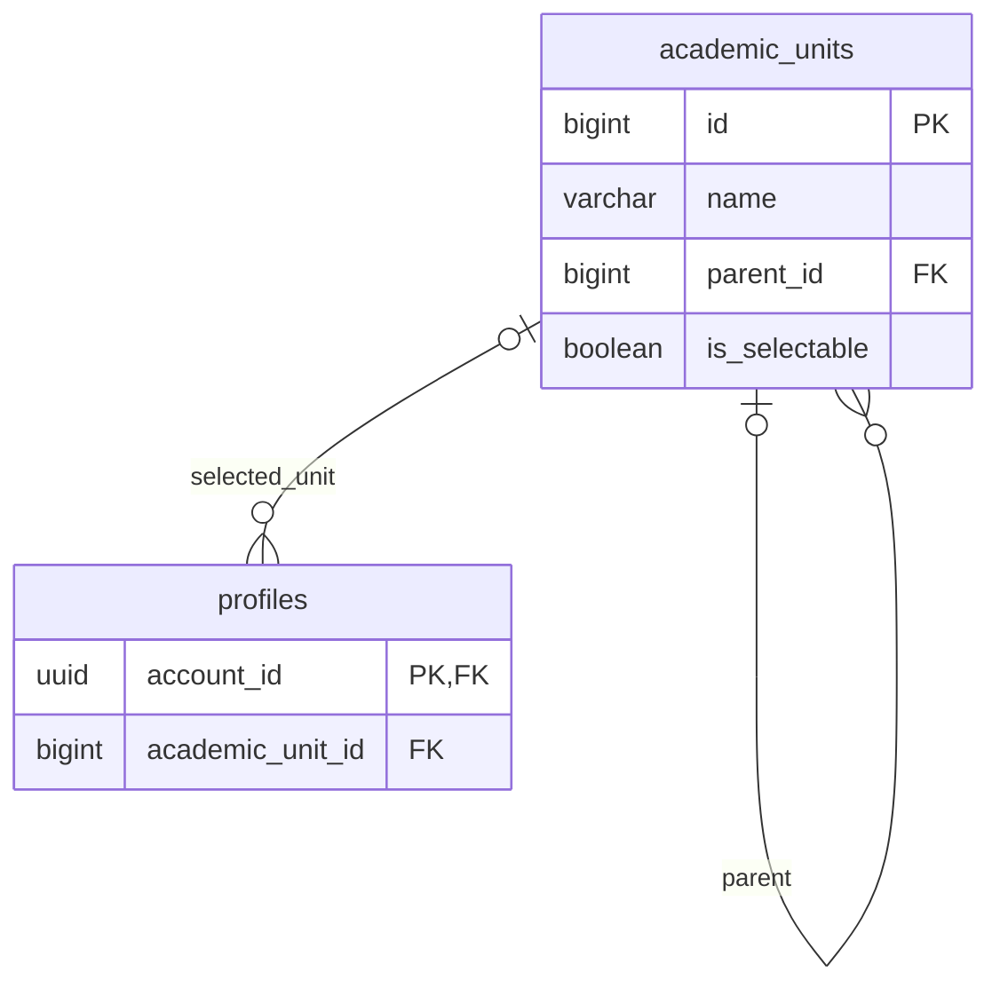

# 공통 선택지 코드·학사 테이블

이 문서는 프로필·공모전·팀이 공유하는 **선택지 enum과 선택값 저장 책임**, 학사 기준 데이터의 물리 구조를 정의합니다. 선택지의 실제 목록과 학사 원문은 아래 명세를 참조합니다.

| 내용 | 원본 |
| --- | --- |
| 선택지와 목록 변경 원칙 | [공통 선택지](../specs/profile-options.md#choices), [관리 정책](../specs/profile-options.md#catalog-management) |
| 주당 시간의 의미·네 구간 | [주당 참여 가능 시간](../specs/profile-options.md#weekly-availability) |
| 현재·과거 소속과 변경 처리 | [학사 선택 정책](../specs/academic-structure.md#selection-policy), [종속 선택](../specs/academic-structure.md#dependent-selection) |
| 타입·시각·제약 표기 | [DB 공통 규칙](conventions.md) |

## 선택지와 학사 저장의 경계

공통 선택지 7종은 서버 코드에서 관리하고, 사용자가 고른 코드만 업무 테이블에 저장합니다. 학사는 증가형 ID를 가진 `academic_units` 한 테이블의 부모 참조로 계층을 구성합니다. 소속 관계가 바뀌면 새 항목을 만들고 기존 항목을 보존합니다.

## 애플리케이션 공통 enum

다음은 서버 공통 정의의 이름이며 DB 테이블이 아닙니다. 코드 식별자는 enum, 표시명·순서·선택 가능 여부는 같은 공통 정의의 메타데이터로 관리합니다. `fields`·`roles`·`skills`·`academic_statuses`·`grades`·`weekly_availability_ranges`·`avatar_presets` 테이블이나 통합 공통코드·그룹 테이블은 만들지 않습니다.

| 공통 enum | 의미·사용처 | 코드 저장 위치 |
| --- | --- | --- |
| `FieldCode` | 프로필 관심 분야와 공모전 분야의 공통 분류 | `profile_interests.field_code`, `contest_fields.field_code` |
| `RoleCode` | 희망 역할·모집 역할·지원 역할의 공통 분류 | `profile_desired_roles.role_code`, `team_recruitment_roles.role_code`, `applications.applied_role_code` |
| `SkillCode` | 프로필에 등록하는 보유 역량 | `profile_skills.skill_code` |
| `AcademicStatusCode` | 학적 상태 | `profiles.academic_status_code` |
| `GradeCode` | 학년 | `profiles.grade_code` |
| `WeeklyAvailabilityCode` | 자기신고 주당 참여 가능 시간의 고정 네 구간 | `profiles.weekly_availability_code` |
| `ProfileImageCode` | 서비스가 제공하는 프로필 캐릭터 | `profiles.profile_image_code` |

### 공통 정의와 API

각 항목은 변경하지 않는 `code`와 `displayName`, `isSelectable`, `sortOrder`를 가집니다. `code`는 길이 1~64의 문자열이며 표시명으로 재생성하거나 다른 의미로 재사용하지 않습니다. 같은 문자열도 분류가 다르면 별개의 값이므로 필드에 맞는 enum으로 검사합니다. 프로필 이미지는 제공 자산의 경로도 같은 정의에 두고 [목록 API](../api/catalogs.md#catalogs)에서 `assetUrl`로 제공합니다.

`GET /catalogs`는 이 서버 정의에서 기존 일곱 목록을 구성합니다. 화면은 API의 표시명·선택 가능 여부·정렬을 사용하고 별도의 수기 목록을 만들지 않습니다. 실제 코드 문자열은 [OPTIONS-02·07](../specs/profile-options.md#open-questions)에서 확정하며 한국어 표시명을 운영 코드로 자동 전환하지 않습니다.

### 선택값 저장과 검증

- 단일 선택은 `profiles`의 코드 컬럼에, 복수 선택은 프로필·공모전·팀의 연결 테이블에 `varchar(64)`로 저장합니다. 선택 코드에는 FK를 두지 않으며 허용 목록을 PostgreSQL ENUM이나 CHECK로 중복 정의하지 않습니다.
- 소유자·공고·팀으로 향하는 FK와 복합 PK·검색 인덱스는 유지합니다. FK는 업무 대상의 존재를, 복합 PK는 같은 항목의 중복 선택을 보장합니다.
- 서버의 저장·적재 경로는 해당 enum에 존재하는 코드인지 검사하고, 새 선택에는 `isSelectable=true`인 값만 허용합니다. DB가 허용 코드 목록을 보장하지 않으므로 배치·데이터 이관도 같은 검증을 거칩니다. 검색 입력도 해당 enum으로 검증한 뒤 저장된 코드와 비교합니다.
- 목록·표시명·정렬·선택 가능 여부 변경은 코드 수정·검토·배포로 반영합니다. 기존 저장에 쓰인 enum 값과 표시 정보는 제거하지 않고 비활성 상태로 유지합니다. 목록 변경 날짜·사유는 Git·PR에 남기며, 공통 선택지의 DB 시드·런타임 관리 API·DB 변경 로그는 두지 않습니다.

선택값의 저장 개수와 권한은 각 업무 명세를 따릅니다. enum 관리 방식이 검색·추천의 의미나 기존 학사 경로 보존 정책을 바꾸지는 않습니다.

## 학사 변경 근거 관리

학사 초기 적재·수정·비활성화는 검토한 시드·마이그레이션으로 반영하고, 변경 사유·공식 출처·적용 대상은 관련 문서와 PR에 남깁니다. MVP에는 별도 DB 변경 이력 테이블을 두지 않습니다. 기존 소속 보존은 학사 행과 부모 연결을 유지하는 아래 저장 계약으로 보장합니다.

## 학사 단일 인접 리스트

도표 원본 보기

### `academic_units`

단과대학·학부·학과·전공을 한 테이블에 저장하고 부모 ID로 계층을 연결합니다. 한 행은 특정 소속 아래의 학사 항목 하나이며, 같은 이름이어도 소속이 달라지면 새 ID를 부여하여 기존 사용자의 과거 소속을 보존합니다.

| 컬럼 | PostgreSQL 타입 | NULL | DB 기본값 | 키·용도 |
| --- | --- | --- | --- | --- |
| `id` | `bigint` | 불가 | `GENERATED ALWAYS AS IDENTITY` | PK. DB가 목록 등록 시 발급하는 양의 증가형 ID |
| `name` | `varchar(100)` | 불가 | 없음 | 표시 이름. 서로 다른 항목의 이름 중복 허용 |
| `parent_id` | `bigint` | 허용 | `NULL` | FK → `academic_units.id`. 단과대학만 부모 없음 |
| `is_selectable` | `boolean` | 불가 | `true` | 신규 소속 선택 가능 여부. 과거 소속의 참조·표시와 구분 |

별도 경로 테이블·고유 코드·종류·학년도·생성/수정 시각 컬럼을 추가하지 않습니다. 루트부터 깊이 0은 단과대학, 1은 학부·학과, 2는 세부전공으로 해석합니다. 학사 적용 대상과 공식 근거는 [학사 명세](../specs/academic-structure.md)와 관련 PR에서 확인하며 자동 참가 자격 판정에 사용하지 않습니다.

| 제약·인덱스 이름 | 정의와 목적 |
| --- | --- |
| `pk_academic_units` | PK (`id`) |
| `fk_academic_units_parent` | `parent_id` → `academic_units.id`, `ON DELETE RESTRICT`, `ON UPDATE RESTRICT` |
| `ck_academic_units_id` | `id > 0` |
| `ck_academic_units_name` | `btrim(name) <> ''`. 입력 길이는 저장 전에 확인하며 자르지 않음 |
| `ck_academic_units_self_parent` | `parent_id IS NULL OR parent_id <> id` |
| `ix_academic_units_parent` | B-tree (`parent_id`, `id`). 부모별 하위 선택지 조회 |

이름이나 `(parent_id, name)`에는 UNIQUE를 두지 않습니다. 이름만 같은 다른 항목과 과거·현행 항목을 구분하고, 기준 데이터 중복 적재 여부는 공식 자료와 기존 ID 대응을 확인합니다. 증가형 ID는 정렬 순서·학번·학교 공식 코드가 아니며, 배포마다 목록을 지우고 재생성하지 않습니다.

## 학사 목록의 저장 계약

| 불변 조건 | 보장할 위치 |
| --- | --- |
| 단과대학 → 학부·학과 → 전공의 최대 3단계 | 기준 데이터 쓰기에서 공식 소속과 부모의 조상 깊이를 확인. 이름으로 종류를 추정하지 않으며 4단계 이상은 거부 |
| 기존 행의 `parent_id`는 변경하지 않음 | 소속 개편은 새 행 생성과 기존 행 비활성화로 기록. 이동한 학부 아래 전공도 새 부모를 참조하는 새 행으로 등록 |
| 자기 참조·순환 없음 | 자기 참조 CHECK와 서버의 부모 경로 검사. 새 행은 이미 존재하는 부모만 참조하고 기존 부모 연결은 고정 |
| 새 선택은 현행 항목만 사용 | 프로필 저장 시 선택한 항목과 모든 조상의 `is_selectable`을 같은 트랜잭션에서 검사·잠금. 비활성화 작업도 해당 행 잠금과 함께 처리 |
| 기존 과거 소속은 계속 참조 | 같은 ID를 유지하는 프로필 수정은 비활성이라는 이유로 거절하지 않음. 과거 소속을 삭제·자동 치환하지 않음 |

프로필에는 가장 깊게 선택한 `academic_units.id` 하나를 `academic_unit_id`에 저장합니다. 상위 대학·학부·전공 ID를 중복 저장하지 않으며 표시 정보는 부모 연결을 따라 구성합니다. 학부·학과까지만 선택하면 해당 ID, 세부전공을 선택하면 전공 ID를 저장하고, 학사 정보 전체가 미입력이면 NULL로 둡니다. 전공을 선택하지 않은 이유나 배정 상태는 별도로 저장·추론하지 않습니다.

학사 ID와 부모 ID는 DB에서 `bigint`, [API](../api/catalogs.md#academic-unit)에서는 `PositiveBigInt` 십진 문자열입니다. 사용자의 소속 저장은 기존 항목을 참조할 뿐 새 학사 행이나 ID를 만들지 않습니다. 계정·공고·팀 등 다른 업무 ID는 UUID를 유지합니다.

**초기 데이터 적재는 별도 확인이 필요합니다.** [ACADEMIC-01~04](../specs/academic-structure.md#open-questions)의 실제 목록·적용 대상·부모 관계와 기존 데이터 대응이 남아 있으며, 31행 이관 표를 현행 운영 목록으로 확정하지 않습니다.
