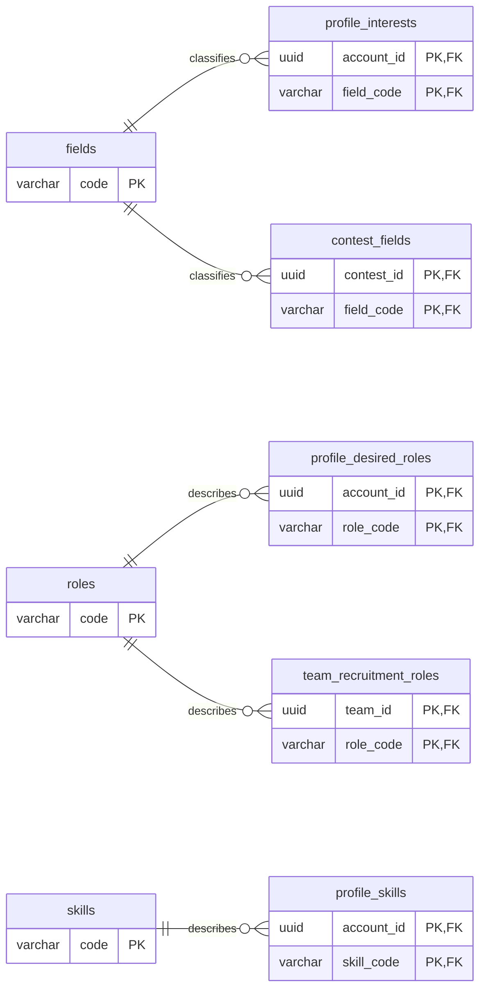
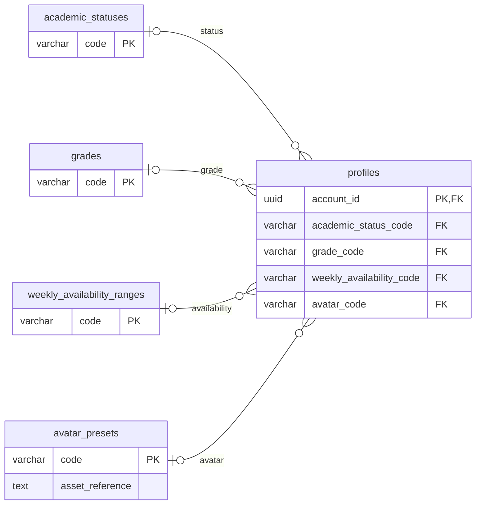
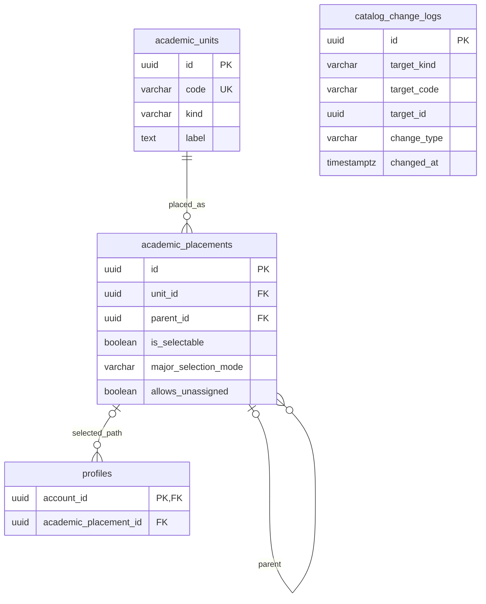

# 공통 분류·학사 테이블

이 문서는 프로필·공모전·팀이 함께 참조하는 **기준 데이터의 물리 저장 구조**를 정의합니다. 선택지 설명과 학사 원문 목록은 복사하지 않고 아래 명세를 참조합니다.

| 내용 | 원본 |
| --- | --- |
| 선택지와 목록 변경 원칙 | [공통 선택지](../specs/profile-options.md#choices), [관리 정책](../specs/profile-options.md#catalog-management) |
| 주당 시간의 의미·네 구간 | [주당 참여 가능 시간](../specs/profile-options.md#weekly-availability) |
| 현재·과거 소속과 변경 처리 | [학사 선택 정책](../specs/academic-structure.md#selection-policy), [종속 선택](../specs/academic-structure.md#dependent-selection) |
| 타입·시각·제약 표기 | [DB 공통 규칙](conventions.md) |

## 분류와 경로의 관계

분야·역할·역량은 각각 별도 테이블입니다. 학사는 **항목 자체**와 **부모 아래에 놓인 경로**를 분리하여 기존 사용자의 소속이 조직 개편만으로 바뀌지 않게 합니다.

도표 원본 보기

도표는 코드와 참조 키를 중심으로 나눴습니다. 아래 표가 전체 컬럼·기본값·제약의 원본입니다.

## 공통 코드 테이블 7개

다음 테이블은 **공통 컬럼 전체**를 각각 가집니다. 테이블 이름을 묶어 적은 것은 정의 중복을 줄이기 위함이며, 하나의 자유형 코드 테이블로 합치는 뜻이 아닙니다.

각 행은 서비스가 공통으로 제공하는 선택지 한 항목입니다. 선택지의 정의는 이 목록에, 사용자가 실제로 고른 값은 `profiles`의 단일 선택 컬럼이나 별도 연결 테이블에 저장합니다.

| 테이블 | 사용처 | 별도 컬럼 |
| --- | --- | --- |
| `fields` | 프로필 관심 분야와 공모전 분야를 같은 분류로 표시·검색하기 위한 목록. 개인·공고의 선택은 각각 `profile_interests`·`contest_fields`로 연결 | 없음 |
| `roles` | 프로필 희망 역할·팀 모집 역할·지원 역할을 같은 의미로 해석하기 위한 공통 목록 | 없음 |
| `skills` | 프로필에서 선택할 보유 역량의 기준 목록. 개인별 선택은 `profile_skills`로 연결 | 없음 |
| `academic_statuses` | 프로필의 학적 상태 선택·표시에 사용하는 목록. 개인별 값은 `profiles`에서 참조 | 없음 |
| `grades` | 프로필의 학년 선택·표시에 사용하는 목록. 개인별 값은 `profiles`에서 참조 | 없음 |
| `weekly_availability_ranges` | 프로필 입력·지원자 검토에서 주당 참여 가능 시간의 자기신고 총량을 같은 구간으로 해석하기 위한 목록 | 없음. 범위 의미는 [고정된 네 구간](../specs/profile-options.md#weekly-availability)으로 해석 |
| `avatar_presets` | 프로필에서 고를 수 있는 제공 캐릭터와 이미지 자산을 연결하는 목록 | 아래 `asset_reference` |

### 단일 선택 코드 관계

도표 원본 보기

### 공통 컬럼

| 컬럼 | PostgreSQL 타입 | NULL | DB 기본값 | 키·용도 |
| --- | --- | --- | --- | --- |
| `code` | `varchar(64)` | 불가 | 없음 | PK. 의미가 유지되는 동안 바꾸지 않는 저장·API 코드 |
| `display_name` | `text` | 불가 | 없음 | 화면 표시명 |
| `is_selectable` | `boolean` | 불가 | `true` | 현행 선택 목록에 포함되는지 여부 |
| `sort_order` | `integer` | 불가 | `0` | 목록 표시 순서. 같으면 `code` 오름차순 |
| `created_at` | `timestamptz` | 불가 | `now()` | 항목 생성 시각 |
| `updated_at` | `timestamptz` | 불가 | `now()` | 표기·선택 가능 상태의 마지막 변경 시각 |

`avatar_presets`에는 아래 컬럼 하나를 추가합니다.

| 컬럼 | PostgreSQL 타입 | NULL | DB 기본값 | 용도 |
| --- | --- | --- | --- | --- |
| `asset_reference` | `text` | 불가 | 없음 | 서비스가 제공하는 정적 이미지의 자산 식별 경로. 사용자 업로드 주소가 아님 |

### 키·제약과 조회

`<table>`은 위 7개 테이블 이름을 그대로 대입합니다. 실제 제약 이름과 구성은 이 규칙으로 정합니다.

| 이름 | 정의 |
| --- | --- |
| `pk_<table>` | PK (`code`). 같은 분류 내 코드 중복 금지 |
| `ck_<table>_code` | 빈 코드 금지. 코드 문자열의 운영 사전은 별도 검토 |
| `ck_<table>_display_name` | 빈 표시명 금지. 표시명에는 유일성 제약 없음 |
| `ck_avatar_presets_asset_reference` | `asset_reference`가 빈 문자열이 아님 |

- 7개 목록은 규모가 작은 기준 데이터이므로 표시 순서용 인덱스를 별도 추가하지 않습니다. PK B-tree로 코드 참조를 조회합니다.
- 코드 변경과 물리 삭제는 일반 운영 경로에서 제공하지 않습니다. 표시명 변경·비활성화가 기존 FK 연결을 바꾸지 않아야 합니다.
- `fields.code`와 `roles.code`에 같은 문자열이 있어도 서로 다른 분류입니다. 각 소비 테이블은 지정한 목록만 FK로 참조합니다.
- 실제 코드 문자열·초기 버전은 [OPTIONS-02·07](../specs/profile-options.md#open-questions), 캐릭터 자산 경로는 실제 제공 자산에 맞춰 초기 적재 시 검증합니다. 예시 화면의 한국어 표시 문자열을 운영 코드로 자동 전환하지 않습니다.

## `catalog_change_logs` — 기준 데이터 변경 기록

한 행은 선택지·학사 목록의 변경 한 건으로, 목록이 왜 달라졌는지 확인할 날짜·사유·근거를 공통 **감사 로그**에 남깁니다. 실제 선택값과 학사 관계는 업무 테이블의 FK로 관리하고, 로그는 대상 종류에 맞는 코드 또는 UUID를 기록하며 저장 서비스가 그 대상의 존재를 검증합니다.

| 컬럼 | PostgreSQL 타입 | NULL | DB 기본값 | 키·용도 |
| --- | --- | --- | --- | --- |
| `id` | `uuid` | 불가 | 없음 | PK. 애플리케이션 발급 |
| `target_kind` | `varchar(32)` | 불가 | 없음 | 아래 9종 중 변경 대상의 종류 |
| `target_code` | `varchar(64)` | 허용 | `NULL` | 코드 목록의 대상 코드. 업무 FK는 아님 |
| `target_id` | `uuid` | 허용 | `NULL` | 학사 항목·경로 ID. 업무 FK는 아님 |
| `change_type` | `varchar(16)` | 불가 | 없음 | `created` / `updated` / `deactivated` / `reactivated` |
| `changed_at` | `timestamptz` | 불가 | `now()` | 변경 시각 |
| `reason` | `text` | 불가 | 없음 | 변경 사유 |
| `source_reference` | `text` | 허용 | `NULL` | 공식 자료·변경 근거의 참조. 학사 변경에는 필수 |

| 대상 종류 `target_kind` | 채우는 식별자 | 검증할 업무 테이블 |
| --- | --- | --- |
| `fields` / `roles` / `skills` | `target_code` | 각각 같은 이름 테이블의 `code` |
| `academic_statuses` / `grades` | `target_code` | 각각 같은 이름 테이블의 `code` |
| `weekly_availability_ranges` / `avatar_presets` | `target_code` | 각각 같은 이름 테이블의 `code` |
| `academic_units` / `academic_placements` | `target_id` | 각각 같은 이름 테이블의 `id` |

| 제약·인덱스 이름 | 정의 |
| --- | --- |
| `pk_catalog_change_logs` | PK (`id`) |
| `ck_catalog_change_logs_target` | 위 9종만 허용. 코드형 7종은 코드만, 학사 2종은 UUID만 있어야 함. 두 값 동시 입력·동시 NULL 금지 |
| `ck_catalog_change_logs_type` | 네 변경 유형만 허용. 선택 가능 여부가 없는 `academic_units`는 `created` / `updated`만 허용 |
| `ck_catalog_change_logs_reason` | 사유는 빈 문자열이 아니며 코드형 대상 코드도 빈 문자열이 아님 |
| `ck_catalog_change_logs_source` | 학사 2종의 근거는 반드시 존재하고 빈 문자열이 아님. 나머지도 근거가 있으면 빈 문자열 금지 |
| `ix_catalog_change_logs_code_time` | B-tree (`target_kind`, `target_code`, `changed_at DESC`, `id DESC`), 조건 `target_code IS NOT NULL` |
| `ix_catalog_change_logs_id_time` | B-tree (`target_kind`, `target_id`, `changed_at DESC`, `id DESC`), 조건 `target_id IS NOT NULL` |

저장 유스케이스는 변경 대상이 해당 종류의 실제 행인지 확인한 뒤 **업무 행 갱신과 로그 추가를 같은 트랜잭션에서 처리**합니다. 정상 업무에서 로그를 덮어쓰거나 삭제하지 않습니다. 대상 코드·ID가 존재한다는 보장은 이 로그의 FK가 아닌 서비스 계약에 있으므로, 기준 데이터 적재·수정 경로도 같은 검증을 거쳐야 합니다.

전후 전체 객체나 사용자 데이터를 JSON으로 복제하지 않습니다. 이 구조는 변경 날짜·사유·근거의 감사용이며, 과거 기준 데이터의 완전한 복원 기능을 약속하지 않습니다.

## 학사 항목과 불변 소속 경로

도표 원본 보기

감사 로그는 업무 FK를 갖지 않으므로 관계선 없이 표시합니다.

### `academic_units`

대학·학부·학과·전공 자체의 이름과 식별자를 관리합니다. 어느 상위 조직에 속하는지는 `academic_placements`로 분리하여 학사 항목과 소속 경로를 구분합니다.

| 컬럼 | PostgreSQL 타입 | NULL | DB 기본값 | 키·용도 |
| --- | --- | --- | --- | --- |
| `id` | `uuid` | 불가 | 없음 | PK. 공식 항목의 내부 식별자 |
| `code` | `varchar(64)` | 불가 | 없음 | 유일한 항목 코드 |
| `kind` | `varchar(16)` | 불가 | 없음 | `college` / `department` / `major` |
| `label` | `text` | 불가 | 없음 | 공식 표시명 |
| `created_at` | `timestamptz` | 불가 | `now()` | 항목 생성 시각 |
| `updated_at` | `timestamptz` | 불가 | `now()` | 표시명 등의 마지막 변경 시각 |

- PK: `pk_academic_units(id)`; UNIQUE: `uq_academic_units_code(code)`.
- CHECK: `ck_academic_units_kind`는 위 세 종류, `ck_academic_units_code`·`ck_academic_units_label`은 각 값이 빈 문자열이 아님을 검사합니다.
- 항목 코드·종류는 식별 의미의 일부로 보존합니다. 비슷한 이름을 가진 서로 다른 항목을 `label`의 유일성으로 합치지 않습니다.

### `academic_placements`

학사 항목이 어느 상위 소속 아래에 놓이는지 나타내며, 프로필이 참조할 소속 경로를 제공합니다. 조직 개편은 새 경로로 기록하고 기존 경로를 보존하여 사용자가 저장한 과거 소속이 바뀌지 않게 합니다.

| 컬럼 | PostgreSQL 타입 | NULL | DB 기본값 | 키·용도 |
| --- | --- | --- | --- | --- |
| `id` | `uuid` | 불가 | 없음 | PK. 프로필이 참조하는 경로 ID |
| `unit_id` | `uuid` | 불가 | 없음 | FK → `academic_units.id` |
| `parent_id` | `uuid` | 허용 | `NULL` | FK → `academic_placements.id`. 대학 경로만 부모 없음 |
| `is_selectable` | `boolean` | 불가 | `true` | 해당 경로의 새 선택 가능 여부 |
| `major_selection_mode` | `varchar(16)` | 허용 | `NULL` | 학부·학과 경로에서 `none` / `selectable`; 나머지는 NULL |
| `allows_unassigned` | `boolean` | 불가 | `false` | 해당 경로에서 전공 미배정 선택 허용 |
| `effective_scope` | `text` | 허용 | `NULL` | 자료의 적용 학년도·대상 설명. 참가 자격 제한 필드가 아님 |
| `source_reference` | `text` | 불가 | 없음 | 공식 근거 문서·URL 식별값 |
| `created_at` | `timestamptz` | 불가 | `now()` | 경로 생성 시각 |
| `updated_at` | `timestamptz` | 불가 | `now()` | 선택 가능 상태·근거 등의 변경 시각 |

| 제약·인덱스 이름 | 정의와 목적 |
| --- | --- |
| `pk_academic_placements` | PK (`id`) |
| `fk_academic_placements_unit` | `unit_id` → `academic_units.id`, `ON DELETE RESTRICT` |
| `fk_academic_placements_parent` | `parent_id` → 같은 테이블의 `id`, `ON DELETE RESTRICT` |
| `uq_academic_placements_path` | (`unit_id`, `parent_id`)에 `NULLS NOT DISTINCT` 유일성. 같은 항목의 중복 루트 경로도 금지 |
| `ck_academic_placements_self_parent` | `parent_id`는 자신의 `id`와 다르거나 NULL |
| `ck_academic_placements_major_mode` | `major_selection_mode`는 NULL / `none` / `selectable`; `allows_unassigned=true`이면 반드시 `selectable` |
| `ck_academic_placements_source` | `source_reference`가 빈 문자열이 아님 |
| `ix_academic_placements_parent` | B-tree (`parent_id`, `id`). 하위 선택지·조상 관계 조회 |

`unit_id`로 시작하는 유일 인덱스가 항목별 경로 조회도 지원하므로 동일 선두 컬럼의 별도 인덱스는 만들지 않습니다. NULL을 같은 값으로 보는 유일성은 [PostgreSQL 17의 `NULLS NOT DISTINCT`](https://www.postgresql.org/docs/17/ddl-constraints.html#DDL-CONSTRAINTS-UNIQUE-CONSTRAINTS)를 사용합니다.

## 학사 목록의 저장 계약

| 불변 조건 | 보장할 위치 |
| --- | --- |
| 루트는 대학, 대학 아래는 학부·학과, 그 아래는 전공 | 기준 데이터 쓰기 유스케이스에서 항목 종류와 부모 종류를 함께 검사. 다른 행을 조회하는 일반 CHECK로 구현하지 않음 |
| 이미 만든 경로의 `unit_id`·`parent_id`는 변경하지 않음 | 기준 데이터 갱신 경로에서 불변 컬럼으로 처리. 조직 개편은 새 경로 생성과 기존 경로 비활성화로 기록 |
| 자기 참조·순환 없음 | 자기 참조 CHECK와 부모 계층 검증. 부모는 이미 존재하는 상위 단계만 허용하고 경로 이동을 금지하여 순환 방지 |
| 전공 미배정은 허용된 학부에서만 가능 | 학사 경로 저장 시 종류·모드·허용 플래그를 함께 검사. 프로필 저장 시 선택 경로와 `major_unassigned` 조합 검사 |
| 새 선택은 현행 경로만 사용 | 프로필 저장 시 새 경로와 조상 경로의 `is_selectable`을 재확인. 목록 변경과 경합하면 같은 경로 행 잠금 아래 검증 |
| 기존 과거 소속은 계속 참조 | 같은 경로를 유지한 프로필 저장은 비활성이라는 이유로 거절하지 않음. 물리 삭제·이동으로 기존 참조를 바꾸지 않음 |
| 값 변경과 근거 보존 | 항목·경로 수정과 `catalog_change_logs` 추가를 하나의 트랜잭션으로 처리 |

프로필에는 가장 깊게 선택한 `academic_placements.id` 하나를 저장합니다. 상위 대학·학부·전공을 중복 컬럼으로 저장하지 않으며, API가 필요로 하는 상위 표시값은 경로를 따라 읽어 구성합니다.

**초기 데이터 적재는 별도 확인이 필요합니다.** [ACADEMIC-01~04](../specs/academic-structure.md#open-questions)가 남아 있으므로 31행 이관 표를 현행 운영 목록으로 확정하지 않습니다. `effective_scope`도 학번별 자격 판정 로직으로 해석하지 않습니다.
