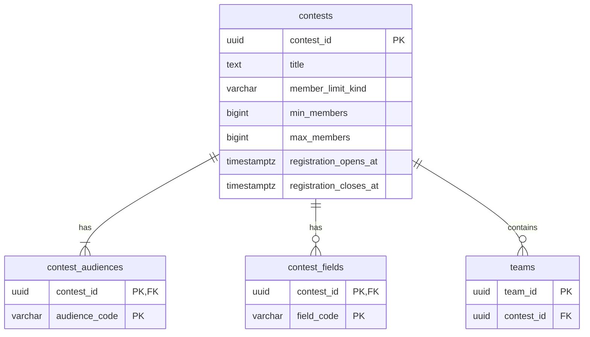

# 공모전 테이블

이 문서는 공모전 원문 정보와 분류의 PostgreSQL 저장 계약을 정의합니다. **ORM 모델·마이그레이션·순수 규칙과 공개 목록·상세 조회를 구현했습니다.** 공고 신규 입력 CLI는 [공고 API 안내](../api/contests.md#contest-import-cli)를 따릅니다. 관리자 수정 경로는 미구현이며, 실제 전송 계약은 [공고 API](../api/contests.md)에서 코드로 연결합니다. 등록·공개·참가 조건은 [공모전 기능 명세](../specs/contests.md)가 원본이며, 이 문서에서는 각 테이블의 업무상 의미와 컬럼·무결성을 설명합니다. 타입·기본값·삭제 원칙은 [공통 규칙](conventions.md)을 따릅니다.

구현 원본은 [공고 모델](../../backend/app/models/contests.py), [접수·인원·분류 규칙](../../backend/app/rules/contests.py), [마이그레이션](../../backend/alembic/versions/20261024_02_contests.py)입니다. [규칙 테스트](../../backend/tests/unit/test_contest_rules.py)와 [PostgreSQL 제약·마이그레이션 테스트](../../backend/tests/integration/test_contest_models.py)가 저장 제약과 시간 경계를 검증합니다. URL·원문/적용 시각의 일치와 분류 집합을 한 트랜잭션에서 검증하는 [신규 등록 서비스](../../backend/app/services/contest_import.py)를 구현했으며, 모델 생성만으로 등록 전 확인을 완료한 것으로 취급하지 않습니다.

[출처 확장 revision 9](../../backend/alembic/versions/20261026_09_contest_sources.py)는 기존 공식 링크를 보존하며 수집 출처·비공개 메타데이터와 미확인 상태를 추가합니다. 공식 링크나 확인 시각이 없는 행이 남아 있으면 이전의 필수 값 계약으로 downgrade하지 않고 오류를 반환합니다. 개발 DB를 이전 상태로 맞추기 위해 미확인 값을 만들어 넣거나 원본 자료를 삭제하지 않습니다.

## 먼저 볼 구조

공모전 한 건에 참가 대상과 분야를 연결합니다. 팀은 `contests.contest_id`를 참조하며 분야를 복제하지 않습니다. 주최 기관은 현재 독립 관리 기능이 없어 이름 문자열로 둡니다.

도표 원본 보기

## `contests` — 공고 원본과 적용 기간

공모전 공고 한 건의 원문 정보·접수 일정·참가 인원 조건을 보관해 목록·상세 표시와 팀 지원·생성 조건 판단의 기준으로 사용합니다. 여러 팀이 같은 공고를 참조하며, 참가 대상·분야는 아래 연결 테이블에서 관리합니다.

`NULL=허용`은 값이 없음을 허용합니다. `DB 기본값=—`는 DB가 값을 만들지 않으며 저장 유스케이스가 값을 명시한다는 뜻입니다.

### 기본 정보

| 컬럼 | PostgreSQL 타입 | NULL | DB 기본값 | 키·설명 |
| --- | --- | --- | --- | --- |
| `contest_id` | `uuid` | 불가 | — | PK `pk_contests`; 서버가 생성한 공고 ID |
| `title` | `text` | 불가 | — | 공모전명; 공백만 있는 값 금지 |
| `organizer_name` | `text` | 불가 | — | 주최 기관 표시명 |
| `official_url` | `text` | 허용 | `NULL` | 수집한 주최 측 HTTP(S) URL; 유일키 아님 |
| `source_url` | `text` | 허용 | `NULL` | 실제 공고 수집 출처. 공식 링크와 구분하며 둘 중 하나는 필수 |
| `source_metadata` | `jsonb` | 불가 | `{}` | 원본 외부 ID·수집 시각·정밀도·원문·가공 근거. 공개 API에는 노출하지 않음 |
| `eligibility_text` | `text` | 불가 | — | 원문 참가 조건 |
| `description` | `text` | 허용 | `NULL` | 확인된 설명; 별도 AI 요약 필드 아님 |
| `submission_details` | `text` | 허용 | `NULL` | 제출물·제출 안내 |
| `awards` | `text` | 허용 | `NULL` | 확인된 시상 정보 |
| `contact_info` | `text` | 허용 | `NULL` | 원문 문의 정보 |
| `poster_url` | `text` | 허용 | `NULL` | 선택 포스터 HTTP(S) URL; 없으면 UI 기본 이미지 |
| `member_limit_kind` | `varchar(16)` | 불가 | — | `range` / `unlimited` / `unknown` |
| `min_members` | `bigint` | 허용 | `NULL` | 확인된 최소 양의 정수 |
| `max_members` | `bigint` | 허용 | `NULL` | 확인된 최대 양의 정수 |
| `verified_at` | `timestamptz` | 허용 | `NULL` | 공식 원문 확인 시각. 미확인은 NULL이며 수집 시각으로 대체하지 않음 |
| `created_at` | `timestamptz` | 불가 | `now()` | 생성 시각 |
| `updated_at` | `timestamptz` | 불가 | `now()` | 저장 시 갱신 |
| `version` | `bigint` | 불가 | `1` | 저장 성공마다 증가하는 변경 버전 |

공고의 확인·생성·수정 시각은 기록하며, 관리자 계정 참조와 등록·수정자 이력 저장은 MVP 범위에 포함하지 않습니다.

참가 인원은 양의 `bigint`로 저장하고 API에서는 십진 문자열로 전송합니다. 서비스가 별도 최대 정원을 정하는 정책은 없으며, `bigint`의 최대 표현값 9,223,372,036,854,775,807은 DB의 기술 범위입니다. 범위를 넘는 입력을 자르거나 반올림하지 않습니다. `unlimited`는 최대 인원 NULL로 표현하며 큰 숫자로 바꾸지 않습니다.

### 기간과 원문 정보

| 컬럼 | PostgreSQL 타입 | NULL | DB 기본값 | 설명 |
| --- | --- | --- | --- | --- |
| `registration_opens_at` | `timestamptz` | 불가 | — | 접수 시작 경계, 해당 시각 포함 |
| `registration_closes_at` | `timestamptz` | 불가 | — | 접수 종료 경계, 해당 시각 제외 |
| `open_source_date` | `date` | 불가 | — | 원문 접수 시작 날짜 |
| `open_source_time` | `time without time zone` | 허용 | `NULL` | 원문 시작 시각; 누락과 00:00 구분 |
| `open_source_timezone` | `text` | 허용 | `NULL` | 원문에서 확인된 시간대의 정규화 식별자 |
| `open_effective_timezone` | `text` | 불가 | — | 시작 시각 해석에 실제 사용한 시간대 |
| `open_timezone_assumed` | `boolean` | 불가 | — | 원문 시간대 누락 보완 여부 |
| `close_source_date` | `date` | 불가 | — | 원문 마감 날짜 |
| `close_source_time` | `time without time zone` | 허용 | `NULL` | 원문 마감 시각 |
| `close_source_timezone` | `text` | 허용 | `NULL` | 원문 마감 시간대 |
| `close_effective_timezone` | `text` | 불가 | — | 실제 적용 시간대 |
| `close_time_assumed` | `boolean` | 불가 | — | 원문 마감 시각을 날짜 끝으로 보완했는지 |
| `close_timezone_assumed` | `boolean` | 불가 | — | 원문 마감 시간대를 보완했는지 |

마감의 원문·적용 시각은 [마감 정책](../specs/contests.md#deadline-policy)에 따라 **한 번의 저장에서 함께 검증**합니다. 예를 들어 날짜만 있는 마감은 해석 시간대의 다음 날 00:00을 종료 경계로 저장합니다. `timestamptz` 자체가 원문의 시간대 이름을 보존하지 않으므로 원문 필드를 분리합니다.

`interpret_deadline`은 마감 원문의 IANA 시간대 또는 `±HH:MM` 고정 오프셋을 받아 UTC 종료 경계와 보완 여부를 반환합니다. 서머타임 때문에 현지 시각이 중복되거나 존재하지 않으면 임의 해석하지 않고 오류를 반환하므로 운영 입력에서 정확한 오프셋을 추가 확인해야 합니다. 이 함수로 시작 시각을 보완하지 않습니다.

날짜만 있는 개발용 수집 자료는 `interpret_opening`으로 해당 날짜 00:00을 적용 경계로 계산합니다. `open_source_time=NULL`은 그대로 보존하고 API의 `openTimeDefaulted=true`로 보완 사실을 표시합니다. 시작 날짜나 마감 날짜 자체가 없으면 경계를 만들지 않습니다. 운영용 확인 완료 입력 CLI는 시작 시각과 필수 자료 확인을 계속 요구합니다.

### 행 제약

| 제약 이름 | 보장하는 내용 |
| --- | --- |
| `ck_contests_required_text` | 제목·주최 기관·참가 조건이 공백만으로 이루어지지 않음 |
| `ck_contests_source_urls` | 공식 링크·수집 출처 중 하나 이상 존재하며 제공된 값은 공백만으로 이루어지지 않음 |
| `ck_contests_source_metadata` | 수집 메타데이터는 JSON 객체 |
| `ck_contests_member_limit` | `range`: 양의 정수 최소·최대와 최소 ≤ 최대. `unlimited`: 최대 NULL, 최소는 NULL 또는 양의 정수. `unknown`: 최소·최대 모두 NULL. 나머지 코드 금지 |
| `ck_contests_period` | 시작 경계 < 종료 경계 |
| `ck_contests_deadline_assumptions` | `close_time_assumed`와 원문 시각 NULL 여부가 일치. 각 `*_timezone_assumed`와 해당 원문 시간대 NULL 여부가 일치 |
| `ck_contests_version` | `version > 0` |

HTTP(S) URL 유효성, IANA 시간대·고정 UTC 오프셋의 해석, 원문과 적용 경계 일치는 저장 유스케이스에서 검증합니다. 현재 시각에 따라 달라지는 접수 상태를 CHECK 또는 저장 컬럼으로 만들지 않습니다. 기존 팀·지원에 영향을 주는 조건 수정은 [미정 영향 정책](../specs/contests.md#eligibility-changes)이 결정되기 전까지 임의 자동 처리를 설계하지 않습니다.

## 분류 연결 테이블

### `contest_audiences`

공고 하나에 대학생·일반인처럼 여러 참가 대상 분류를 연결하기 위해 둡니다. 공고의 참가 대상 안내에 사용하며, 이 코드만으로 사용자 자격을 자동 판정하지 않습니다.

| 컬럼 | PostgreSQL 타입 | NULL | DB 기본값 | 키·설명 |
| --- | --- | --- | --- | --- |
| `contest_id` | `uuid` | 불가 | — | PK 구성, FK → `contests.contest_id` |
| `audience_code` | `varchar(16)` | 불가 | — | PK 구성, 아래 고정 코드 |

| 코드 | 표시 이름 |
| --- | --- |
| `student` | 대학생 |
| `general` | 일반인 |
| `unrestricted` | 제한 없음 |
| `unknown` | 미확인 |

- `pk_contest_audiences (contest_id, audience_code)`: 같은 값을 중복 연결하지 않습니다.
- `ck_contest_audiences_code`: 표에 있는 네 코드만 허용합니다.
- 최종 대상 집합이 비어 있지 않고 허용된 조합인지 저장 서비스에서 확인합니다. `student`·`general`은 함께 가능하고 나머지 두 코드는 각각 단독입니다. 공고와 연결 집합을 같은 트랜잭션에서 저장합니다.

### `contest_fields`

공고 하나에 공통 `FieldCode` enum의 분야를 여러 개 저장해 목록 표시·분야 필터에 사용합니다. 해당 공고의 팀도 이 연결을 통해 분야를 읽으며, 표시명은 서버의 공통 정의에서 해석합니다.

| 컬럼 | PostgreSQL 타입 | NULL | DB 기본값 | 키·설명 |
| --- | --- | --- | --- | --- |
| `contest_id` | `uuid` | 불가 | — | PK 구성, FK → `contests.contest_id` |
| `field_code` | `varchar(64)` | 불가 | — | PK 구성. `FieldCode` 검증, 코드 FK 없음 |

- `pk_contest_fields (contest_id, field_code)`: 중복 분야 연결 금지.
- 저장 서비스가 [공통 enum](catalogs.md#code-enums)의 코드·새 선택 가능 여부와 최종 분야 집합의 개수 0~3개를 검증합니다. 대표 분야·정렬 우선순위 컬럼은 없습니다.

기존 연결을 교체하는 중간 상태는 사용자에게 노출하지 않습니다. 저장 서비스는 공고 행 잠금 아래 최종 대상·분야 집합을 검사하고 연결 교체와 공고 버전 갱신을 함께 커밋합니다. 여러 행의 개수·조합을 검사하는 DB 트리거는 추가하지 않습니다.

## FK와 삭제 동작

| FK 이름 | 참조 | 삭제 동작 |
| --- | --- | --- |
| `fk_contest_audiences_contest` | `contest_audiences.contest_id` → `contests.contest_id` | `RESTRICT` |
| `fk_contest_fields_contest` | `contest_fields.contest_id` → `contests.contest_id` | `RESTRICT` |

식별자의 갱신 동작도 `RESTRICT`입니다. 공고 삭제·보존 기간이 미정이므로 연쇄 삭제나 soft-delete 공개 숨김을 추가하지 않습니다.

## 조회용 인덱스와 파생 값

| 인덱스 이름 | 방식·열 | 용도 |
| --- | --- | --- |
| `ix_contests_created` | B-tree `(created_at DESC, contest_id DESC)` | 등록순과 동률 순서 |
| `ix_contests_closes` | B-tree `(registration_closes_at ASC, contest_id ASC)` | 마감 임박순 |
| `ix_contest_fields_field` | B-tree `(field_code, contest_id)` | 분야 필터 |

초기 이름·주최자 검색은 `ILIKE` 조건으로 설계합니다. 분야 검색은 검증한 코드를 `contest_fields.field_code`와 비교하며 결과는 공고 단위로 중복 제거합니다. 한글 부분 검색 성능 개선용 확장·전문 검색은 실제 데이터와 실행 계획을 확인한 뒤 결정하며 이 설계에서 `pg_trgm`을 필수 설치하지 않습니다.

| 응답 값 | 계산 원본 |
| --- | --- |
| 접수 상태 | 시작·종료 경계와 요청 시각 |
| D-day·기간 보완 안내 | 원문 마감·적용 시간대·보완 플래그 |
| 전체 연결 팀 수 | `teams.contest_id`; 모집 중 필터와 독립 |
| 분야·참가 대상 목록 | 두 연결 테이블과 공통 분야 사전 |

페이지 결과와 전체 건수는 같은 필터를 적용합니다. 조회 조건·페이지·스크롤 위치는 업무 테이블로 저장하지 않으며 [API 계약](../api/README.md)에서 정의합니다.
