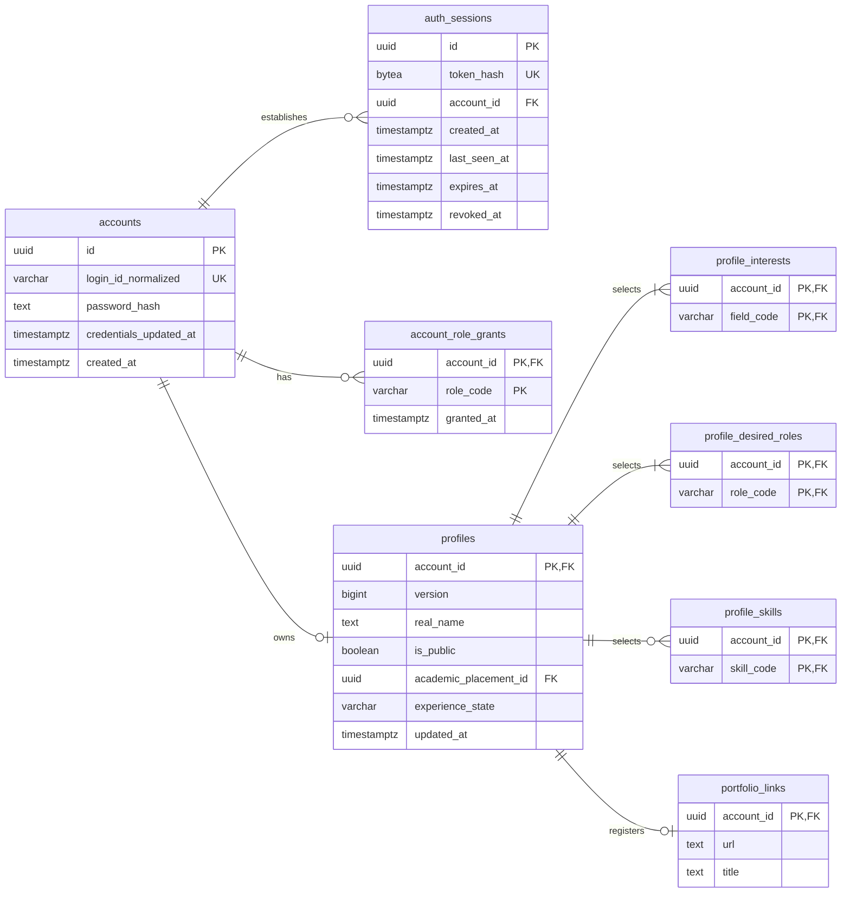

# 계정·프로필 테이블

이 문서는 PostgreSQL 17 기준 **물리 설계 초안**입니다. 계정 식별·서버 세션·현재 프로필의 저장 구조를 정의합니다. 세션 정리·보존 기간·탈퇴처럼 미정인 제품 결정을 테이블 설계로 확정하지 않습니다.

| 먼저 확인할 내용 | 원본 |
| --- | --- |
| 가입·로그인과 입력 규칙 | [인증 명세](../specs/authentication.md#login-identifier) |
| 서버 세션·쿠키·만료·로그아웃 | [세션 정책](../specs/authentication.md#session-policy) |
| 프로필 항목·공개·지원 팀장 열람 | [프로필 항목](../specs/profile.md#fields), [공개 범위](../specs/profile.md#visibility) |
| 선택 코드·학사 경로 | [공통 분류 테이블](catalogs.md) |
| ID·시각·NULL·기본값 표기 | [DB 공통 규칙](conventions.md) |

## 구조를 먼저 보기

서비스 활동은 로그인 아이디와 구분되는 불변 계정 ID를 참조합니다. 현재 MVP의 자체 로그인 아이디·비밀번호 해시는 `accounts`의 같은 행에 저장합니다. 로그인 세션은 계정에 연결하고, 원문 토큰 대신 검증용 해시와 만료·회수 정보를 저장합니다. 프로필은 계정당 현재 값 하나이며, 지원할 때 복제하지 않습니다. 복수 선택은 연결 테이블에, 포트폴리오는 선택적인 1:1 관계에 저장합니다.

도표 원본 보기

그림은 이 문서가 정의하는 테이블을 표시합니다. 외부 코드·학사 FK의 대상은 [분류 ERD](catalogs.md)에서 확인합니다. 단일 선택 FK와 전체 컬럼·제약은 아래 정의를 기준으로 합니다. 연결 행의 1~3개·1~2개 제한은 ERD의 `1개 이상` 표기보다 엄격하므로 저장 트랜잭션에서 검증합니다.

## 계정과 로그인

### `accounts`

현재 계정당 자체 로그인 정보 하나만 있으므로 서비스 활동의 주체와 로그인 정보를 한 행에 저장합니다. 지원·팀 소속·알림은 로그인 아이디 대신 불변 `id`를 참조하여 같은 계정의 활동으로 유지됩니다.

| 컬럼 | PostgreSQL 타입 | NULL | DB 기본값 | 키·용도 |
| --- | --- | --- | --- | --- |
| `id` | `uuid` | 불가 | 없음 | PK. 애플리케이션이 발급하는 불변 계정 ID |
| `login_id_normalized` | `varchar(320)` | 불가 | 없음 | 정규화 완료 로그인 아이디. 유일. 향후 이메일 사용에 대비한 저장 폭 |
| `password_hash` | `text` | 불가 | 없음 | 검증용 해시. 알고리즘·파라미터를 표현할 수 있는 인코딩 문자열 |
| `credentials_updated_at` | `timestamptz` | 불가 | `now()` | 자체 인증 정보 변경 시각. 변경 시 애플리케이션이 갱신 |
| `created_at` | `timestamptz` | 불가 | `now()` | 계정 생성 시각 |

| 제약·인덱스 이름 | 정의와 목적 |
| --- | --- |
| `pk_accounts` | PK (`id`) |
| `uq_accounts_login_id` | `login_id_normalized` 유일. B-tree 유일 인덱스로 로그인 조회도 수행 |
| `ck_accounts_login_id` | ASCII 소문자·숫자만으로 구성된 4~24자. 대문자·공백을 정규화하는 작업은 저장 전에 수행 |
| `ck_accounts_password_hash` | 해시 문자열은 빈 문자열이 아님. 원문 비밀번호 길이와 해시 길이를 혼동하지 않음 |

`varchar(320)`은 향후 이메일 로그인 도입에 대비한 저장 공간이며, 현재 입력·CHECK는 [영문 소문자·숫자 4~24자](../specs/authentication.md#login-identifier)를 유지합니다. 이메일 도입 시 형식·길이·정규화·유일성·소유권 확인과 기존 아이디 전환을 함께 정하고 CHECK·API 검증을 변경합니다.

- 탈퇴 효력·보존·복구를 정하는 [PROFILE-04](../specs/profile.md#open-questions)가 남아 있어 탈퇴 상태 컬럼·API는 별도 설계로 보류합니다. 현재 테이블에서 자동 소속 해제·물리 삭제·복구를 수행하지 않습니다.
- 이메일·연락처·학교 인증 결과는 현재 수집 범위가 아니므로 저장 컬럼을 추가하지 않습니다. 교내 미인증 표시는 [인증 명세](../specs/authentication.md#verification-meaning)의 현재 고정 응답으로 처리합니다.

현재 MVP는 모든 계정이 자체 아이디·비밀번호로 가입하므로 두 인증 컬럼은 `NOT NULL`입니다. 향후 소셜 전용 가입을 도입하면 두 컬럼을 함께 비울 수 있도록 NULL 허용과 조합 제약을 검토하고, 소셜 연결 정보는 같은 `accounts.id`에 연결합니다. 소셜 전용 가입이나 이메일 로그인으로의 변경을 이번 통합에 포함하지 않습니다.

가입은 [가입 후 자동 로그인 정책](../specs/authentication.md#session-policy)에 따라 자체 로그인 정보를 포함한 `accounts`와 새 `auth_sessions`를 한 트랜잭션에서 생성하고, commit 성공 뒤 세션 쿠키를 발급합니다. 세션 저장을 포함한 어느 저장 단계라도 실패하면 전체를 rollback하여 계정·세션의 부분 가입 성공을 남기지 않습니다.

commit 뒤 응답 전달이 유실된 경우는 DB 저장 실패와 구분합니다. 이미 생성된 계정·세션을 rollback했다고 안내하지 않으며, 사용자는 가입한 아이디·비밀번호로 일반 로그인하여 새 세션을 받을 수 있습니다. 비밀번호 해시 알고리즘·비용과 시도 제한 등은 [인증 최소 기준과 미정 사항](../specs/authentication.md#open-questions)을 따릅니다. 소셜 연결은 후속 구현이며, [계정 복구](../specs/authentication.md#account-recovery)는 MVP 범위에서 제외하고 후속으로 검토합니다.

로그인 아이디 유일성은 저장된 모든 계정에 적용합니다. 향후 탈퇴 기능에서 아이디 재사용을 허용하려면 [탈퇴 정책](../specs/profile.md#account-withdrawal)과 유일성 변경을 함께 검토해야 합니다.

### `auth_sessions` — 서버 로그인 세션

로그인 후 요청마다 비밀번호를 다시 입력하지 않고 같은 계정으로 활동하도록 유지하는 기록입니다. 로그인마다 별도로 두어 한 곳에서 로그아웃해도 다른 로그인 상태를 독립적으로 관리합니다.

[세션 정책](../specs/authentication.md#session-policy)에 따라 PostgreSQL이 로그인 세션의 유효 상태를 관리합니다. 쿠키에는 불투명한 원문 토큰만 전달하고, 이 테이블에는 SHA-256 해시를 저장합니다. 계정·프로필·팀 권한을 쿠키나 세션 행에 복제하지 않습니다.

| 컬럼 | PostgreSQL 타입 | NULL | DB 기본값 | 키·용도 |
| --- | --- | --- | --- | --- |
| `id` | `uuid` | 불가 | 없음 | PK. 서버 내부 세션 식별자이며 인증 토큰으로 사용하지 않음 |
| `token_hash` | `bytea` | 불가 | 없음 | 원문 세션 토큰의 SHA-256 해시, 32바이트 |
| `account_id` | `uuid` | 불가 | 없음 | FK → `accounts.id` |
| `created_at` | `timestamptz` | 불가 | 없음 | 세션을 발급한 서버 시각 |
| `last_seen_at` | `timestamptz` | 불가 | 없음 | 해당 세션의 유효성 확인을 통과한 최근 활동 시각. 생성 시 `created_at`과 같으며 유휴 24시간의 기준 |
| `expires_at` | `timestamptz` | 불가 | 없음 | [세션 정책](../specs/authentication.md#session-policy)의 절대 만료 경계: `created_at`부터 UTC 기준 168시간(7일) 뒤. 해당 시각부터 무효이며 요청 사용으로 연장하지 않음 |
| `revoked_at` | `timestamptz` | 허용 | `NULL` | 명시적으로 회수한 서버 시각. NULL만으로 유효함을 뜻하지 않음 |

| 제약·인덱스 이름 | 정의와 목적 |
| --- | --- |
| `pk_auth_sessions` | PK (`id`) |
| `fk_auth_sessions_account` | `account_id` → `accounts.id`, `ON DELETE RESTRICT`, `ON UPDATE RESTRICT` |
| `uq_auth_sessions_token_hash` | UNIQUE (`token_hash`). 요청 토큰의 해시로 세션 조회 |
| `ck_auth_sessions_token_hash` | `octet_length(token_hash) = 32` |
| `ck_auth_sessions_times` | `last_seen_at >= created_at`, `expires_at > created_at`, `revoked_at IS NULL OR revoked_at >= created_at` |
| `ix_auth_sessions_account` | B-tree (`account_id`). 계정 참조와 해당 계정의 세션 조회 |
| `ix_auth_sessions_expires` | B-tree (`expires_at`). 절대 만료된 정리 후보 조회; 삭제 시점·보존 기간을 정하는 제약은 아님 |

`accounts`와의 1:N 구조로 [세션 정책](../specs/authentication.md#session-policy)의 동시 로그인을 지원합니다. 새 로그인은 새 세션 행을 생성하며 기존 세션을 회수하지 않습니다. 활동 기록·만료·로그아웃은 세션별로 독립적이고, 다른 세션의 활동이 이 세션의 유휴 만료를 연장하지 않습니다. 동시 기기 상한이나 자동 축출 규칙은 추가하지 않습니다.

CSRF 보호는 필수이며, 토큰 전달·검증 방식과 추가 저장 항목은 [API 공통 계약](../api/conventions.md#access)과 후속 개발 계획에서 함께 정합니다. 이번 표에 임의의 CSRF 전송 규칙이나 컬럼을 추가하지 않습니다.

| 저장·조회 책임 | 처리 경계 |
| --- | --- |
| 가입 후 자동 로그인 | 자체 로그인 정보를 포함한 새 계정 행과 세션 행을 같은 트랜잭션에서 생성합니다. 세션 토큰은 아래 로그인과 같은 생성·해시 저장 기준을 사용하고, 전체 commit 성공 뒤 쿠키를 발급해 프로필 설정으로 연결합니다. |
| 로그인 성공 | 비밀번호 검증 후 CSPRNG로 최소 128비트의 엔트로피를 가진 새 불투명 토큰을 생성하고, 해시·계정·발급 및 만료 시각을 저장합니다. DB commit 성공 뒤에만 세션 쿠키를 발급합니다. 원문 토큰은 DB·로그에 남기지 않습니다. |
| 인증 확인 | 받은 원문 토큰을 같은 방식으로 SHA-256 해시하여 조회합니다. 현재 서버 시각이 `expires_at` 이상이거나 이전 `last_seen_at`부터 24시간 이상 지났거나 `revoked_at`이 있으면 인증에 사용하지 않습니다. 기간과 만료 경계의 정책 원본은 [세션 정책](../specs/authentication.md#session-policy)입니다. |
| 최근 사용 기록 | 이전 값의 유효성 검사를 통과한 해당 세션만 `last_seen_at`을 갱신합니다. 다른 세션의 사용 기록은 바꾸지 않습니다. 동시 로그아웃으로 회수된 행을 갱신해 되살리거나, 만료된 행을 새 세션으로 재생성하지 않습니다. `expires_at`과 `revoked_at`은 이 갱신으로 바꾸지 않습니다. |
| 브라우저 재시작 | 지속 쿠키로 전달된 기존 토큰을 같은 세션으로 조회합니다. 재시작 자체로 `created_at`·`last_seen_at`·`expires_at`을 초기화하지 않으며, 재시작 후 요청도 이전 활동 시각으로 만료를 검사한 뒤에만 최근 사용 기록을 갱신합니다. |
| 현재 세션 로그아웃 | 현재 행의 `revoked_at`을 저장해 즉시 회수하고 commit한 뒤 쿠키를 삭제합니다. 회수 이후 이전 토큰으로 새 인증을 허용하지 않으며, 같은 계정의 다른 세션은 변경하지 않습니다. 쿠키 삭제만으로 서버 회수를 대신하지 않습니다. |
| 업무 권한 | 세션으로 식별한 `account_id`를 기준으로 현재 프로필 공개 범위·지원 관계·팀 소속·관리 권한을 다시 확인합니다. 세션 생성 당시 권한의 사본으로 접근을 허용하지 않습니다. |
| 정리 | 만료·회수된 행의 정리 주기·보존 기간은 미정입니다. 정리 작업 전에도 요청마다 유효성을 검사하므로 만료 행이 남았다는 이유로 인증을 허용하지 않습니다. |

유휴 24시간·절대 7일과 브라우저 재시작 후 로그인 유지는 [세션 정책](../specs/authentication.md#session-policy)을 적용하며, 현재 시각에 의존하는 만료 판단을 DB CHECK나 정리 작업에 맡기지 않습니다. 별도 로그인 유지 체크박스·`remember_me` 저장 구조는 두지 않습니다. 쿠키 수명·전달 계약은 [공통 API 계약](../api/conventions.md#access), 세션 정리 및 보존 기간은 [AUTH-06 남은 운영 정책](../specs/authentication.md#open-questions)에서 관리합니다. SQLAlchemy의 DB 작업 단위인 `Session`·`AsyncSession`과 이 로그인 세션은 다른 개념입니다.

### `account_role_grants`

계정에 부여된 서비스 운영 권한을 기록하여 공고 관리 같은 관리자 업무의 권한을 확인합니다. 사용자가 팀에서 맡고 싶은 역할과는 별개의 정보입니다.

| 컬럼 | PostgreSQL 타입 | NULL | DB 기본값 | 키·용도 |
| --- | --- | --- | --- | --- |
| `account_id` | `uuid` | 불가 | 없음 | 복합 PK, FK → `accounts.id` |
| `role_code` | `varchar(32)` | 불가 | 없음 | 복합 PK. 현재 저장값 `admin` |
| `granted_at` | `timestamptz` | 불가 | `now()` | 부여 시각 |

- PK: `pk_account_role_grants(account_id, role_code)`.
- FK: `fk_account_role_grants_account`, `ON DELETE RESTRICT`.
- CHECK: `ck_account_role_grants_role`은 현재 `admin`만 허용합니다. 사용자의 희망 역할을 저장하는 `roles`와 별개의 서비스 권한입니다.
- 관리자 공고 관리 권한을 확인하는 최소 저장 구조입니다. 권한 부여·회수 운영 절차와 관리자 화면은 [공모전 명세의 미정 사항](../specs/contests.md#open-questions)을 따릅니다. 관리자라는 이유로 비공개 프로필 열람 범위를 넓히지 않습니다.

## 현재 프로필

### `profiles`

함께 공모전에 참여할 사람을 찾거나 지원자를 검토할 때 참고하는 계정의 현재 소개 정보입니다. 지원마다 사본을 만드는 대신 하나의 프로필을 참조하여 최신 정보를 확인합니다.

| 컬럼 | PostgreSQL 타입 | NULL | DB 기본값 | 키·용도 |
| --- | --- | --- | --- | --- |
| `account_id` | `uuid` | 불가 | 없음 | PK, FK → `accounts.id` |
| `version` | `bigint` | 불가 | `1` | 프로필 전체 변경 버전. 하위 선택·포트폴리오 변경도 포함 |
| `real_name` | `text` | 불가 | 없음 | 등록 실명. 유일성 없음 |
| `is_public` | `boolean` | 불가 | `false` | 프로필 전체 공개 상태 |
| `avatar_code` | `varchar(64)` | 허용 | `NULL` | FK → `avatar_presets.code` |
| `academic_status_code` | `varchar(64)` | 허용 | `NULL` | FK → `academic_statuses.code` |
| `grade_code` | `varchar(64)` | 허용 | `NULL` | FK → `grades.code` |
| `weekly_availability_code` | `varchar(64)` | 허용 | `NULL` | FK → `weekly_availability_ranges.code` |
| `academic_placement_id` | `uuid` | 허용 | `NULL` | FK → `academic_placements.id`. 가장 깊게 선택한 경로 |
| `major_unassigned` | `boolean` | 불가 | `false` | 전공 미배정을 명시한 상태 |
| `experience_state` | `varchar(16)` | 불가 | `unspecified` | `unspecified` / `none` / `provided` |
| `experience_body` | `text` | 허용 | `NULL` | 현재 경험 본문 |
| `introduction` | `text` | 허용 | `NULL` | 자기소개 |
| `created_at` | `timestamptz` | 불가 | `now()` | 첫 프로필 저장 시각 |
| `updated_at` | `timestamptz` | 불가 | `now()` | 프로필 전체의 마지막 저장 시각 |

**FK:** `fk_profiles_account`, `fk_profiles_avatar`, `fk_profiles_academic_status`, `fk_profiles_grade`, `fk_profiles_weekly_availability`, `fk_profiles_academic_placement`는 위 대상 컬럼을 참조하며 모두 `ON DELETE RESTRICT`입니다. `ON UPDATE`는 공통 규칙을 따릅니다.

| 제약·인덱스 이름 | 정의와 목적 |
| --- | --- |
| `pk_profiles` | PK (`account_id`) |
| `ck_profiles_version` | `version >= 1` |
| `ck_profiles_real_name` | `real_name`은 빈 문자열이 아님. 공백 정규화·글자 수 검증은 저장 계약 적용 |
| `ck_profiles_experience` | `unspecified`·`none`이면 본문 `NULL`; `provided`이면 본문이 `NULL`도 빈 문자열도 아님. 다른 상태값 금지 |
| `ck_profiles_unassigned_path` | `major_unassigned=true`이면 `academic_placement_id`가 반드시 존재 |
| `ix_profiles_academic_placement` | B-tree (`academic_placement_id`). 경로 참조 확인·학사 조건 조회 |
| `ix_profiles_public_updated` | B-tree (`updated_at DESC, account_id ASC`), 조건 `is_public=true`. 공개 사람 목록의 정렬·집계 후보 |

가입 완료 시에는 자체 로그인 정보를 포함한 `accounts`와 로그인 세션이 생성되고 프로필은 없습니다. [가입 후 자동 로그인](../specs/authentication.md#session-policy) 상태에서 프로필 설정으로 이동합니다. 프로필 첫 저장은 `expectedVersion="0"`으로 필수 항목·연결 행을 함께 생성하고 `version=1`을 반환합니다. 이후 수정은 조회한 현재 버전을 전송하고, 성공할 때만 1 증가시킵니다. API의 `version`·`expectedVersion`은 JavaScript 정밀도 손실을 피하기 위한 십진 문자열이며 DB에는 `bigint`로 저장합니다. 미완성 편집 초안은 별도 `draft` 행으로 저장하지 않습니다.

### `profile_interests` · `profile_desired_roles` · `profile_skills`

한 프로필에서 여러 항목을 선택할 수 있도록 선택한 항목마다 연결을 저장합니다. 선택지 자체의 정의는 [공통 분류 테이블](catalogs.md)에 둡니다.

- `profile_interests`: 사용자가 관심을 둔 공모전 분야로, 사람 탐색과 추천의 참고 정보입니다.
- `profile_desired_roles`: 팀에서 맡고 싶은 역할로, 함께할 사람을 찾을 때 참고하는 참여 의향입니다.
- `profile_skills`: 사용자가 등록한 보유 역량으로, 함께할 사람이나 지원자를 판단할 때 참고합니다.

세 테이블은 다음 두 컬럼으로 각각 구성됩니다. FK는 모두 `ON DELETE RESTRICT`입니다.

| 테이블 | 컬럼 | PostgreSQL 타입 | NULL | DB 기본값 | 키·참조 |
| --- | --- | --- | --- | --- | --- |
| `profile_interests` | `account_id` | `uuid` | 불가 | 없음 | 복합 PK, FK → `profiles.account_id` |
| `profile_interests` | `field_code` | `varchar(64)` | 불가 | 없음 | 복합 PK, FK → `fields.code` |
| `profile_desired_roles` | `account_id` | `uuid` | 불가 | 없음 | 복합 PK, FK → `profiles.account_id` |
| `profile_desired_roles` | `role_code` | `varchar(64)` | 불가 | 없음 | 복합 PK, FK → `roles.code` |
| `profile_skills` | `account_id` | `uuid` | 불가 | 없음 | 복합 PK, FK → `profiles.account_id` |
| `profile_skills` | `skill_code` | `varchar(64)` | 불가 | 없음 | 복합 PK, FK → `skills.code` |

| 테이블 | PK·FK 이름 | 추가 인덱스 |
| --- | --- | --- |
| `profile_interests` | `pk_profile_interests(account_id, field_code)`; `fk_profile_interests_profile`, `fk_profile_interests_field` | `ix_profile_interests_field(field_code, account_id)` |
| `profile_desired_roles` | `pk_profile_desired_roles(account_id, role_code)`; `fk_profile_desired_roles_profile`, `fk_profile_desired_roles_role` | `ix_profile_desired_roles_role(role_code, account_id)` |
| `profile_skills` | `pk_profile_skills(account_id, skill_code)`; `fk_profile_skills_profile`, `fk_profile_skills_skill` | `ix_profile_skills_skill(skill_code, account_id)` |

추가 인덱스는 모두 B-tree이며 분야·역할·역량으로 사람을 찾는 역방향 조회에 사용합니다. PK는 같은 코드의 중복 선택을 방지합니다. 순위·대표값 컬럼은 없습니다.

### `portfolio_links`

프로필 소개를 뒷받침하는 작업물·경험을 외부 링크로 보여 주기 위한 정보입니다. 포트폴리오를 등록한 프로필에만 연결 행을 둡니다.

| 컬럼 | PostgreSQL 타입 | NULL | DB 기본값 | 키·용도 |
| --- | --- | --- | --- | --- |
| `account_id` | `uuid` | 불가 | 없음 | PK, FK → `profiles.account_id` |
| `url` | `text` | 불가 | 없음 | 유효한 HTTP(S) URL |
| `title` | `text` | 허용 | `NULL` | 선택 제목 |

- PK: `pk_portfolio_links(account_id)`로 프로필당 최대 1개를 보장합니다.
- FK: `fk_portfolio_links_profile`, `ON DELETE RESTRICT`.
- CHECK: `ck_portfolio_links_url`은 URL이 빈 문자열이 아님을 검사합니다. URL 파싱·HTTP(S) 스킴 검증은 저장 전에 수행합니다.
- 링크 제거는 행을 삭제하는 갱신입니다. 제목만 남는 고아 상태와 별도의 공개 플래그가 없습니다. 프로필과 같은 트랜잭션에서 저장하며 `profiles.version`과 `updated_at`을 갱신합니다.

## 저장 책임과 조회 경계

| 책임 | 설계 |
| --- | --- |
| 동시 프로필 편집 | 계정 행을 잠근 뒤 프로필 버전을 비교합니다. 첫 저장도 같은 계정 잠금을 사용하여 중복 생성을 막습니다. 요청 버전이 현재 버전과 다르면 덮어쓰지 않고 충돌 응답을 반환합니다. |
| 저장 단위 | 프로필 본문·선택 연결 행·포트폴리오를 하나의 트랜잭션에서 갱신하고 버전을 1 증가시킵니다. `updated_at`도 같은 저장에서 갱신합니다. |
| 복수 선택 개수 | 최종 연결 집합을 [프로필 입력 규칙](../specs/profile.md#input-validation)에 맞춰 검증합니다. 다른 행 개수를 일반 `CHECK`로 계산하지 않습니다. |
| 텍스트 상한 | 기존 명세의 상한을 서비스에서 검사합니다. [PROFILE-07](../specs/profile.md#open-questions)의 Unicode 계수 계약이 미정이므로 사용자 본문은 `text`로 저장하고 `varchar(n)`으로 임의의 계수 방식을 확정하지 않습니다. |
| 학사 선택 | 새 경로의 계층·현행 여부·미배정 허용을 [학사 저장 계약](catalogs.md#academic-write-contract)에서 검증합니다. |
| 일반 조회·AI 사람 추천 | [프로필 공개 권한](../specs/profile.md#visibility)에 맞는 후보 조회에서 현재 `is_public`을 확인합니다. 검색 결과 수에도 같은 조건을 적용합니다. |
| 지원자 검토 | 지원 관계와 팀장을 확인한 후 현재 `profiles`를 조회합니다. 프로필 버전으로 오래된 AI 검토를 식별하며, 지원별 프로필 사본이나 필드별 공개 플래그를 만들지 않습니다. |

행 잠금 순서와 지원·선발 작업의 원자성은 [트랜잭션 설계](transactions.md)에서 관리합니다. DB FK만으로 API 열람 권한이 보장되지는 않습니다.

## 이 설계에서 보류한 부분

| 후속 결정 | 영향을 받는 저장·API |
| --- | --- |
| [남은 인증·세션 운영 정책](../specs/authentication.md#open-questions) | CSRF 검증 정보·전달 세부, 시도 제한 수치·세션 정리 및 보존 |
| [탈퇴·보존·복구·아이디 재사용](../specs/profile.md#open-questions) | 탈퇴 상태의 저장 표현, 관련 행 삭제·열람·소속 처리. 자동 연쇄 삭제 없음 |
| [프로필 Unicode 계수·URL 길이](../specs/profile.md#open-questions) | 본문 서비스 검증·추가 DB CHECK·API validation schema |
| [실제 공통 코드·학사 목록](../specs/profile-options.md#open-questions) | 기준 데이터 초기 적재. 테이블을 설계한 것이 운영 목록 검증 완료를 뜻하지 않음 |

[계정 복구](../specs/authentication.md#account-recovery)는 MVP 범위 밖의 후속 검토 항목입니다. 복구 테이블·API를 이번에 추가하지 않으며, 복구 방식 결정이 현재 가입·로그인 개발의 선행 조건은 아닙니다.
