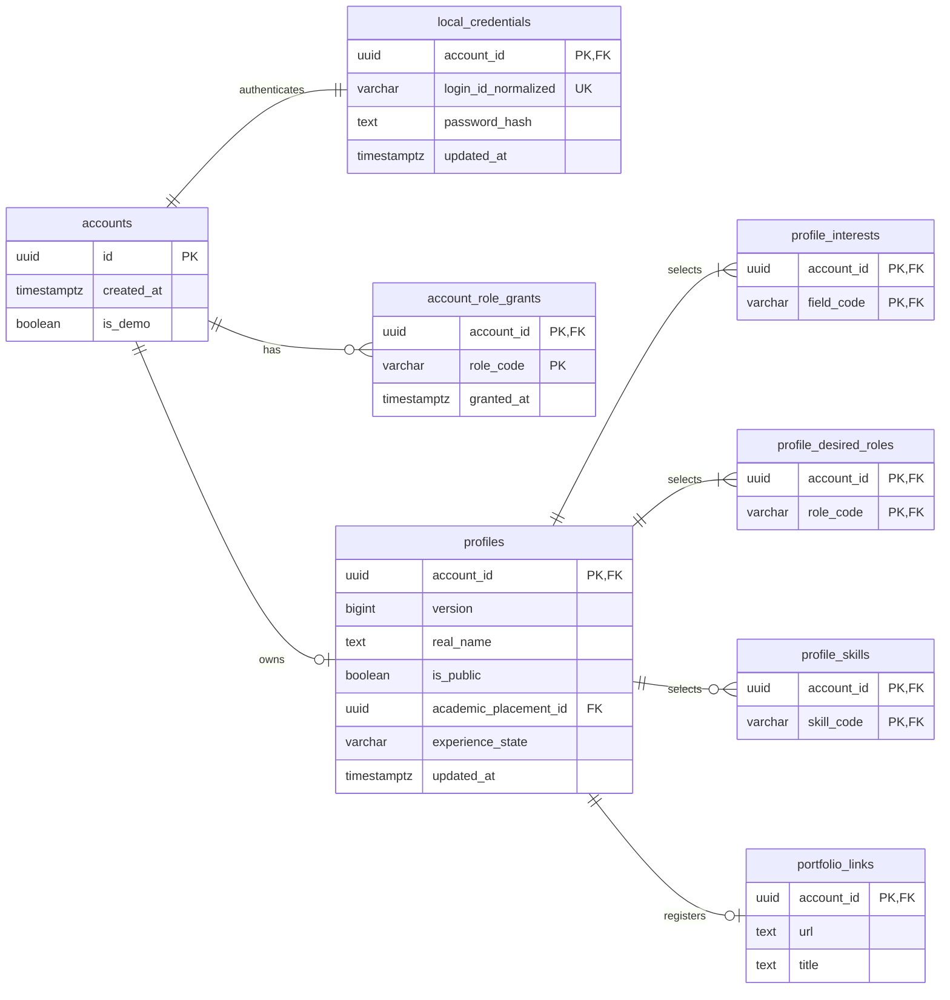

# 계정·프로필 테이블

이 문서는 PostgreSQL 17 기준 **물리 설계 초안**입니다. 계정 식별과 현재 프로필의 저장 구조를 정의합니다. 인증 방식·탈퇴 정책처럼 미정인 제품 결정을 테이블 설계로 확정하지 않습니다.

| 먼저 확인할 내용 | 원본 |
| --- | --- |
| 가입·로그인과 입력 규칙 | [인증 명세](../specs/authentication.md#login-identifier) |
| 프로필 항목·공개·지원 팀장 열람 | [프로필 항목](../specs/profile.md#fields), [공개 범위](../specs/profile.md#visibility) |
| 선택 코드·학사 경로 | [공통 분류 테이블](catalogs.md) |
| ID·시각·NULL·기본값 표기 | [DB 공통 규칙](conventions.md) |

## 구조를 먼저 보기

계정은 로그인 수단과 분리된 식별자입니다. 프로필은 계정당 현재 값 하나이며, 지원할 때 복제하지 않습니다. 복수 선택은 연결 테이블에, 포트폴리오는 선택적인 1:1 관계에 저장합니다.

도표 원본 보기

그림은 이 문서가 정의하는 테이블을 표시합니다. 외부 코드·학사 FK의 대상은 [분류 ERD](catalogs.md)에서 확인합니다. 단일 선택 FK와 전체 컬럼·제약은 아래 정의를 기준으로 합니다. 연결 행의 1~3개·1~2개 제한은 ERD의 `1개 이상` 표기보다 엄격하므로 저장 트랜잭션에서 검증합니다.

## 계정과 로그인

### `accounts`

| 컬럼 | PostgreSQL 타입 | NULL | DB 기본값 | 키·용도 |
| --- | --- | --- | --- | --- |
| `id` | `uuid` | 불가 | 없음 | PK. 애플리케이션이 발급하는 불변 계정 ID |
| `created_at` | `timestamptz` | 불가 | `now()` | 계정 생성 시각 |
| `is_demo` | `boolean` | 불가 | `false` | [시연 데이터 표시](../specs/sprint-1.md#demo-data-scope) |

- PK: `pk_accounts(id)`.
- 탈퇴 효력·보존·복구를 정하는 [PROFILE-04](../specs/profile.md#open-questions)가 남아 있어 탈퇴 상태 컬럼·API는 별도 설계로 보류합니다. 현재 테이블에서 자동 소속 해제·물리 삭제·복구를 수행하지 않습니다.
- 이메일·연락처·학교 인증 결과는 현재 수집 범위가 아니므로 저장 컬럼을 추가하지 않습니다. 교내 미인증 표시는 [인증 명세](../specs/authentication.md#verification-meaning)의 현재 고정 응답으로 처리합니다.

### `local_credentials`

| 컬럼 | PostgreSQL 타입 | NULL | DB 기본값 | 키·용도 |
| --- | --- | --- | --- | --- |
| `account_id` | `uuid` | 불가 | 없음 | PK, FK → `accounts.id` |
| `login_id_normalized` | `varchar(24)` | 불가 | 없음 | 정규화 완료 로그인 아이디 |
| `password_hash` | `text` | 불가 | 없음 | 검증용 해시. 알고리즘·파라미터를 표현할 수 있는 인코딩 문자열 |
| `updated_at` | `timestamptz` | 불가 | `now()` | 인증 정보 변경 시각. 변경 시 애플리케이션이 갱신 |

| 제약·인덱스 이름 | 정의와 목적 |
| --- | --- |
| `pk_local_credentials` | PK (`account_id`) |
| `fk_local_credentials_account` | `account_id` → `accounts.id`, `ON DELETE RESTRICT` |
| `uq_local_credentials_login_id` | `login_id_normalized` 유일. B-tree 유일 인덱스로 로그인 조회도 수행 |
| `ck_local_credentials_login_id` | ASCII 소문자·숫자만으로 구성된 4~24자. 대문자·공백을 정규화하는 작업은 저장 전에 수행 |
| `ck_local_credentials_password_hash` | 해시 문자열은 빈 문자열이 아님. 원문 비밀번호 길이와 해시 길이를 혼동하지 않음 |

가입은 `accounts`와 `local_credentials`를 한 트랜잭션에서 생성합니다. 일반 FK만으로 모든 계정의 인증 정보 존재를 강제할 수 없으므로 가입 유스케이스가 1:1 완성을 책임집니다. 해시 알고리즘·비용·세션 방식·수명·시도 제한은 [인증 최소 기준과 미정 사항](../specs/authentication.md#open-questions)에서 결정합니다. 세션·소셜 연결·계정 복구 테이블을 이번 설계에 임의 추가하지 않습니다.

로그인 아이디 유일성은 저장된 모든 계정에 적용합니다. 향후 탈퇴 기능에서 아이디 재사용을 허용하려면 [탈퇴 정책](../specs/profile.md#account-withdrawal)과 유일성 변경을 함께 검토해야 합니다.

### `account_role_grants`

| 컬럼 | PostgreSQL 타입 | NULL | DB 기본값 | 키·용도 |
| --- | --- | --- | --- | --- |
| `account_id` | `uuid` | 불가 | 없음 | 복합 PK, FK → `accounts.id` |
| `role_code` | `varchar(32)` | 불가 | 없음 | 복합 PK. 현재 저장값 `admin` |
| `granted_at` | `timestamptz` | 불가 | `now()` | 부여 시각 |

- PK: `pk_account_role_grants(account_id, role_code)`.
- FK: `fk_account_role_grants_account`, `ON DELETE RESTRICT`.
- CHECK: `ck_account_role_grants_role`은 현재 `admin`만 허용합니다. 사용자의 희망 역할을 저장하는 `roles`와 별개의 서비스 권한입니다.
- 관리자 공고 관리 권한을 확인하는 최소 저장 구조입니다. 권한 부여·회수 운영 절차와 관리자 화면은 [공모전 명세의 미정 사항](../specs/contests.md#open-questions)을 따릅니다. 관리자라는 이유로 비공개 프로필 열람 범위를 넓히지 않습니다.

## 현재 프로필

### `profiles`

| 컬럼 | PostgreSQL 타입 | NULL | DB 기본값 | 키·용도 |
| --- | --- | --- | --- | --- |
| `account_id` | `uuid` | 불가 | 없음 | PK, FK → `accounts.id` |
| `version` | `bigint` | 불가 | `1` | 프로필 전체 변경 버전. 하위 선택·포트폴리오 변경도 포함 |
| `real_name` | `text` | 불가 | 없음 | 등록 실명. 유일성 없음 |
| `is_public` | `boolean` | 불가 | `false` | 프로필 전체 공개 상태 |
| `avatar_code` | `varchar(64)` | 허용 | `NULL` | FK → `avatar_presets.code` |
| `academic_status_code` | `varchar(64)` | 허용 | `NULL` | FK → `academic_statuses.code` |
| `grade_code` | `varchar(64)` | 허용 | `NULL` | FK → `grades.code` |
| `weekly_availability_code` | `varchar(64)` | 허용 | `NULL` | FK → `weekly_availability_ranges.code` |
| `academic_placement_id` | `uuid` | 허용 | `NULL` | FK → `academic_placements.id`. 가장 깊게 선택한 경로 |
| `major_unassigned` | `boolean` | 불가 | `false` | 전공 미배정을 명시한 상태 |
| `experience_state` | `varchar(16)` | 불가 | `unspecified` | `unspecified` / `none` / `provided` |
| `experience_body` | `text` | 허용 | `NULL` | 현재 경험 본문 |
| `introduction` | `text` | 허용 | `NULL` | 자기소개 |
| `created_at` | `timestamptz` | 불가 | `now()` | 첫 프로필 저장 시각 |
| `updated_at` | `timestamptz` | 불가 | `now()` | 프로필 전체의 마지막 저장 시각 |

**FK:** `fk_profiles_account`, `fk_profiles_avatar`, `fk_profiles_academic_status`, `fk_profiles_grade`, `fk_profiles_weekly_availability`, `fk_profiles_academic_placement`는 위 대상 컬럼을 참조하며 모두 `ON DELETE RESTRICT`입니다. `ON UPDATE`는 공통 규칙을 따릅니다.

| 제약·인덱스 이름 | 정의와 목적 |
| --- | --- |
| `pk_profiles` | PK (`account_id`) |
| `ck_profiles_version` | `version >= 1` |
| `ck_profiles_real_name` | `real_name`은 빈 문자열이 아님. 공백 정규화·글자 수 검증은 저장 계약 적용 |
| `ck_profiles_experience` | `unspecified`·`none`이면 본문 `NULL`; `provided`이면 본문이 `NULL`도 빈 문자열도 아님. 다른 상태값 금지 |
| `ck_profiles_unassigned_path` | `major_unassigned=true`이면 `academic_placement_id`가 반드시 존재 |
| `ix_profiles_academic_placement` | B-tree (`academic_placement_id`). 경로 참조 확인·학사 조건 조회 |
| `ix_profiles_public_updated` | B-tree (`updated_at DESC, account_id ASC`), 조건 `is_public=true`. 공개 사람 목록의 정렬·집계 후보 |

가입 완료 시에는 `accounts`와 `local_credentials`만 존재하며 프로필은 없습니다. 프로필 첫 저장은 `expectedVersion="0"`으로 필수 항목·연결 행을 함께 생성하고 `version=1`을 반환합니다. 이후 수정은 조회한 현재 버전을 전송하고, 성공할 때만 1 증가시킵니다. API의 `version`·`expectedVersion`은 JavaScript 정밀도 손실을 피하기 위한 십진 문자열이며 DB에는 `bigint`로 저장합니다. 미완성 편집 초안은 별도 `draft` 행으로 저장하지 않습니다.

### `profile_interests` · `profile_desired_roles` · `profile_skills`

세 테이블은 다음 두 컬럼으로 각각 구성됩니다. FK는 모두 `ON DELETE RESTRICT`입니다.

| 테이블 | 컬럼 | PostgreSQL 타입 | NULL | DB 기본값 | 키·참조 |
| --- | --- | --- | --- | --- | --- |
| `profile_interests` | `account_id` | `uuid` | 불가 | 없음 | 복합 PK, FK → `profiles.account_id` |
| `profile_interests` | `field_code` | `varchar(64)` | 불가 | 없음 | 복합 PK, FK → `fields.code` |
| `profile_desired_roles` | `account_id` | `uuid` | 불가 | 없음 | 복합 PK, FK → `profiles.account_id` |
| `profile_desired_roles` | `role_code` | `varchar(64)` | 불가 | 없음 | 복합 PK, FK → `roles.code` |
| `profile_skills` | `account_id` | `uuid` | 불가 | 없음 | 복합 PK, FK → `profiles.account_id` |
| `profile_skills` | `skill_code` | `varchar(64)` | 불가 | 없음 | 복합 PK, FK → `skills.code` |

| 테이블 | PK·FK 이름 | 추가 인덱스 |
| --- | --- | --- |
| `profile_interests` | `pk_profile_interests(account_id, field_code)`; `fk_profile_interests_profile`, `fk_profile_interests_field` | `ix_profile_interests_field(field_code, account_id)` |
| `profile_desired_roles` | `pk_profile_desired_roles(account_id, role_code)`; `fk_profile_desired_roles_profile`, `fk_profile_desired_roles_role` | `ix_profile_desired_roles_role(role_code, account_id)` |
| `profile_skills` | `pk_profile_skills(account_id, skill_code)`; `fk_profile_skills_profile`, `fk_profile_skills_skill` | `ix_profile_skills_skill(skill_code, account_id)` |

추가 인덱스는 모두 B-tree이며 분야·역할·역량으로 사람을 찾는 역방향 조회에 사용합니다. PK는 같은 코드의 중복 선택을 방지합니다. 순위·대표값 컬럼은 없습니다.

### `portfolio_links`

| 컬럼 | PostgreSQL 타입 | NULL | DB 기본값 | 키·용도 |
| --- | --- | --- | --- | --- |
| `account_id` | `uuid` | 불가 | 없음 | PK, FK → `profiles.account_id` |
| `url` | `text` | 불가 | 없음 | 유효한 HTTP(S) URL |
| `title` | `text` | 허용 | `NULL` | 선택 제목 |

- PK: `pk_portfolio_links(account_id)`로 프로필당 최대 1개를 보장합니다.
- FK: `fk_portfolio_links_profile`, `ON DELETE RESTRICT`.
- CHECK: `ck_portfolio_links_url`은 URL이 빈 문자열이 아님을 검사합니다. URL 파싱·HTTP(S) 스킴 검증은 저장 전에 수행합니다.
- 링크 제거는 행을 삭제하는 갱신입니다. 제목만 남는 고아 상태와 별도의 공개 플래그가 없습니다. 프로필과 같은 트랜잭션에서 저장하며 `profiles.version`과 `updated_at`을 갱신합니다.

## 저장 책임과 조회 경계

| 책임 | 설계 |
| --- | --- |
| 동시 프로필 편집 | 계정 행을 잠근 뒤 프로필 버전을 비교합니다. 첫 저장도 같은 계정 잠금을 사용하여 중복 생성을 막습니다. 요청 버전이 현재 버전과 다르면 덮어쓰지 않고 충돌 응답을 반환합니다. |
| 저장 단위 | 프로필 본문·선택 연결 행·포트폴리오를 하나의 트랜잭션에서 갱신하고 버전을 1 증가시킵니다. `updated_at`도 같은 저장에서 갱신합니다. |
| 복수 선택 개수 | 최종 연결 집합을 [프로필 입력 규칙](../specs/profile.md#input-validation)에 맞춰 검증합니다. 다른 행 개수를 일반 `CHECK`로 계산하지 않습니다. |
| 텍스트 상한 | 기존 명세의 상한을 서비스에서 검사합니다. [PROFILE-07](../specs/profile.md#open-questions)의 Unicode 계수 계약이 미정이므로 사용자 본문은 `text`로 저장하고 `varchar(n)`으로 임의의 계수 방식을 확정하지 않습니다. |
| 학사 선택 | 새 경로의 계층·현행 여부·미배정 허용을 [학사 저장 계약](catalogs.md#academic-write-contract)에서 검증합니다. |
| 일반 조회·AI 사람 추천 | [프로필 공개 권한](../specs/profile.md#visibility)에 맞는 후보 조회에서 현재 `is_public`을 확인합니다. 검색 결과 수에도 같은 조건을 적용합니다. |
| 지원자 검토 | 지원 관계와 팀장을 확인한 후 현재 `profiles`를 조회합니다. 프로필 버전으로 오래된 AI 검토를 식별하며, 지원별 프로필 사본이나 필드별 공개 플래그를 만들지 않습니다. |

행 잠금 순서와 지원·선발 작업의 원자성은 [트랜잭션 설계](transactions.md)에서 관리합니다. DB FK만으로 API 열람 권한이 보장되지는 않습니다.

## 이 설계에서 보류한 부분

| 후속 결정 | 영향을 받는 저장·API |
| --- | --- |
| [인증 방식·세션·복구](../specs/authentication.md#open-questions) | 세션 저장 테이블·토큰 폐기·시도 제한 저장소. 현재는 계정·자체 인증 정보까지만 정의 |
| [탈퇴·보존·복구·아이디 재사용](../specs/profile.md#open-questions) | 탈퇴 상태의 저장 표현, 관련 행 삭제·열람·소속 처리. 자동 연쇄 삭제 없음 |
| [프로필 Unicode 계수·URL 길이](../specs/profile.md#open-questions) | 본문 서비스 검증·추가 DB CHECK·API validation schema |
| [실제 공통 코드·학사 목록](../specs/profile-options.md#open-questions) | 기준 데이터 초기 적재. 테이블을 설계한 것이 운영 목록 검증 완료를 뜻하지 않음 |
