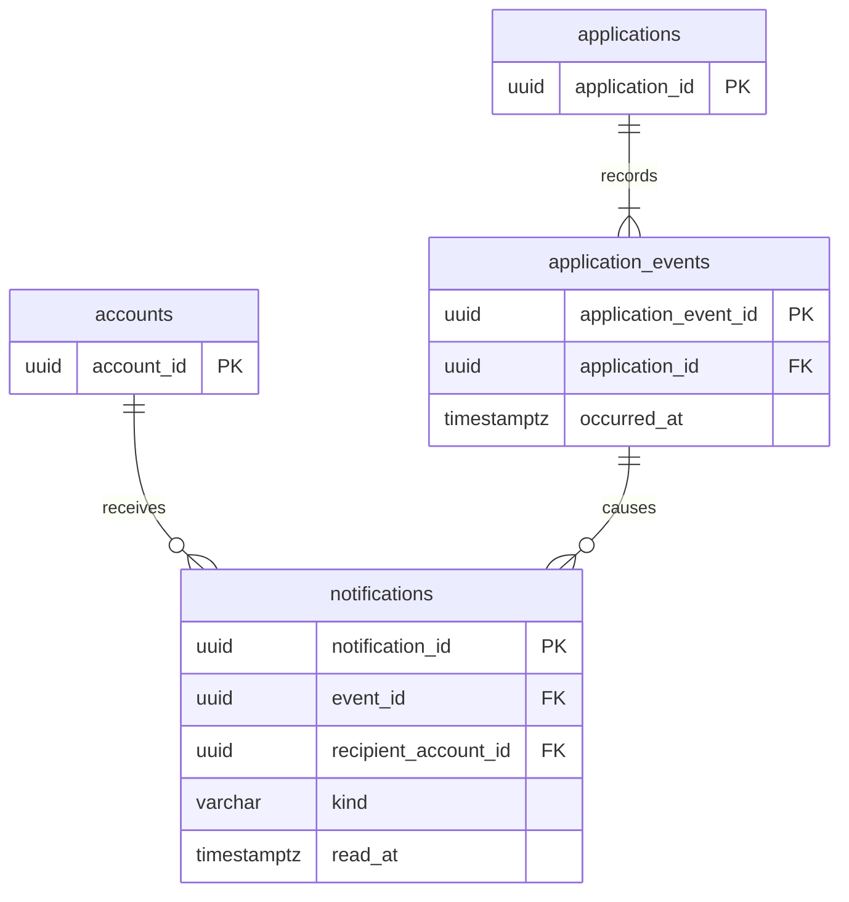

# 알림 테이블

**상태: 저장 모델·제약, 본인 조회·읽음 및 지원 상태 변경 알림 생성 구현.** 검토·미선발·선발·취소와 선발에 따른 다른 대기 지원 폐기는 같은 트랜잭션에서 알림을 생성합니다. 신규 지원의 본인·팀장 알림과 팀 생성에 따른 대기 지원 폐기 알림도 해당 업무와 함께 원자적으로 저장합니다. 수신자별 알림과 읽음 시각은 [알림 모델](../../backend/app/models/notifications.py)과 [마이그레이션](../../backend/alembic/versions/20261024_05_team_integrity.py)에서 정의합니다. 기능의 대상·문구·이동·예외는 [서비스 알림 명세](../specs/notifications.md)를 참조합니다.

## ERD

도표 원본 보기

`accounts`는 [계정](identity.md), `applications`와 `application_events`는 [팀·지원](teams.md)의 같은 테이블입니다. 이 그림은 참조에 필요한 컬럼만 보여줍니다.

## notifications

한 행은 **하나의 발생 건을 한 수신자에게 전달하는 알림**이며, 알림함 목록과 미읽음 개수의 기준입니다. 지원 변경 사실은 `application_events`에서 참조하고, 수신자별 읽음 상태는 이 테이블에서 따로 관리합니다.

| 컬럼 | PostgreSQL 타입 | NULL | 기본값 | 키·의미 |
| --- | --- | --- | --- | --- |
| `notification_id` | `UUID` | 불가 | 서버 생성 | PK |
| `event_id` | `UUID` | 불가 | — | FK → `application_events.application_event_id` |
| `recipient_account_id` | `UUID` | 불가 | — | FK → `accounts.account_id` |
| `kind` | `VARCHAR(32)` | 불가 | — | 아래 코드 중 하나 |
| `read_at` | `TIMESTAMPTZ` | 허용 | NULL | 최초 읽음 성공 시각 |

| 코드 | 의미 | 수신자 검증 |
| --- | --- | --- |
| `application_status_changed` | 본인 지원의 상태 발생 사실 | 사건의 `applicant_account_id`와 동일 |
| `new_application` | 팀장이 새 지원을 받음 | 첫 접수 사건이며 해당 팀의 `leader_account_id`와 동일 |

종류·수신자 검증은 알림을 만드는 업무 트랜잭션에서 수행합니다. 다른 행을 참조하는 CHECK로 가장하지 않습니다. 관련 지원·팀·공모전·발생 시각은 `application_events`에서 조회하고 중복 저장하지 않습니다.

명시적 검토 시작·미선발, 다른 팀 선발·본인 팀 생성으로 인한 폐기는 `application_status_changed`에 포함합니다. 팀 생성 자체나 폐기된 지원을 받은 팀장을 위한 새 알림 종류는 추가하지 않습니다. 폐기의 원인 참조는 [지원 사건](teams.md)에서 관리하며, 지원 변경·사건·본인 알림은 선발 또는 팀 생성과 같은 트랜잭션에 포함합니다.

## 제약과 조회 인덱스

| 이름 | 정의 | 목적 |
| --- | --- | --- |
| `pk_notifications` | PK `(notification_id)` | 개별 읽음 대상 |
| `uq_notifications_event_recipient` | UNIQUE `(event_id, recipient_account_id)` | 실제 발생 건·수신자마다 한 번 |
| `ck_notifications_kind` | `kind`는 위 두 코드 | 현재 알림 범위 고정 |
| `ix_notifications_recipient` | `(recipient_account_id, event_id, notification_id)` | 본인 목록·원천 사건 결합 |
| `ix_notifications_unread` | `(recipient_account_id, event_id, notification_id)`, 조건 `read_at IS NULL` | 미읽음 목록·수 |

FK는 모두 `ON DELETE RESTRICT`, `ON UPDATE RESTRICT`입니다. 유일 인덱스가 `event_id`로 시작하므로 별도 단일 FK 인덱스를 추가하지 않습니다. 정렬은 원천 사건의 `occurred_at DESC`, 알림 `notification_id DESC`를 사용합니다. 초기 설계는 수신자 범위의 결과를 결합·정렬하며, 조회량을 확인하기 전 발생 시각을 알림에 복제하지 않습니다.

## 저장과 읽음

1. 지원 변경·원천 사건·수신자별 알림을 [동일 트랜잭션](transactions.md)으로 저장합니다.
2. 같은 사건을 재처리하면 유일 제약을 통해 기존 알림을 사용합니다. 이미 읽은 알림을 미읽음으로 되돌리지 않습니다.
3. 개별 읽음은 본인 소유를 확인하고, `read_at`이 NULL일 때만 서버 시각을 기록합니다. 반복 호출은 원래 시각을 반환합니다.
4. 모두 읽음은 [API](../api/notifications.md)가 전달한 현재 제공된 알림 ID 집합에만 적용합니다. 하나라도 타인 소유·존재하지 않는 ID이면 전체 실패하며 부분 처리하지 않습니다. 그 사이 도착한 다른 알림은 유지합니다.

조회·읽음 성공은 `application_events`나 지원 상태를 변경하지 않습니다. 제목에 비공개 프로필 내용을 영구 복제하지 않고, 응답 구성과 목적지 접근 시 현재 권한을 확인합니다.

## 저장 범위

이 설계안은 `read_at`을 서버에 저장하므로 같은 계정의 다음 조회에는 저장된 읽음 상태를 돌려줍니다. 실시간 전송, 브라우저 간 즉시 갱신, 푸시·이메일, 보존 기간과 삭제 방식은 포함하지 않습니다. 명세의 NOTIFY-01·02 중 **저장·중복 방지·원자성·정렬·읽음 조회**에 대한 제안이며 기능 완료 표시는 아닙니다.
