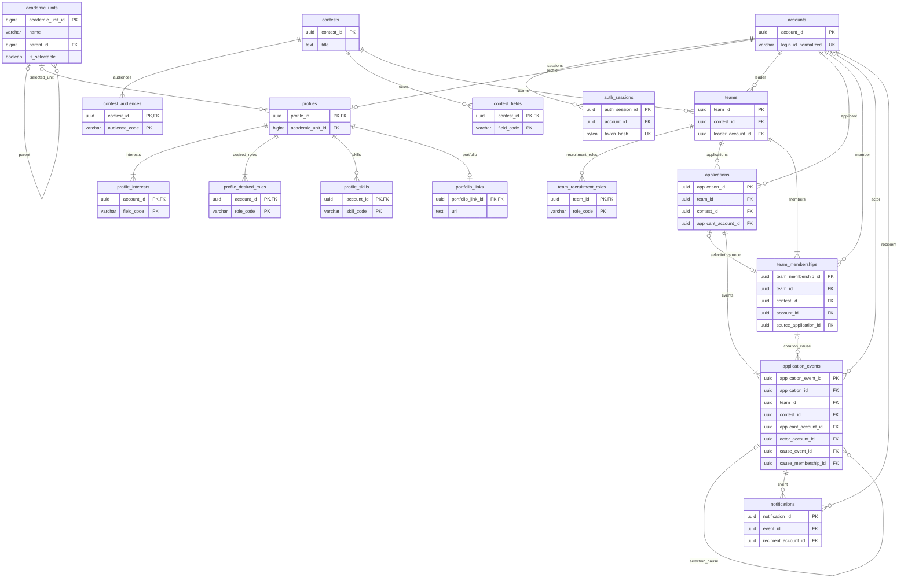

# 전체 ERD

아래 그림은 **17개 업무 테이블과 도메인 간 FK 관계**를 표시합니다. 이들과 FK로 연결되지 않는 인증 시도 제한 테이블 `auth_attempts`는 [계정·인증 문서](identity.md)에 별도로 설명하며, AI 실행·대화 저장 `ai_runs`·`ai_conversations`·`ai_messages`는 [AI 저장 문서](ai.md)에 따로 정의합니다. 현재 전체 저장 모델은 21개이며 아래 그림은 AI 저장 테이블을 제외한 업무 관계입니다. ORM·마이그레이션으로 구현한 핵심 키와 관계를 먼저 보여줍니다. 실제 등록 모델과 업무 구현 범위는 [DB 인덱스](README.md)를 따릅니다. 전체 컬럼·복합 키·제약·인덱스는 각 도메인 문서가 원본입니다.

도표 원본 보기

## 그림을 읽는 기준

- `PK`는 기본 키, `FK`는 외래 키, `UK`는 유일 키입니다. 학사 항목 ID와 그 참조는 증가형 `bigint`, 나머지 업무 객체 ID는 UUID입니다.
- 복합 FK는 테이블 사이의 선 하나로 요약합니다. 예를 들어 지원의 `team_id`·`contest_id`는 함께 팀을 참조하고, 사건의 지원 문맥은 `applications`를 참조합니다. 개별 컬럼을 별도 공고·계정 FK로 해석하지 않습니다.
- 팀의 최소 소속 1명, 지원의 최초 사건 등 서비스 저장 규칙도 관계의 최소 개수에 반영했습니다. FK 자체가 자식 최소 개수를 보장하지 않으며 프로필 복수 선택의 상한도 상세 검증이 필요합니다.
- 공통 선택지 7종은 애플리케이션 enum이므로 별도 코드 테이블·FK 선이 없습니다. 연결 테이블은 소유자 FK와 복합 PK를 유지합니다.
- 학사 변경 근거는 문서·PR에서 관리하므로 별도 DB 변경 이력 테이블은 없습니다.
- AI 대화·요청·결과의 물리 영속화는 아직 미정이므로 테이블을 추가하지 않습니다.

## 도메인별 상세

| 영역 | 테이블 | 원본 |
| --- | --- | --- |
| 계정·프로필 | `accounts`, `auth_sessions`, `profiles`, `profile_interests`, `profile_desired_roles`, `profile_skills`, `portfolio_links` | [계정·프로필](identity.md) |
| 학사 | `academic_units` | [공통 선택지·학사](catalogs.md) |
| 공모전 | `contests`, `contest_audiences`, `contest_fields` | [공모전](contests.md) |
| 팀·지원·소속 | `teams`, `team_recruitment_roles`, `applications`, `team_memberships`, `application_events` | [팀·지원·소속](teams.md) |
| 알림 | `notifications` | [알림](notifications.md) |

여러 관계를 함께 변경하는 순서는 [트랜잭션 설계](transactions.md), 확정·보류 범위는 [설계 결정](decisions.md)을 참조합니다.
