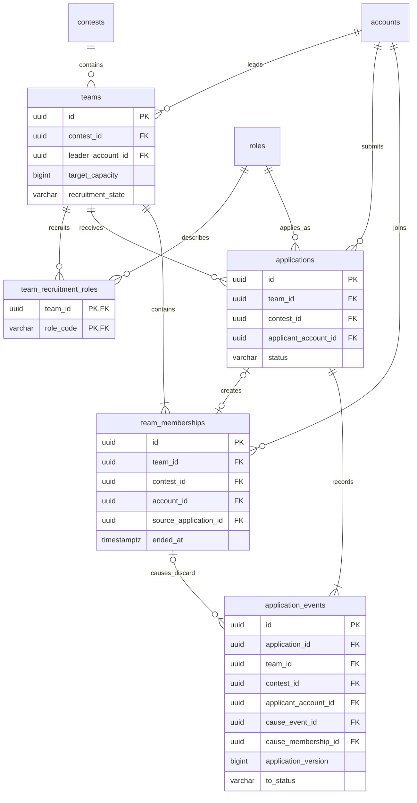

# 팀·지원·소속 테이블

이 문서는 [팀 모집·지원 명세](../specs/team-recruitment.md)를 PostgreSQL 테이블과 제약으로 옮긴 **미구현 설계안**입니다. 사용자 흐름·권한·정책은 원문 링크로 참조하고, 여기서는 저장 구조와 정합성에 집중합니다. 공통 타입·기본값·삭제 규칙은 [공통 규칙](conventions.md), 여러 테이블을 함께 바꾸는 처리 순서는 [트랜잭션 설계](transactions.md)가 원본입니다.

## 구조와 책임

| 테이블 | 한 행이 뜻하는 것 |
| --- | --- |
| `teams` | 공모전 하나에 속한 팀과 현재 모집 정보 |
| `team_recruitment_roles` | 팀이 안내하는 모집 역할 한 개 |
| `applications` | 한 사용자가 한 팀에 제출한 지원 시도 한 건 |
| `team_memberships` | 팀장 또는 선발된 팀원의 소속 기간 한 건 |
| `application_events` | 지원 상태가 실제 변경된 사건 한 건 |

지원과 소속은 서로 다릅니다. 취소·폐기 후 허용된 재지원은 새로운 지원 ID를 만들며, 현재 인원은 종료되지 않은 소속을 세어 계산합니다. 공모전 분야와 최신 프로필은 복제하지 않고 각각 [공모전 테이블](contests.md)과 [계정·프로필 테이블](identity.md)을 조회합니다.

도표 원본 보기

## `teams` — 팀과 모집 정보

팀명·소개·정원·모집 상태처럼 한 팀의 현재 모집 정보를 관리합니다. 팀 목록·상세의 기준이 되며, 이 팀이 속한 공모전과 팀장, 지원·소속 기록을 연결합니다.

| 컬럼 | PostgreSQL 타입 | NULL | DB 기본값 | 키·설명 |
| --- | --- | --- | --- | --- |
| `id` | `uuid` | 불가 | — | PK `pk_teams` |
| `request_id` | `uuid` | 불가 | — | 최초 생성 요청 식별자; 재전송 중복 방지 |
| `request_fingerprint` | `char(64)` | 불가 | — | 서버가 생성한 최초 생성 요청의 SHA-256 지문 |
| `contest_id` | `uuid` | 불가 | — | FK → `contests.id` |
| `leader_account_id` | `uuid` | 불가 | — | FK → `accounts.id`; 생성자, 일반 수정 불가 |
| `name` | `text` | 불가 | — | 팀명, 정규화 후 2~40자 |
| `introduction` | `text` | 불가 | — | 소개·목표, 정규화 후 10~1,000자 |
| `target_capacity` | `bigint` | 불가 | — | 팀장 포함 목표 총 정원, 양의 정수 |
| `recruitment_state` | `varchar(16)` | 불가 | — | 아래 모집 상태 코드 |
| `closed_reason` | `varchar(32)` | 허용 | `NULL` | `leader_closed` / `capacity_reached`; 닫힘 기록이 없으면 NULL |
| `recruitment_closes_at` | `timestamptz` | 불가 | — | 팀 신규 접수 종료 경계, 해당 시각 제외 |
| `deadline_source_date` | `date` | 불가 | — | 입력한 모집 마감 날짜 |
| `deadline_source_time` | `time without time zone` | 허용 | `NULL` | 입력한 시각; 없으면 날짜 끝 해석 |
| `deadline_source_timezone` | `text` | 허용 | `NULL` | 입력에서 명시한 시간대 |
| `deadline_effective_timezone` | `text` | 불가 | — | 실제 해석 시간대 |
| `deadline_time_assumed` | `boolean` | 불가 | — | 원문 시각 보완 여부 |
| `deadline_timezone_assumed` | `boolean` | 불가 | — | 원문 시간대 보완 여부 |
| `created_at` | `timestamptz` | 불가 | `now()` | 생성 시각 |
| `updated_at` | `timestamptz` | 불가 | `now()` | 최종 저장 시각 |
| `version` | `bigint` | 불가 | `1` | 저장 성공마다 증가 |

| 모집 상태 코드 | 표시 이름 | 이번 설계에서 쓰는 경계 |
| --- | --- | --- |
| `open` | 모집 중 | 생성·명시적 재개 성공 후 상태 |
| `closed` | 모집 마감 | 팀장 종료 또는 정원 충족의 닫힘 기록 |

현재 접수 가능 여부는 저장 상태만으로 결정하지 않습니다. [모집 가능 조건](../specs/team-recruitment.md#recruitment-conditions)을 현재 공고·팀 기한·활성 소속 수에 적용합니다. 시각 경과만으로 저장 상태를 자동 변경하거나 마감 알림을 생성하지 않습니다. 검토 중은 개별 지원의 상태이며, 팀 전체 확정 상태는 두지 않습니다. 저장 상태 전이는 [팀 상태 전이](../specs/team-recruitment.md#team-state-transitions)를 따릅니다.

### 제약과 저장 시 검증

| 이름 | 종류 | 보장하는 내용 |
| --- | --- | --- |
| `uq_teams_request` | UNIQUE `(leader_account_id, request_id)` | 같은 생성 요청으로 팀 중복 생성 금지 |
| `uq_teams_id_contest` | UNIQUE `(id, contest_id)` | 자식의 공모전 일치 검사용 참조키 |
| `ck_teams_text` | CHECK | 팀명·소개가 공백만으로 이루어지지 않음 |
| `ck_teams_request_fingerprint` | CHECK | 소문자 16진수 64자리 |
| `ck_teams_capacity` | CHECK | `target_capacity > 0`; 정수 타입 자체가 소수 입력을 허용한다는 뜻은 아니며 API에서 반올림 없이 거부 |
| `ck_teams_recruitment_state` | CHECK | `open`, `closed`만 허용 |
| `ck_teams_closed_reason` | CHECK | `closed`이면 정의된 닫힘 사유 필수. 다른 상태에는 NULL |
| `ck_teams_deadline_assumptions` | CHECK | 시각·시간대 보완 플래그와 해당 원문 필드의 NULL 여부 일치 |
| `ck_teams_version` | CHECK | `version > 0` |

팀명 2~40자·소개 10~1,000자 및 정규화는 저장 유스케이스에서 검사합니다. Unicode 계수 계약이 미정이므로 DB의 `varchar(n)` 길이로 제품의 글자 수를 대신 결정하지 않습니다. 공식 인원 범위와 목표 정원의 일치, 기한 해석, 현재 관리자·팀장 권한도 저장 유스케이스에서 검사합니다. 인원 타입은 [공모전의 숫자 표현](contests.md)을 따르며 서비스 별도 상한·초기 기본 정원은 만들지 않습니다. 공고 조건 변경의 기존 팀 영향은 [미정 정책](../specs/contests.md#eligibility-changes)을 따릅니다.

정원 충족 시 `closed + capacity_reached`를 함께 저장합니다. 이후 소속 종료는 이 두 값을 바꾸지 않으며, 재개 성공 때만 `open + NULL`로 변경합니다. 정원 1명 팀의 생성도 팀장 소속과 `closed + capacity_reached`를 함께 기록합니다. 이 상태 표현은 [명시적 모집 재개 정책](../specs/team-recruitment.md#recruitment-reopening)의 자동 재개 방지를 위한 설계입니다.

## `team_recruitment_roles` — 모집 역할

팀별 모집 역할을 공통 역할 선택지인 `roles`와 연결합니다. 모집글에 필요한 역할을 표시하고, 팀 탐색에서 역할로 목록을 좁히는 데 사용합니다.

| 컬럼 | PostgreSQL 타입 | NULL | DB 기본값 | 키·설명 |
| --- | --- | --- | --- | --- |
| `team_id` | `uuid` | 불가 | — | PK 구성, FK → `teams.id` |
| `role_code` | `varchar(64)` | 불가 | — | PK 구성, FK → `roles.code` |

`pk_team_recruitment_roles (team_id, role_code)`로 중복을 막습니다. 저장 서비스가 정원 1명이면 0개, 2명 이상이면 1~6개인지 검사합니다. 팀 행 잠금 아래 팀 생성·정원과 최종 역할 집합을 같은 트랜잭션에서 저장합니다. 역할별 정원·충원 상태·팀별 분야 연결은 추가하지 않습니다.

## `applications` — 지원 시도

사용자가 팀에 지원한 시도별로 선택 역할·메시지·현재 상태를 관리합니다. 내 지원 현황과 팀장의 지원자 검토에 사용하며, 선발 후 실제 소속은 `team_memberships`에 구분해 기록합니다.

| 컬럼 | PostgreSQL 타입 | NULL | DB 기본값 | 키·설명 |
| --- | --- | --- | --- | --- |
| `id` | `uuid` | 불가 | — | PK `pk_applications` |
| `request_id` | `uuid` | 불가 | — | 최초 접수 요청 식별자; 재전송 중복 방지 |
| `request_fingerprint` | `char(64)` | 불가 | — | 서버가 생성한 최초 접수 요청의 SHA-256 지문 |
| `team_id` | `uuid` | 불가 | — | 아래 결합 FK 구성 |
| `contest_id` | `uuid` | 불가 | — | 팀에서 가져온 공모전; 결합 FK로 일치 강제 |
| `applicant_account_id` | `uuid` | 불가 | — | FK → `accounts.id` |
| `applied_role_code` | `varchar(64)` | 불가 | — | FK → `roles.code`; 지원 시 선택 역할 |
| `message` | `text` | 허용 | `NULL` | 선택 메시지, 공백만 입력하면 NULL |
| `status` | `varchar(16)` | 불가 | `submitted` | 아래 지원 상태 |
| `submitted_at` | `timestamptz` | 불가 | `now()` | 최초 접수 시각 |
| `status_changed_at` | `timestamptz` | 불가 | `now()` | 현재 상태가 된 시각 |
| `version` | `bigint` | 불가 | `1` | 상태 변경 성공마다 증가 |

| 지원 상태 코드 | 표시 이름 |
| --- | --- |
| `submitted` | 지원 완료 |
| `reviewing` | 검토 중 |
| `selected` | 선발 |
| `rejected` | 미선발 |
| `canceled` | 지원 취소 |
| `discarded` | 폐기 |

`contest_id`는 동시 선발·다른 지원 폐기의 조회와 결합 참조를 위한 제한된 중복입니다. API 입력을 독립 저장하지 않고 팀에서 가져오며, 결합 FK가 공모전 불일치를 거부합니다. 지원 시 프로필 사본을 저장하지 않는 이유와 최신 정보 사용 범위는 [현재 프로필 검토 정책](../specs/profile.md#application-profile)을 따릅니다.

| 이름 | 종류·열 | 보장하는 내용 |
| --- | --- | --- |
| `uq_applications_request` | UNIQUE `(applicant_account_id, request_id)` | 같은 접수 요청으로 지원 중복 생성 금지 |
| `uq_applications_context` | UNIQUE `(id, team_id, contest_id, applicant_account_id)` | 소속·사건의 팀·공모전·지원자 일치 참조키 |
| `uq_applications_current` | 부분 UNIQUE `(team_id, applicant_account_id)`; `status IN (submitted, reviewing, selected)` | 같은 팀의 현재 유효 지원 중복 금지 |
| `ck_applications_status` | CHECK | 위 여섯 상태만 허용 |
| `ck_applications_message` | CHECK | NULL 또는 공백만이 아닌 문자열. 1,000자 상한·정규화는 서비스 입력 검증 |
| `ck_applications_request_fingerprint` | CHECK | 소문자 16진수 64자리 |
| `ck_applications_time_version` | CHECK | `status_changed_at ≥ submitted_at`, `version > 0` |

팀·지원 생성의 `request_id`는 같은 입력의 재시도에서 재사용합니다. `request_fingerprint`는 행위자 ID·요청 경로·정규화한 최초 허용 입력을 정해진 키 순서로 직렬화한 뒤 서버가 SHA-256으로 생성합니다. 사용자에게 지문 입력을 받지 않고, 현재 프로필·현재 팀 표시명 같은 변동 조회값은 지문에 넣지 않습니다. 같은 사용자·요청 ID의 지문이 같으면 기존 리소스를 반환하고 다르면 충돌로 응답합니다. 최초 지문은 이후 상태나 허용된 필드 변경으로 갱신하지 않습니다. 세부 정규화·재시도 순서는 [트랜잭션 설계](transactions.md)를 따릅니다.

이 제약을 통과하는 것과 재지원이 허용되는 것은 다릅니다. [재지원 정책](../specs/team-recruitment.md#reapplication)에 따라 같은 팀의 `rejected` 이력이 하나라도 있으면 새 지원을 거부합니다. `canceled`·`discarded` 이후에는 같은 공모전 활성 소속이 없고 현재 모집 조건을 충족할 때 새 지원 ID로 접수합니다. 같은 공모전 소속 중 신규 지원 금지는 [소속과 지원의 경계](../specs/team-recruitment.md#membership-exclusions)를 따릅니다. 이력·소속 조회와 신규 저장은 [공통 계정 잠금](transactions.md) 아래 수행하며, 부분 UNIQUE만으로 과거 미선발 이력까지 검사했다고 간주하지 않습니다.

검토 시작·미선발은 팀장의 명시적 명령으로만 수행합니다. 조회·모집 종료·기한 경과·정원 충족으로 자동 미선발을 만들지 않습니다. `rejected`·`canceled`·`discarded`는 종료 상태이며 되돌리지 않습니다. `selected`의 본인 취소를 포함한 허용 전이는 [지원 상태 전이](../specs/team-recruitment.md#application-transitions)를 따릅니다. 일반적인 `PATCH status`로 이 범위를 넓히지 않습니다.

## `team_memberships` — 소속 기간

사용자의 팀 소속 기간을 기록하여 지원 이력과 실제 팀원 관계를 구분합니다. 팀 생성·선발 때 생긴 소속 중 종료되지 않은 행을 현재 팀원 목록과 인원 계산의 기준으로 사용합니다.

| 컬럼 | PostgreSQL 타입 | NULL | DB 기본값 | 키·설명 |
| --- | --- | --- | --- | --- |
| `id` | `uuid` | 불가 | — | PK `pk_team_memberships` |
| `team_id` | `uuid` | 불가 | — | 결합 FK → `teams` |
| `contest_id` | `uuid` | 불가 | — | 팀과 같은 공모전 |
| `account_id` | `uuid` | 불가 | — | FK → `accounts.id` |
| `source_application_id` | `uuid` | 허용 | `NULL` | 선발 원인이 된 지원. 팀장 생성 소속에만 NULL |
| `joined_at` | `timestamptz` | 불가 | `now()` | 생성·선발 성공 시각 |
| `ended_at` | `timestamptz` | 허용 | `NULL` | 활성 소속이면 NULL |
| `end_reason` | `varchar(32)` | 허용 | `NULL` | 종료되면 `application_canceled` |

| 이름 | 종류·열 | 보장하는 내용 |
| --- | --- | --- |
| `uq_memberships_active_contest` | 부분 UNIQUE `(account_id, contest_id)`; `ended_at IS NULL` | 팀장 포함 공모전별 활성 소속 최대 1개 |
| `uq_memberships_source_application` | UNIQUE `(source_application_id)` | 같은 지원으로 소속 기간을 두 번 만들지 않음; 팀장 NULL은 여러 팀에서 가능 |
| `uq_memberships_cause_context` | UNIQUE `(id, contest_id, account_id)` | 팀 생성 폐기 원인이 같은 사용자·공모전인지 FK로 검증하는 참조키 |
| `ck_memberships_end` | CHECK | 활성: 종료 시각·사유 모두 NULL. 종료: `ended_at ≥ joined_at`이고 사유 `application_canceled` |

여러 행의 상태·개수는 저장 서비스가 [공통 잠금 순서](transactions.md) 아래 검증합니다. DB에는 위 행 제약·유일성과 아래 결합 FK를 최종 방어선으로 둡니다.

| 서비스 검증 책임 | 최종 저장 상태 |
| --- | --- |
| 팀 생성 | 해당 팀장과 일치하는 활성 소속 정확히 1개. 이 소속에만 원인 지원 NULL 허용. 같은 공모전 본인의 다른 대기 지원은 함께 폐기 |
| 선발 | 같은 팀·사용자의 `selected` 지원과 활성 일반 소속이 1:1로 대응 |
| 선발 후 본인 취소 | 원인 지원은 `canceled`, 해당 일반 소속은 종료 상태 |
| 소속 추가·정원 저장 | 활성 소속 수가 목표 정원을 넘지 않음 |

이 검증과 상태·소속 변경을 한 트랜잭션으로 처리하며, 별도의 교차 행 제약 트리거는 추가하지 않습니다.

팀장 여부는 `teams.leader_account_id`로 판정합니다. 변경 가능한 `is_leader` 컬럼을 추가하지 않습니다. 일반 팀원의 작업 역할은 원인 지원의 `applied_role_code`에서 읽습니다.

## `application_events` — 지원 상태 변경 사건

지원의 최초 제출과 실제 상태 변경을 현재 상태와 같은 트랜잭션에서 기록하여, 변경 원인과 알림의 근거로 사용합니다. 정상 업무에서 UPDATE·DELETE하지 않으며, 현재 상태는 `applications`에 두고 전체 이벤트 소싱이나 과거 프로필 복제는 도입하지 않습니다.

| 컬럼 | PostgreSQL 타입 | NULL | DB 기본값 | 키·설명 |
| --- | --- | --- | --- | --- |
| `id` | `uuid` | 불가 | — | PK `pk_application_events`; 알림이 참조하는 사건 ID |
| `application_id` | `uuid` | 불가 | — | 지원 문맥 결합 FK 구성 |
| `team_id` | `uuid` | 불가 | — | 지원받은 팀 |
| `contest_id` | `uuid` | 불가 | — | 지원한 공모전 |
| `applicant_account_id` | `uuid` | 불가 | — | 지원자 |
| `application_version` | `bigint` | 불가 | — | 이번 변경 후 지원 버전 |
| `from_status` | `varchar(16)` | 허용 | `NULL` | 최초 제출 사건에만 NULL |
| `to_status` | `varchar(16)` | 불가 | — | 변경 결과 |
| `actor_account_id` | `uuid` | 허용 | `NULL` | 본인·팀장 행위자. 자동 폐기는 NULL |
| `reason_code` | `varchar(32)` | 불가 | — | 아래 사건 코드 |
| `cause_event_id` | `uuid` | 허용 | `NULL` | 자동 폐기를 일으킨 다른 지원의 선발 사건 |
| `cause_membership_id` | `uuid` | 허용 | `NULL` | 자동 폐기를 일으킨 새 팀의 팀장 소속 |
| `occurred_at` | `timestamptz` | 불가 | `now()` | 성공한 상태 변경 시각 |

| 사건 코드 | 상태 대응 | 추가 조건 |
| --- | --- | --- |
| `submitted` | NULL → `submitted` | 버전 1, 행위자=지원자 |
| `selected` | `submitted`/`reviewing` → `selected` | 행위자=해당 팀장 |
| `canceled` | `submitted`/`reviewing`/`selected` → `canceled` | 행위자=지원자 |
| `selected_elsewhere` | `submitted`/`reviewing` → `discarded` | 행위자 NULL, 원인 선발 사건 필수 |
| `team_created_elsewhere` | `submitted`/`reviewing` → `discarded` | 행위자 NULL, 새 팀의 팀장 소속 필수 |
| `reviewing_started` | `submitted` → `reviewing` | 행위자=해당 팀장, 명시적 검토 시작 |
| `rejected` | `submitted`/`reviewing` → `rejected` | 행위자=해당 팀장, 명시적 미선발 |

| 이름 | 종류 | 보장하는 내용 |
| --- | --- | --- |
| `uq_application_events_version` | UNIQUE `(application_id, application_version)` | 동일 상태 버전의 사건 중복 금지 |
| `uq_application_events_cause_context` | UNIQUE `(id, contest_id, applicant_account_id)` | 폐기 원인이 같은 사용자·공모전인지 FK로 검증 |
| `ck_application_events_transition` | CHECK | 위 코드·상태 조합, 최초 버전 1·나머지 버전 > 1, 이전·결과 상태가 다름 |
| `ck_application_events_cause` | CHECK | `selected_elsewhere`: `cause_event_id`만 필수·행위자 NULL. `team_created_elsewhere`: `cause_membership_id`만 필수·행위자 NULL. 나머지: 두 원인 모두 NULL·행위자 필수 |

서비스는 지원 상태 변경과 사건 추가를 함께 저장하면서 버전 연속성, 새 사건의 `from_status`와 직전 사건의 `to_status` 일치, 현재 지원과 마지막 사건의 상태·버전 일치, 행위자의 팀장·본인 권한을 검증합니다. `selected_elsewhere`의 원인은 같은 사용자·공모전의 다른 팀에서 이번 트랜잭션에 생성한 `selected` 사건이어야 합니다. `team_created_elsewhere`의 원인은 같은 사용자·공모전의 다른 팀을 이번 트랜잭션에 생성하면서 만든 활성 팀장 소속이어야 합니다. 이 소속의 `source_application_id IS NULL`과 `account_id = teams.leader_account_id`도 검사합니다. 아래 결합 FK는 같은 사용자·공모전 참조를 보장하며, 원인의 종류·다른 팀 여부·생성 트랜잭션까지 대신 검증하지는 않습니다.

선발 1건과 폐기 N건은 서로 다른 사건 ID를 갖습니다. 선발에 따른 폐기 N건은 같은 `cause_event_id`, 팀 생성에 따른 폐기 N건은 같은 `cause_membership_id`를 공유할 수 있습니다. 팀 생성 원인을 표현하기 위해 가짜 지원·선발 사건을 만들지 않습니다. 각 폐기 사건 ID가 [알림 설계](notifications.md)의 `(event_id, recipient_account_id)` 중복 방지 기준이 됩니다. 종료된 지원의 사건·관계를 유지하므로 [기존 지원 검토 권한](../specs/profile.md#former-applicant-visibility)을 조회할 수 있습니다.

## 결합 FK와 삭제 동작

아래 FK는 모두 `ON DELETE RESTRICT`, `ON UPDATE RESTRICT`입니다. 팀 삭제는 MVP에서 제공하지 않으며, 후속 보존·회원 탈퇴 정책 없이 업무 이력을 자동으로 지우지 않습니다. NULL인 `source_application_id`·`cause_event_id`·`cause_membership_id`의 결합 FK에는 `MATCH SIMPLE`을 적용하고, 저장 서비스가 위 책임표에 따라 NULL 허용 의미를 확인합니다.

| FK 이름 | 자식 컬럼 → 부모 컬럼 |
| --- | --- |
| `fk_teams_contest` | `teams.contest_id` → `contests.id` |
| `fk_teams_leader` | `teams.leader_account_id` → `accounts.id` |
| `fk_team_recruitment_roles_team` | `team_recruitment_roles.team_id` → `teams.id` |
| `fk_team_recruitment_roles_role` | `team_recruitment_roles.role_code` → `roles.code` |
| `fk_applications_team_context` | `applications.(team_id, contest_id)` → `teams.(id, contest_id)` |
| `fk_applications_account` | `applications.applicant_account_id` → `accounts.id` |
| `fk_applications_role` | `applications.applied_role_code` → `roles.code` |
| `fk_memberships_team_context` | `team_memberships.(team_id, contest_id)` → `teams.(id, contest_id)` |
| `fk_memberships_account` | `team_memberships.account_id` → `accounts.id` |
| `fk_memberships_application_context` | `team_memberships.(source_application_id, team_id, contest_id, account_id)` → `applications.(id, team_id, contest_id, applicant_account_id)` |
| `fk_application_events_application` | `application_events.(application_id, team_id, contest_id, applicant_account_id)` → `applications.(id, team_id, contest_id, applicant_account_id)` |
| `fk_application_events_actor` | `application_events.actor_account_id` → `accounts.id` |
| `fk_application_events_cause` | `application_events.(cause_event_id, contest_id, applicant_account_id)` → `application_events.(id, contest_id, applicant_account_id)` |
| `fk_application_events_cause_membership` | `application_events.(cause_membership_id, contest_id, applicant_account_id)` → `team_memberships.(id, contest_id, account_id)` |

## 조회용 인덱스

PK·UNIQUE가 만드는 인덱스 외의 초기 인덱스입니다. 팀의 공개 검색과 지원자 관리 조회는 별도 권한 필터를 적용하며 인덱스만으로 접근을 통제하지 않습니다.

| 인덱스 이름 | 방식·열·조건 | 조회 목적 |
| --- | --- | --- |
| `ix_teams_contest_created` | B-tree `(contest_id, created_at DESC, id DESC)` | 공모전 상세의 팀 목록·전체 팀 수 |
| `ix_teams_created` | B-tree `(created_at DESC, id DESC)` | 전체 팀 목록 |
| `ix_teams_leader` | B-tree `(leader_account_id, id)` | 팀장 소유 확인 |
| `ix_team_recruitment_roles_role` | B-tree `(role_code, team_id)` | 모집 역할 필터 |
| `ix_applications_team_status` | B-tree `(team_id, status, submitted_at DESC, id DESC)` | 팀장 지원자 목록·대기 수 |
| `ix_applications_account` | B-tree `(applicant_account_id, submitted_at DESC, id DESC)` | 내 지원 목록 |
| `ix_applications_pending_contest` | B-tree `(applicant_account_id, contest_id, id)`; `status IN (submitted, reviewing)` | 선발·팀 생성 시 다른 대기 지원 잠금·폐기 |
| `ix_applications_rejected_history` | B-tree `(team_id, applicant_account_id)`; `status = rejected` | 같은 팀 재지원 금지 이력 확인 |
| `ix_applications_role` | B-tree `(applied_role_code)` | 공통 역할 FK 참조 |
| `ix_memberships_team_active` | B-tree `(team_id, account_id)`; `ended_at IS NULL` | 현재 팀원·현재 인원 |
| `ix_memberships_team_history` | B-tree `(team_id, joined_at, id)` | 팀 소속 이력·FK 참조 |
| `ix_memberships_account_history` | B-tree `(account_id, joined_at DESC, id DESC)` | 계정 소속 이력·FK 참조 |
| `ix_application_events_cause` | B-tree `(cause_event_id)` | 선발로 발생한 폐기 사건 |
| `ix_application_events_cause_membership` | B-tree `(cause_membership_id)` | 팀 생성으로 발생한 폐기 사건·원인 소속 FK 참조 |
| `ix_application_events_actor` | B-tree `(actor_account_id)` | 사건 행위자 FK 참조 |

`uq_application_events_version`의 선두 열은 지원 상태 이력 조회에도 사용합니다. 현재 인원·대기 수·공모전 전체 팀 수는 집계값이며 수동으로 갱신하는 카운터 컬럼을 두지 않습니다. 확장 인덱스·검색용 복제 데이터는 측정 후 도입합니다.

## 확정된 실행 경계와 범위 밖 동작

팀·지원 상태와 재지원·소속 경계는 [팀 명세](../specs/team-recruitment.md)의 확정 규칙을 따릅니다. DB가 상태·이력을 표현할 수 있다는 이유로 범위 밖 동작을 API에서 활성화하지 않습니다.

| 경계 | 설계에서의 처리 |
| --- | --- |
| 선발 가능 시점 | [선발 기한](../specs/team-recruitment.md#selection-window)에 따라 공고 접수 마감 전·여석 존재가 필수. 팀 `closed`·팀 기한 경과만으로 기존 지원의 선발을 막지 않음 |
| 같은 공모전 소속과 신규 지원 | 활성 소속이 있으면 신규 지원 거부. 팀 생성 성공 시 본인의 같은 공모전 다른 대기 지원만 원자적으로 폐기 |
| 종료 지원·다른 공모전 지원 | 팀 생성·선발의 폐기 대상에서 제외. 미선발 이력은 같은 팀 재지원 차단에 사용 |
| 팀장 선발 취소·강퇴·팀장 탈퇴·팀 삭제 | MVP 범위 밖. 기존 본인 지원 취소를 다른 권한의 소속 제거로 확장하지 않음 |
| 회원 탈퇴 이후 이력·데이터 보존 | CASCADE·임의 익명화·보존 기간을 추가하지 않음 |
| 모집 정보·지원 메시지 편집 | 구조가 있다는 이유로 편집 endpoint를 새로 열지 않음 |

[공고 조건 변경의 기존 팀 영향](../specs/contests.md#eligibility-changes) 등 남은 질문은 별도 정책 결정이며, 위 확정 전이의 구현을 모두 보류한다는 뜻은 아닙니다.

이 문서는 DDL·마이그레이션·트리거·서버 코드가 아닙니다. 구현 단계에서 제약과 [동시성 검증 사례](transactions.md)를 실제 PostgreSQL에서 검증해야 합니다.
