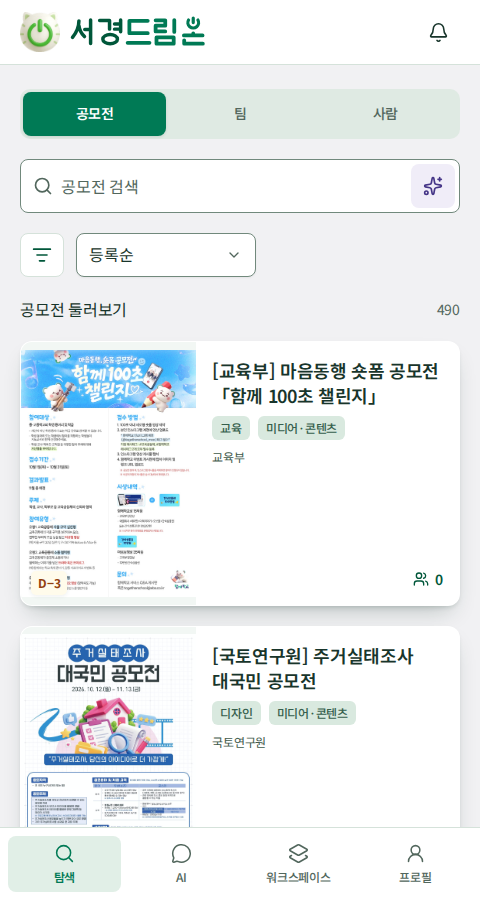
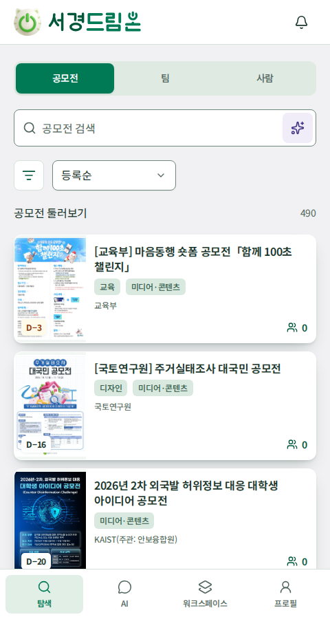
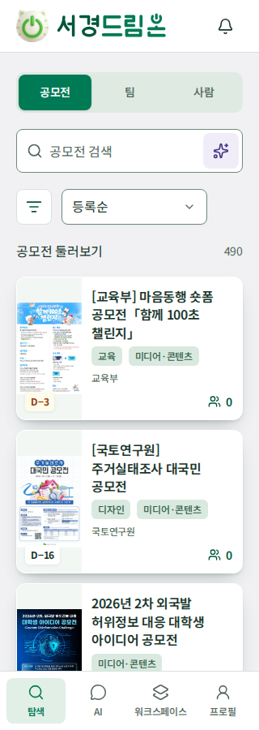

# 스타일과 컴포넌트

제품의 모바일 UI는 에메랄드 강조색과 밝은 표면을 사용합니다. 탐색은 흰 배경 위에 얇은 녹색 실선으로 목록 행을 구분하며, 다른 화면의 중립 회색 배경과 흰 카드는 유지합니다. 선택·hover·누름·정보의 값에 녹색을 적용합니다. 공통 색상·수치는 [globals.css](../../frontend/src/styles/globals.css)와 [service-ui.css](../../frontend/src/styles/service-ui.css), 탐색 배치는 [explore-layout.css](../../frontend/src/styles/explore-layout.css), 공개 팀 카드는 [team-cards.css](../../frontend/src/styles/team-cards.css)가 원본입니다.

## 표면과 상태

| 용도 | 토큰 · 현재 값 | 적용 |
| --- | --- | --- |
| 화면 바탕 | `--surface-canvas: #f1f1f3` | 일반 스크롤 화면의 배경. 탐색은 흰색으로 덮어씀 |
| 콘텐츠 카드 | `--surface-card: #ffffff` | 공모전·팀·사람·AI 결과 카드, 프로필·내용 패널과 지원자 행의 기본 면 |
| 카드 hover·포커스 | `--surface-card-hover: #bdd9c7` | 조작 가능한 카드에 커서·키보드 포커스가 올라온 상태. 녹색 테두리와 함께 표시 |
| 누른 카드 | `--surface-card-pressed: #b2d0bd` | 카드의 누름 상태. 녹색 테두리 유지 |
| 입력·상단·팝업·폼 | `--card`, `--background: #ffffff` | 기본 shadcn 표면과 조작 영역 |
| 카드 안 보조 면 | `--muted: #f2f7f4` | 공모전 포스터 영역의 바탕과 보조 정보 영역 |
| 눌린 면·탭 바탕 | `--surface-sunken: #dfeae3` | 탭 레일·설정·사용자 메시지 등 |
| 본문 | `--foreground: #18352b` | 제목·본문 |
| 주요 행동·선택 | `--primary: #007a55`, hover `#00573a` | 주요 버튼·선택한 탐색 항목. 하단 탐색은 아이콘·글자 색상으로 현재 위치 표시 |
| 선택한 면 | `--accent: #e1efe7`, 글자 `#00573a` | 선택·hover 영역 |
| AI 보조 강조 | `--ai-soft: #f0edf8`, `--ai-ink: #453587` | AI 시작 아이콘의 보조색 |
| 보조 텍스트 | `--muted-foreground: #52675d` | 흰 조작 면의 설명·부가 정보 |
| 카드 안 보조 텍스트 | `--card-muted-foreground: #40594a` | 카드·내용 패널·지원자 행에서 보조 텍스트 토큰을 덮어씀. hover·누름 상태에서도 대비 유지 |
| 읽기 전용 정보의 값·카드 안 링크 | `--accent-foreground: #00573a` | 날짜·대상·인원·역할 등 값과 팀 수·이동 아이콘 |
| 경계·입력 | `--border: #d5e2da`, `--input: #71897c` | 카드와 조작 요소의 경계 |
| 포커스 | `--ring: #007a55` | 키보드 포커스 표시 |
| 성공·확정 | `--leaf-soft: #f0fdf4`, `--leaf-ink: #166534` | 성공·완료 상태 |
| 모집 중 | `--recruiting-background: #cce9d7`, 글자 `#164c35` | `TeamStatusBadge`의 접수 가능한 상태. 상태 문구와 함께 사용 |
| 모집 마감·정원 마감 | `--closed-background: #e4e4e7`, 글자 `#52525b` | 접수가 닫힌 상태의 회색 면. 카드 자체는 클릭 가능한 흰 기본 면 유지 |
| 주의·확인 | `--warning-soft: #fffbeb`, `--warning-ink: #92400e` | 확인 필요·주의 상태 |
| 오류·위험 행동 | `--coral-soft: #fef2f2`, `--coral-ink: #b91c1c` | 오류·파괴적 행동 |

제품 토큰은 [globals.css](../../frontend/src/styles/globals.css)에 정의돼 있습니다. [service-ui.css](../../frontend/src/styles/service-ui.css)와 [모바일 배치](../../frontend/src/styles/mobile-preview.css)의 실제 적용을 함께 확인합니다. 탐색은 흰 면 위 여백·구분선으로 행을 나누고 다른 화면의 카드와 배경 대비는 유지합니다. 상태는 색상 외에 문구·아이콘으로도 구분합니다. 주요 버튼의 흰 글자 대비는 5.36:1입니다. 카드 보조 글자는 기본·hover·누름 면에서 각각 7.65:1·5.07:1·4.61:1이며, 정보의 녹색 값은 각각 8.66:1·5.74:1·5.22:1입니다. 흰 조작 면의 기본 보조 글자는 6.07:1입니다. 기본색은 [공식 홈페이지 CSS 확인 기록](assets.md)을 참고합니다.

## 간격·글꼴·입체감

| 항목 | 현재 기준 |
| --- | --- |
| 화면 폭 | `min(100%, 480px)`, 넓은 창에서 가운데 배치 |
| 좌우 여백·기본 섹션 간격 | 20px, 팀 영역의 간격은 아래 개별 기준 적용 |
| 모바일 카드 내부 여백 | 16px, 상황별 개별 조정은 실제 CSS 확인 |
| 컨트롤·버튼 반경 | 8px |
| 카드·패널 반경 | 12px |
| 페이지 제목 | 26px, 실제 계층은 화면별 스타일 확인 |
| 읽기 전용 정보의 키 | 13px·500, 보조 텍스트 색상 |
| 읽기 전용 정보의 값 | 16px·600, `--accent-foreground: #00573a`와 숫자 고정 폭 |
| 긴 경험·자기소개 | 16px·400, 줄 높이 1.7 |
| 폰트 | `DreamOn Noto` / Noto Sans KR |
| 주요 조작 영역 | 버튼·아이콘·탭 등에서 최소 44px을 확보 |

탐색 목록은 카드 그림자·외곽 상자·떠오르는 효과 없이 얇은 녹색 실선과 여백으로 구분합니다. 공모전 행의 왼쪽 썸네일은 390px에서 96×104px, 320px에서는 폭 80px이며 `object-fit: contain`으로 원본을 보존합니다. 오른쪽은 제목·주최자·D-day/분야/전체 연결 팀 수 순으로 배치하고 긴 내용은 행 높이를 늘려 표시합니다. 공개 팀 카드는 내부 여백을 줄이고 소개를 최대 두 줄로 표시하며 상세에서는 전문을 유지합니다. 다른 화면의 카드·작은 패널 그림자와 hover·포커스·누름 상태는 [제품 스타일](../../frontend/src/styles/service-ui.css)을 따릅니다. 모바일에서 hover에만 중요한 정보나 행동을 숨기지 않습니다.

[information-hierarchy.css](../../frontend/src/styles/information-hierarchy.css)는 공모전·팀 정보, 프로필과 지원자 정보의 키·값·설명을 구분합니다. 키는 보조색으로 유지하고 짧은 값은 진한 녹색으로 강조하며, 긴 문단과 빈 상태 안내 전체를 굵게 만들지 않습니다. 긴 설명의 본문 색상은 유지합니다. 상세 정보는 라벨 열과 값 열을 맞추고 긴 값은 줄바꿈하며, 폼 입력 라벨과 실제 섹션 제목은 이 규칙으로 바꾸지 않습니다.

[폰트 파일](../../frontend/public/fonts/NotoSansKR.ttf)과 [OFL 라이선스](../../frontend/public/fonts/OFL.txt), 카드의 공모전 커버·로고·파워프렌즈 캐릭터는 제품의 로컬 자산입니다. 원본 및 생성 이미지의 출처는 [자산 문서](assets.md)를 따릅니다. [CommonUi](../../frontend/src/components/common/CommonUi.tsx)의 사용처를 확인하고 파일·라이선스를 함께 유지합니다. 실제 인물 사진·공고 포스터로 오인해 서비스 데이터의 출처로 사용하지 않습니다.

서비스명 워드마크는 [전용 SVG](../../frontend/public/brand/dreamon-wordmark.svg)의 형태·색상·종횡비를 유지합니다. 앱 공통 브랜드 헤더는 탐색·AI·팀·프로필·상세 화면 모두에서 제거합니다. 알림 진입은 탐색 검색창 오른쪽에만 두고 로그인·가입은 브랜드 바 없이 `탐색으로` 복귀 링크를 표시합니다. 시작·로그인 본문의 워드마크 자산과 상단 브랜드 바는 구분합니다.

2026-10-28에는 포스터 열과 여백을 줄인 작은 카드 변형을 적용했습니다. 아래는 해당 변경 당시의 자료이며 현재 탐색 목록의 배치는 위 기준과 [탐색 화면](../../frontend/src/features/explore/ExplorePages.tsx)을 따릅니다. 페이지당 12개와 제목 전체·원본 이미지·44px 조작 영역은 유지합니다.

아래 캡처는 실제 API와 같은 공고를 사용한 비교입니다. 대표 포스터를 복구한 2026-10-28의 개발 데이터이며 페이지당 12개, 이미지 표시와 가로 넘침 없음을 브라우저에서 확인했습니다.

| 480px 변경 전 | 480px 변경 후 | 320px 변경 후 |
| --- | --- | --- |
|  |  |  |

## shadcn/ui 사용 맵

| 상황 | 참고 컴포넌트·원본 |
| --- | --- |
| 주요/보조 행동·링크 | [Button](../../frontend/src/components/ui/button.tsx), [CommonUi](../../frontend/src/components/common/CommonUi.tsx) |
| 팀 화면 작업 | [Button](../../frontend/src/components/ui/button.tsx)의 링크 조합과 [WorkspacePages](../../frontend/src/features/workspace/WorkspacePages.tsx). 내 지원은 `ClipboardList`, 팀 만들기는 `Plus` 아이콘 |
| 입력·선택·설명·오류 | [Input](../../frontend/src/components/ui/input.tsx), [Textarea](../../frontend/src/components/ui/textarea.tsx), [NativeSelect](../../frontend/src/components/ui/native-select.tsx), [Alert](../../frontend/src/components/ui/alert.tsx) |
| 학교 인증 상태 | [SchoolVerificationBadge](../../frontend/src/components/common/CommonUi.tsx). 미인증은 `--school-unverified: #b42318`, 인증은 `--school-verified: #1d4ed8`, 글자는 흰색. 내 프로필의 미인증 배지는 44px 버튼으로 감싸 안내 Drawer를 열고 다른 화면은 상태 배지로 표시. 현재 계정은 모두 미인증 |
| 공개 여부 | [Switch](../../frontend/src/components/ui/switch.tsx) + [Drawer](../../frontend/src/components/ui/drawer.tsx), [ProfileVisibilityControl](../../frontend/src/features/account/AccountPages.tsx). 전체 프로필 상태 하나를 설명·확인 후 전환하며 취소·닫기는 기존 상태 유지 |
| 다중·단일 선택 | [Checkbox](../../frontend/src/components/ui/checkbox.tsx), [RadioGroup](../../frontend/src/components/ui/radio-group.tsx) |
| 프로필 캐릭터 선택 | [Drawer](../../frontend/src/components/ui/drawer.tsx) + [RadioGroup](../../frontend/src/components/ui/radio-group.tsx), [AvatarPicker](../../frontend/src/features/account/AvatarPicker.tsx). 팝업 적용 후 프로필 저장, 취소 시 유지. 제목 `프로필 이미지 변경`은 `sr-only`, 작은 설명 `마음에 드는 파워프렌즈를 골라보세요.`만 표시 |
| 공모전 검색 선택 | [Drawer](../../frontend/src/components/ui/drawer.tsx) + [Command](../../frontend/src/components/ui/command.tsx), [ContestPicker](../../frontend/src/features/teams/ContestPicker.tsx) |
| 탐색 분야·역할 필터 | [Drawer](../../frontend/src/components/ui/drawer.tsx) + [RadioGroup](../../frontend/src/components/ui/radio-group.tsx) + [Checkbox](../../frontend/src/components/ui/checkbox.tsx), [ExploreFilters](../../frontend/src/features/explore/ExploreFilters.tsx). 초안 선택·취소·적용, 적용한 조건은 URL에 유지 |
| 시간 설정·알림·확인 | [Drawer](../../frontend/src/components/ui/drawer.tsx), 각 화면의 열기·닫기·취소·적용 흐름 |
| AI 대화·입력 | [Message](../../frontend/src/components/ui/message.tsx), [Bubble](../../frontend/src/components/ui/bubble.tsx), [InputGroup](../../frontend/src/components/ui/input-group.tsx), [MessageScroller](../../frontend/src/components/ui/message-scroller.tsx) |
| 모집 상태 | [TeamStatusBadge](../../frontend/src/components/common/CommonUi.tsx). [모집 상태 표시](../../frontend/src/features/teams/status.ts)의 `recruitmentIssue`에 따라 녹색·회색을 구분하며 `teamStatusLabel`의 상태 문구 유지 |
| 상태 표시·경계 | [Badge](../../frontend/src/components/ui/badge.tsx), [Separator](../../frontend/src/components/ui/separator.tsx) |

컴포넌트는 저장소에 포함된 소스와 고정 의존성을 기준으로 합니다. 공식 사이트의 최신 예제를 복사해 버전·상호작용을 임의로 교체하지 않습니다. 채팅 구성 요소의 출처·라이선스는 [LICENSE.shadcn](../../frontend/src/components/ui/LICENSE.shadcn)을 유지합니다.

## 모바일 상호작용 확인

하단 탐색은 `탐색 · AI · 팀 · 프로필`의 네 항목입니다. `팀`은 기존 `/workspace`의 표시 이름이며 경로·권한은 유지합니다. 높이는 56px에 하단 안전 영역을 더하고 각 조작 영역은 44px 이상입니다. 선택은 아이콘·글자 색상으로 표시하고 큰 배경 타일은 두지 않습니다. 네 루트 화면의 중복 제목은 `h1.sr-only`로 유지하며 상세·입력 화면의 제목은 표시합니다. AI의 대화·입력창·하단 영역 배치와 키보드 대응은 [AppShell](../../frontend/src/components/layout/AppShell.tsx)의 `visualViewport` 처리를 확인합니다.

공모전·팀·사람 탐색은 상단 검색창과 오른쪽 알림을 공유합니다. 아래 한 줄에 결과 수·탐색 종류 선택(`공모전`, `팀`, `사람`)·공모전 정렬(`등록순`, `마감 임박순`)·필터를 배치합니다. 필터 아이콘은 글자 오른쪽에 두고 적용한 조건 수·접근성 설명을 제공합니다. 검색창 AI 바로가기와 탐색 팀 만들기 링크, 도구 행·빈 결과의 초기화 버튼은 두지 않습니다. 하단 `탐색`은 쿼리 없는 `/explore`로 이동해 종류를 포함한 모든 조건을 기본값으로 복원합니다. 검색어 지우기는 유지하며 검색·알림·필터의 조작 영역은 44px 이상입니다. AI 진입은 하단 AI 항목을 사용하고 기존 로그인 조건을 적용합니다.

팀 화면은 내 팀·내 지원 콘텐츠 제목, 개수, 작업 아이콘을 한 줄로 배치하고 작업 묶음의 접근성 이름은 `팀 작업`으로 제공합니다. 내 지원·팀 만들기 링크는 각각 44px 조작 영역과 행동 이름을 나타내는 `aria-label`·`title`을 제공하고, 팀 만들기는 녹색 주요 버튼으로 강조합니다. 내 지원 화면의 목록 아이콘은 `aria-current`와 녹색으로 현재 위치를 표시합니다. 팀 카드는 전체 링크를 유지하고 내 역할·확정 인원과 같은 행 우하단의 `ChevronRight`로 이동을 나타냅니다. 화살표는 장식으로 처리하며, 카드 링크의 접근성 이름에 팀 이름과 `팀 공간으로`를 포함합니다. 이 카드의 이동 문구만 생략하고 상세·선발 이후의 명시적 이동 버튼은 유지합니다.

팀 영역의 본문 상단 여백은 12px과 기기의 상단 안전 영역 중 큰 값이며, 내 팀·내 지원의 주요 영역 간격은 16px입니다. 팀 공간·지원자 관리의 바깥 영역 간격은 12px이며, 팀 메뉴 링크의 높이는 44px입니다. 카드 내부 여백과 본문 가독성을 유지하면서 상단과 섹션 사이 공백을 줄입니다. 실제 적용은 [팀 화면 스타일](../../frontend/src/styles/workspace.css)과 [공통 화면 배치](../../frontend/src/styles/explore-layout.css)를 따릅니다.

내 프로필 보기에서는 첫 기본 정보 카드의 이름·아바타 옆에 `SquarePen` 수정 아이콘을 배치합니다. 44px 조작 영역과 `프로필 수정` 접근성 이름·title을 제공하며 공개/비공개 스위치·눈 모양 미리보기를 같은 조작 묶음에 배치합니다. 반복되는 공개 안내 행과 상시 학교 인증 설명은 표시하지 않습니다. 공개 스위치의 접근성 이름은 `프로필 공개`이며, 전체 프로필 공개·비공개를 바꾸기 전에 설명 Drawer와 확인·취소 버튼을 제공합니다. 확인 전 스위치는 기존 값을 유지하고 취소·Escape·바깥 닫기로 되돌릴 수 있습니다. 항목별·포트폴리오별 스위치는 두지 않습니다. 등록 시간·포트폴리오를 포함한 전체 항목 공개와 지원 팀장 예외는 [현재 공개·지원 정책](../specs/profile.md#visibility)을 참고합니다. AI의 `새 대화`는 입력창 왼쪽 도구 아이콘으로 배치하고 `type="button"`을 사용해 메시지 전송과 구분합니다.

팝업은 열기·닫기·Escape·바깥 영역·포커스 복귀를 확인하고, 폼의 적용과 취소를 구분합니다. 프로필 공개 스위치는 라벨과 설명에서 누구에게 공개되는지 드러내야 합니다. 화면 제목·입력 라벨·오류 메시지·로딩·빈 상태를 유지하고 색만으로 상태를 전달하지 않습니다. 긴 한국어 텍스트·큰 글꼴·화면 확대·작은 높이·키보드가 열린 상태·감소된 모션 설정에서 조작이 가능한지 확인합니다.

페이지 번호는 기존 shadcn `Button`과 React Router `Link`를 조합한 [ListPagination](../../frontend/src/components/common/ListPagination.tsx)로 표시합니다. 현재 번호는 주요 녹색, 나머지는 outline이며 `aria-current=page`와 전체/현재 페이지 설명을 제공합니다. `처음` 버튼을 왼쪽에 두고 현재 페이지를 중심으로 최대 5개의 연속 번호를 한 줄로 배치합니다(최대 6개 조작). 이전·다음·마지막 버튼은 두지 않습니다. 양 끝에서는 번호 범위를 보정하며 첫 페이지에서 처음 버튼은 비활성화합니다. 각 영역은 44×44px 이상이고 320px에서도 가로 넘침 없이 표시합니다. 공모전 상세의 팀 목록은 별도 큰 패널로 감싸지 않고 화면 배경 위에 기존 흰 팀 카드를 배치합니다. 팀 영역 제목 오른쪽의 AI·생성 아이콘도 44×44px이며 접근성 이름을 유지합니다.
