# 공식 디자인 검증 기록

2026-10-19에는 탐색·AI·워크스페이스·프로필의 하단 내비게이션과 중복되는 상단 제목을 줄였습니다. 접근성용 페이지 제목은 유지하고, 상세 화면과 프로필 수정 제목은 그대로 표시합니다. 탐색의 AI 진입점은 검색창 오른쪽, 새 대화는 AI 입력창, 프로필 수정은 기본 정보 카드 안에 배치했습니다. 워크스페이스는 내 팀·내 지원 제목과 개수 옆에 작업 아이콘을 둡니다. 회색 배경·흰 기본 카드·녹색 선택 상태는 유지합니다. 프로필 카드 상단은 수정·공개/비공개·미리보기를 한 묶음으로 정리했습니다. 학교 인증 설명은 빨간 미인증 배지를 누르면 열리는 안내 팝업으로 옮겼으며, 파란 인증 배지는 후속 상태의 스타일만 준비했습니다.

재생성 가능한 검증 원본은 [탐색 테스트](../../design-reference/src/features/design-preview/ExplorePages.test.tsx)·[프로필 테스트](../../design-reference/src/features/design-preview/AccountPages.test.tsx)와 [브라우저 검사 스크립트](../../design-reference/scripts/reference-check.cjs)이며, 화면은 같은 변경 PR에 포함된 코드 기준입니다.

## 실행 결과

| 검사 | 결과 |
| --- | --- |
| 고정 의존성 `npm ci` | 이전 검증에서 성공. 이번에는 의존성 변경 없이 기존 설치를 사용했으며 재실행하지 않음 |
| `npm test` | 이번 변경에서 9개 파일·111개 테스트 통과 |
| ESLint | 이번 변경에서 전체 검사 통과 |
| Prettier | 이번 변경에서 통과 |
| TypeScript·production build | 이번 변경에서 통과. 단일 JS 청크 678.14kB 경고는 남아 있으며 제품 구현 시 분할·실제 네트워크 성능 검증 필요 |
| `npm run check:ui` | 직전 상단 제목 변경에서 Chromium 320×844·390×844·430×844 통과. 기존 흐름·필터 취소/적용/초기화·워크스페이스 요약을 함께 확인 |
| 브라우저 확인 | 직전 상단 제목 변경에서 비로그인 사람 차단, 마감 공고 읽기 전용, 생성·프로필, 선발 즉시 팀원·정원 반영, AI 실패/재시도, 알림 실패/재시도 확인 |
| 상단 제목·작업 아이콘 | 직전 상단 제목 변경에서 320·390·430px 확인. 접근성용 루트 제목 유지·상세 제목 표시, 검색창 안 AI·지우기 44px 분리, AI 이동·새 대화 초기화·프로필 수정/취소 확인 |
| 프로필 상단 조작·인증 안내 | 이번 변경에서 320·390·430px 확인. 공개/비공개 즉시 반영, 기존 항목별·포트폴리오 동의 보존, 미리보기 공개/비공개, 수정/취소, 인증 팝업 열기·닫기·Escape 포커스 복귀, 가로 넘침·런타임 오류 없음 |
| 별도 모바일 흐름 | 이전 검증에서 필수 입력 오류·원래 팀 복귀, 모집에 없는 역할 지원, 취소 후 새 지원, 공식 인원 오류, 개인 공모전 준비 팀, 공개 스위치·학사 연쇄 선택·포트폴리오 저장 확인 |
| 마스코트·기본 커버 | 이전 검증에서 5종 원본 PNG·선택/취소/저장·공개 프로필 반영, 이미지 없음/로드 실패 fallback, 320·390·430px 브라우저 확인 |
| 키보드·작은 높이 | 직전 변경에서 마스코트·탐색 필터의 화살표 키·Escape·트리거 포커스 복귀 확인. 320×568에서 두 선택 목록의 스크롤·하단 버튼 접근, 탐색 필터 적용·취소 확인 |
| 색상 대비 | 인증 배지 흰 글자는 미인증 빨강 6.57:1·인증 파랑 6.70:1. 주요 버튼·선택 탭 흰 글자 5.36:1. 카드 보조 글자 #40594a는 기본·hover·누름 면에서 7.65:1·5.07:1·4.61:1, 녹색 값 #00573a는 각각 8.66:1·5.74:1·5.22:1. 흰 조작 면의 기본 보조 글자는 6.07:1. 모든 화면 전체의 자동 접근성 감사 완료를 뜻하지 않음 |
| 카드와 배경 | 배경 #f1f1f3 유지. 기본 카드 #ffffff, hover #bdd9c7·누름 #b2d0bd와 녹색 테두리, 아래쪽 그림자 적용. 카드 안 공모전 정보 면은 #f2f7f4 |
| 탐색 탭·필터 | 선택 탭은 #007a55 바탕·흰 글자·600 두께. 필터의 초안 취소·적용·URL 복원과 정렬만 변경한 상태의 초기화는 직전 컴포넌트 테스트에서 통과 |
| 정보 계층·중복 안내 | 키 13px/500 보조색 유지, 값 16px/600을 #00573a로 변경, 긴 설명 16px/400·본문 색상 유지. 7개 정보 화면의 320·390·430px 배치와 팀 목록 중복 안내 제거는 직전 변경에서 확인했으며 정원 정책은 유지 |
| 레퍼런스 화면 | 모바일 320·390·430px에서 가로 넘침·브라우저 런타임 오류 없음. 기본 화면은 포인터를 카드 밖에 둔 상태로, hover는 별도 화면으로 기록 |
| 문서 | 최신 스크린샷을 포함한 원본 링크·앵커, VitePress 빌드·생성 링크·자산 검사 통과. 문서 도구는 변경하지 않아 이전에 통과한 도구 테스트는 재실행하지 않음 |

브라우저 검사는 설치된 Playwright/Chromium을 환경 변수로 지정해 실행했습니다. 일반 설치·수동 실행 명령은 [인계 문서](handoff.md#verification-commands)를 따릅니다. 실제 기기의 키보드·보조 기술, 서버 권한, 다중 사용자 동시 선발, 영구 저장과 실제 LLM 품질은 검증 대상이 아닙니다. 이 결과는 기능 명세 AC의 제품 구현 완료를 의미하지 않습니다.

## 모바일 화면

이미지는 빠른 리뷰를 위한 기록입니다. 공식 인터랙션은 저장소 앱을 실행해 확인합니다.

| 탐색 · 390px | AI · 390px |
| --- | --- |
| 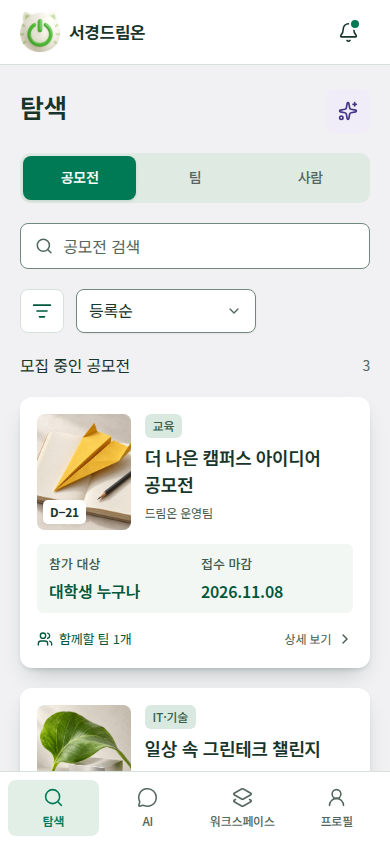 | 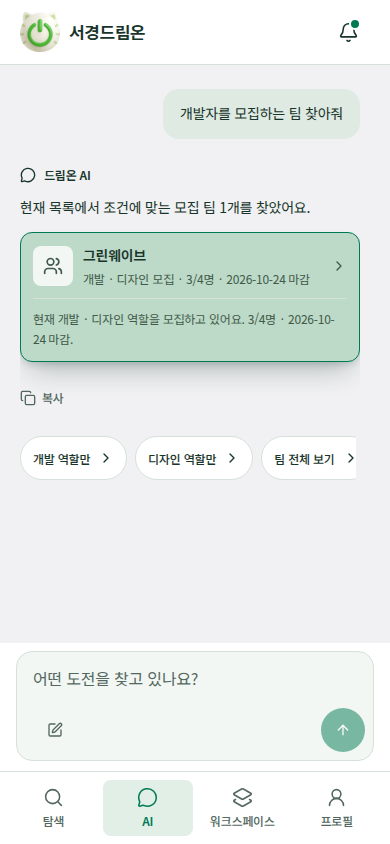 |

| 탐색 필터 · 390px | 카드 hover · 390px |
| --- | --- |
| 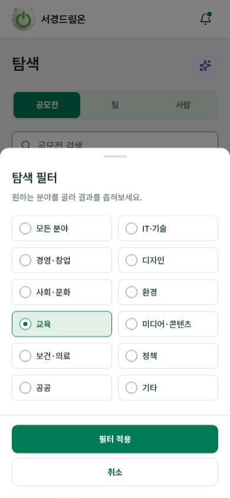 | 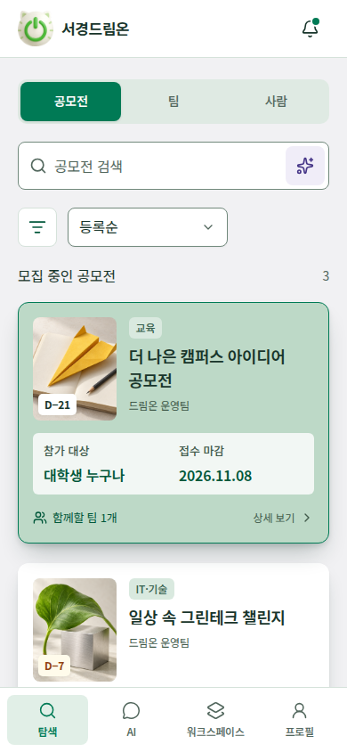 |

워크스페이스는 내 팀·내 지원 제목 옆에 작업 아이콘을 배치합니다. 카드에서는 역할과 확정 인원을 강조하고, 전체 카드를 누르면 팀 공간으로 이동합니다.

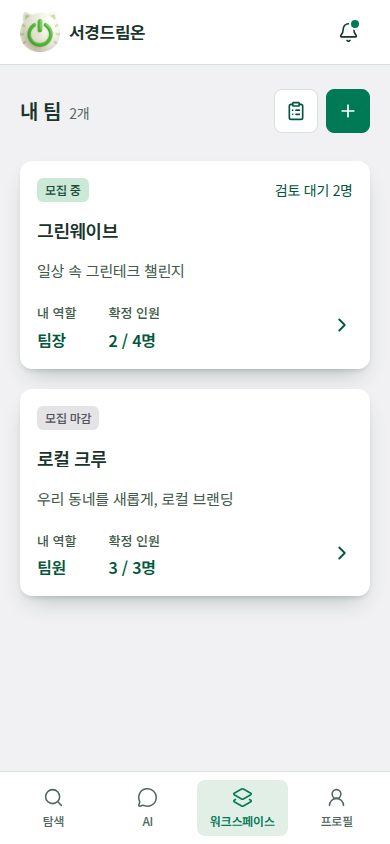

| 즉시 선발 확인 · 390px | 확정 팀원 · 390px |
| --- | --- |
| 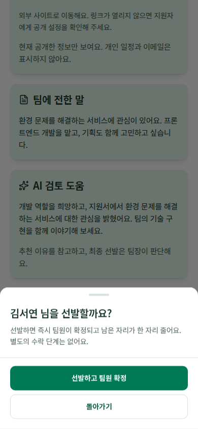 | 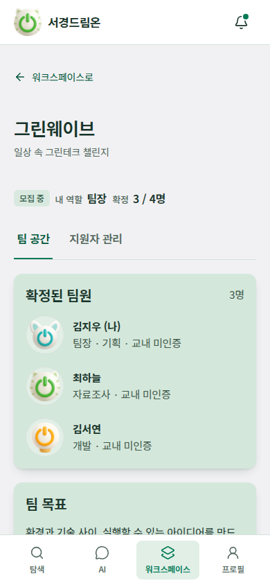 |

| 공개 설정 · 320px | 팀 생성 · 320px |
| --- | --- |
| 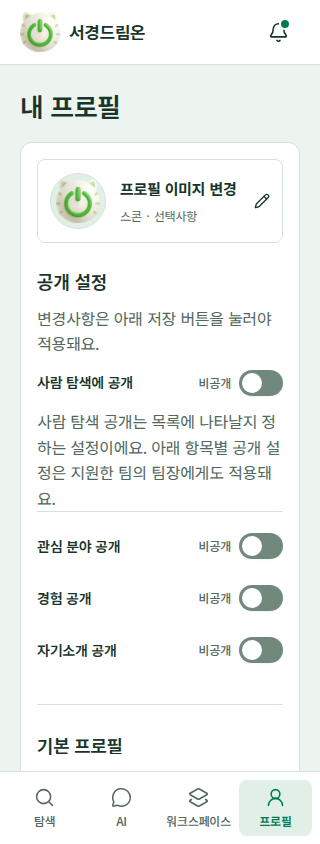 | 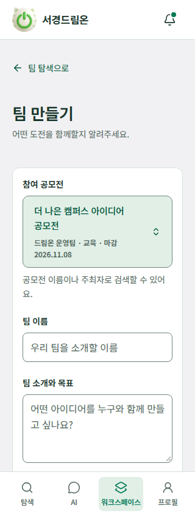 |

| 마스코트 선택 · 390px | 공모전 기본 커버 · 390px |
| --- | --- |
| 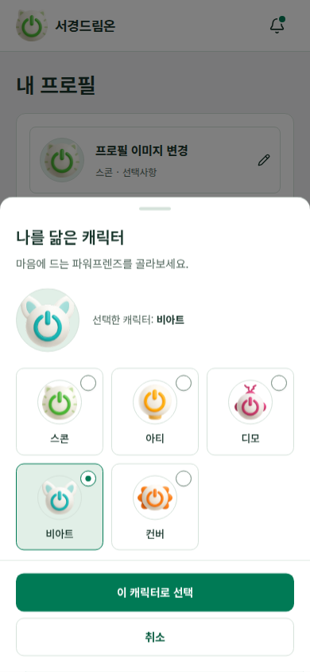 | 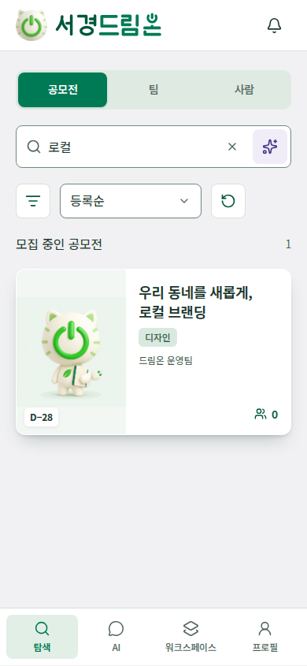 |

공모전 검색 팝업은 320px에서도 썸네일·이름·주최자·마감과 선택 표시를 함께 확인합니다.

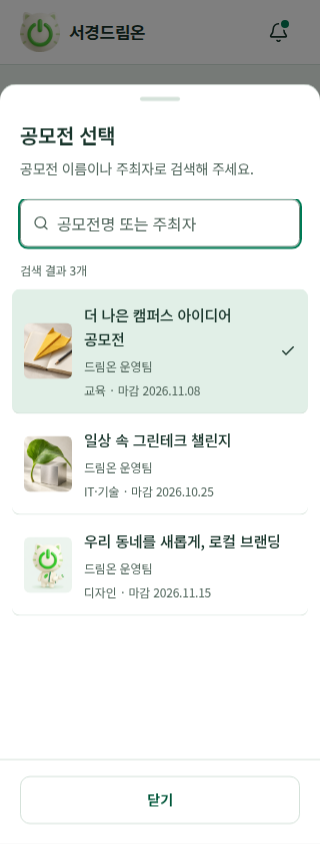

검색창의 AI 진입점과 프로필 카드의 수정·공개·미리보기 조작은 별도 페이지 제목 없이 사용할 수 있습니다. AI의 새 대화는 입력창 왼쪽 아래에 있습니다.

| 검색어 지우기·AI · 320px | 프로필 수정 진입 · 390px |
| --- | --- |
| 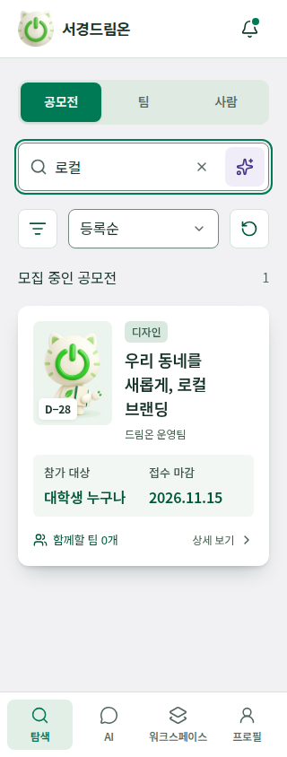 | 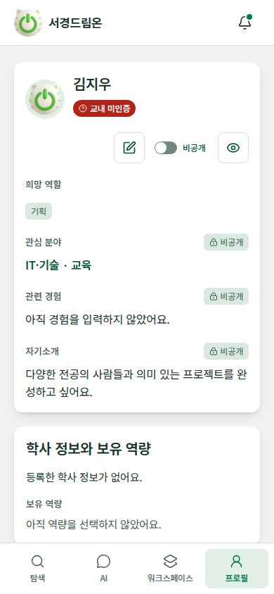 |

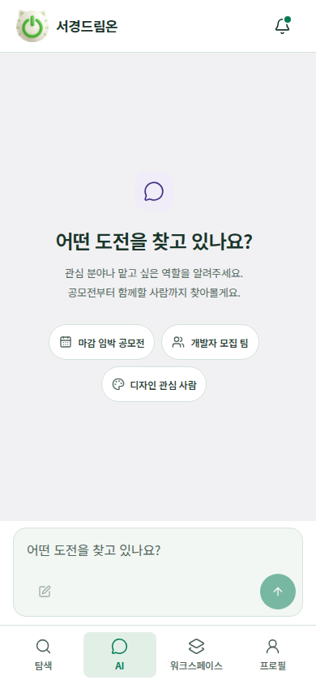

학교 인증 안내는 미인증 배지를 눌렀을 때만 표시합니다. 현재 계정의 인증 상태는 바꾸지 않습니다.

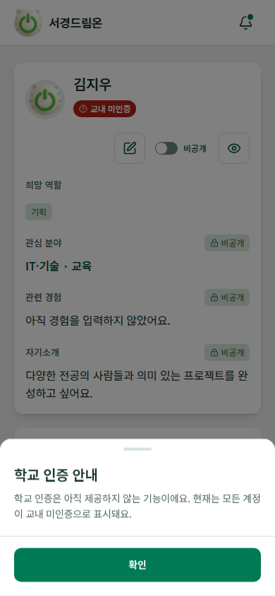
