

# UI 검증 기록

날짜·대상 앱별로 검증 당시의 코드·이미지·검사 결과를 보존합니다. 현재 화면·인터랙션의 기준은 `frontend/`이며, 아래 기록의 제품·레퍼런스 동시 반영은 당시 작업 내역으로서 이후 동기화 의무를 뜻하지 않습니다. 최신 구현 상태는 [구현 현황](../development/implementation-status.md)과 각 제품 PR에서 확인합니다.

회원가입의 현재 정책과 화면 검증은 [2026-10-31 회원가입 개선](#signup-20261031)을 참고합니다. 아래 2026-10-19 기록의 15자 정책은 당시 검증 결과입니다.

## 2026-11-01 탐색 목록·공통 화면 정리

`develop` 기준 `7f1ac30ddbba4c169582992730fbf51be3de30d7`에서 사용자 선택 시안 2와 후속 요청을 반영하고 제품 화면을 다시 검증했습니다. 흰 탐색 목록·얇은 녹색 구분선, 검색창 오른쪽 알림, 한 줄의 결과 수·종류·정렬·필터를 적용했습니다. 검색창 AI·탐색 팀 만들기·초기화 버튼과 공통 브랜드 헤더를 제거했습니다. 하단은 56px와 안전 영역을 유지하며 `팀` 표시 이름을 사용합니다. 하단 탐색은 전체 검색 조건을 기본값으로 되돌리고, 공개 팀 소개는 목록에서 두 줄·상세에서 전문을 표시합니다. 공모전 12개·팀/사람 6개와 처음/최대 5개 번호 정책은 유지합니다.

| 검사 | 결과 |
| --- | --- |
| 프론트 단위·화면 테스트 | 40개 파일·597개 테스트 통과 |
| 정적 검사·빌드 | 전체 ESLint·포맷·TypeScript·프로덕션 빌드 통과. 기존 500kB 청크 경고 유지 |
| 브라우저 | Playwright 목업 API 환경의 320·390·430px에서 가로 넘침 없음·런타임 오류 0건 |
| 공통 화면·이동 | 로그인 후 AI·팀·프로필, 브랜드 헤더 제거·56px 하단 메뉴·AI 입력 영역·하단 탐색의 검색 기본값 복귀 확인 |
| 팀 목록 | 소개 최대 높이 39px·두 줄 제한 확인. 긴 팀명·긴 소개·역할 6개를 넣은 320px 화면에서도 넘침 없음 |
| 후속 확인 | AI 상단 안전 영역과 실제 하단 탐색 클릭을 통한 IME 초기화 보완 후 탐색 테스트 56개·해당 ESLint/포맷·최종 빌드 통과 |
| 안전 영역 모의 검사 | 상단 44px·하단 34px을 대입한 390×844px·390×500px에서 AI 본문 상단 여백과 입력·하단 메뉴 배치 확인. 입력창 가림 없음. 실제 기기 검사는 미실행 |

이후 [PR #270](https://github.com/wejo-team/sku-dreamon/pull/270)이 반영된 `develop`의 `6f4168d4da21d3d933814796573ac4496eca396b`를 통합했습니다. 팀 화면의 명칭·상세 구성과 간격을 보존하고, 팀 본문 상단은 12px과 안전 영역 중 큰 값을 적용했습니다. 통합 후 탐색·팀 화면·권한 테스트 3개 파일의 113개 테스트와 320·390·430px 목업 브라우저 재검증을 통과했습니다. 위의 전체 597개 결과는 최초 기준 검증이며, 통합 이후의 별도 재검증과 구분합니다.

아래는 **이 작업의 제품 브라우저 캡처**입니다. 팀 320px 이미지는 DOM에 긴 내용을 넣은 표시 한계 검사이며 나머지는 기본 목업 자료입니다. 최신 통합본의 실제 API·DB 연결 E2E는 PR CI 재실행에서 확인하며 로컬 목업 검사와 구분합니다.

| 탐색 · 320px | 탐색 · 390px | 탐색 · 430px |
| --- | --- | --- |
| 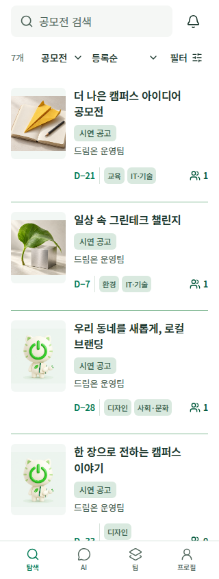 | 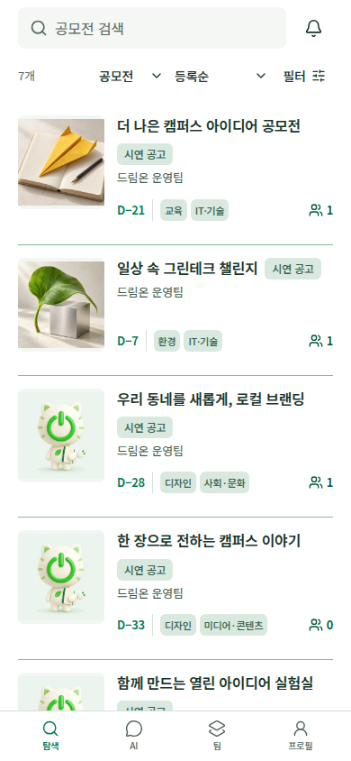 | 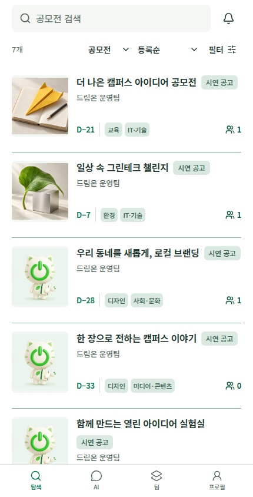 |

| 팀 목록 · 390px | 긴 내용 검사 · 320px |
| --- | --- |
| 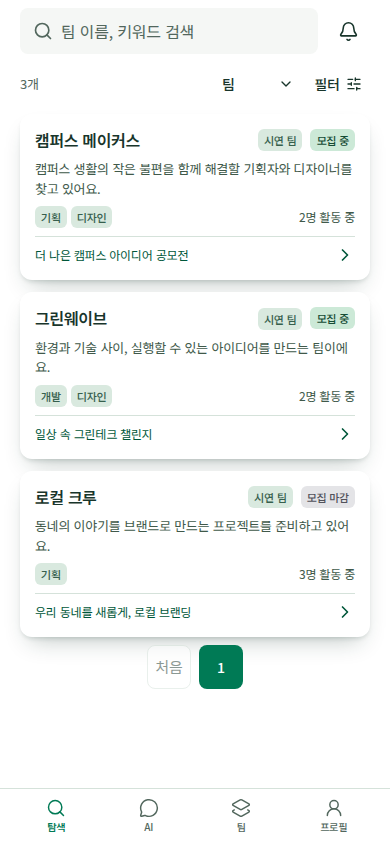 | 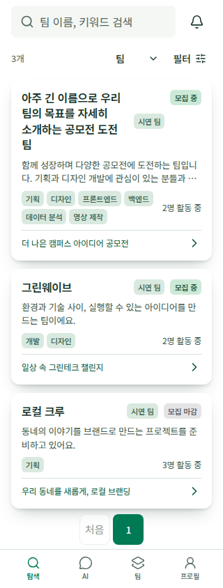 |

| AI · 390px | 내 팀 · 390px | 프로필 · 320px |
| --- | --- | --- |
| 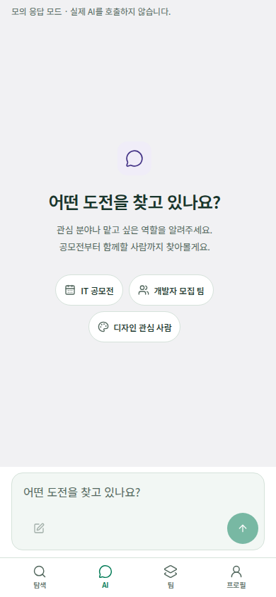 | 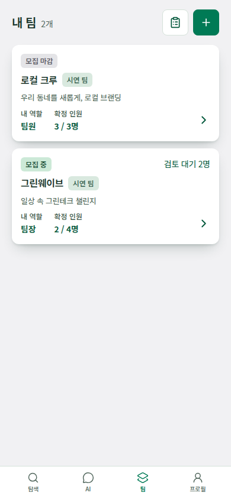 | 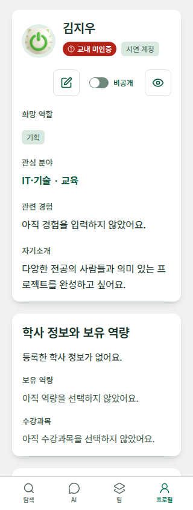 |

## 2026-10-19 독립 디자인 앱 기록 안내

2026-10-19 [문서 PR #93](https://github.com/wejo-team/sku-dreamon/pull/93)의 정책에 이어 [정책 PR #94](https://github.com/wejo-team/sku-dreamon/pull/94)의 모집 재개·동시 지원·폐기 정책을 저장소 디자인에 반영했습니다. 이번 실행 코드 기준은 [커밋 `14d59b9`](https://github.com/wejo-team/sku-dreamon/tree/14d59b968b3f0faeb88ba54db94dfca796c2382d/design-reference)입니다. **공유 GPT Sites는 이전 v13이며 이번 변경은 재배포하지 않았습니다.** 배포 버전과 저장소의 차이는 [명세 대조 기록](../specs/prototype-alignment.md#policy-follow-up)에서 구분합니다.

2026-10-19 레퍼런스 화면에 표시되는 데이터와 AI 응답은 로컬 예시입니다. 해당 검증은 당시 모바일 디자인과 상태 전이에 대한 결과이며 제품 인증·API·DB·LLM 구현 완료를 뜻하지 않습니다. 2026-10-28·2026-10-31의 제품 검증은 각 날짜의 절에서 구분합니다.

## 2026-10-28 페이지 이동 한 줄로 단순화

[사용자 후속 요청 #207](https://github.com/wejo-team/sku-dreamon/issues/207)에 따라 페이지 조작은 **처음 버튼 + 최대 5개 번호**의 한 줄(최대 6개)로 변경했습니다. 이전·다음·마지막 버튼은 제거했으며, 아래 #204 당시의 두 줄 구성을 대체합니다. 처음 버튼은 첫 페이지에서 비활성화되고 번호를 누르면 현재 페이지를 중심으로 번호 범위가 이동합니다.

320·375·480px 제품 화면에서 버튼 6개가 동일 높이의 한 줄로 표시되고 각 조작 영역이 44×44px임을 확인했습니다. 320px에서는 버튼 간격만 줄이며 가로 넘침·런타임 오류가 없었습니다. 키보드로 6→8페이지 이동 후 10페이지가 표시되는지, 처음 버튼으로 1페이지에 돌아올 때 팀 탭을 유지하는지 확인했습니다. 제품과 디자인 레퍼런스를 함께 반영했습니다.

| 한 줄 페이지 이동 · 320px | 한 줄 페이지 이동 · 480px |
| --- | --- |
| 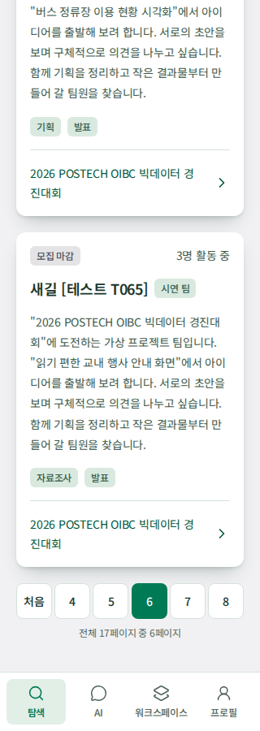 | 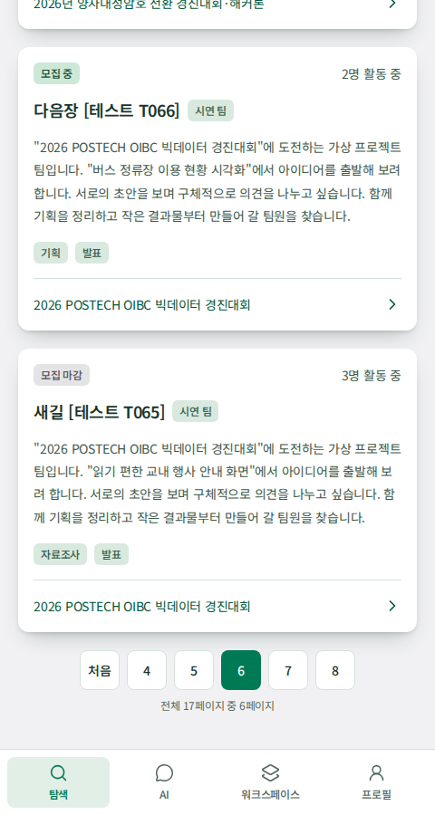 |

## 2026-10-28 탐색·지원자 관리 사용성 정리

[사용 피드백 #204](https://github.com/wejo-team/sku-dreamon/issues/204)에 따라 공모전 상세의 시각·시간대 보완 설명을 제거하고, 지원자 관리 목록을 지원 완료·검토 중으로 제한했습니다. 페이지 번호는 최대 5개로 늘리고 처음·이전·다음·마지막 이동을 다음 줄에 배치했습니다. 제품과 실행 가능한 디자인 레퍼런스에 함께 반영했습니다.

제품 브라우저를 320·480px에서 확인했습니다. 번호는 44×44px, 이동 버튼은 57×44px이며 가로 넘침·런타임 오류가 없었습니다. 키보드로 팀 탐색의 마지막→처음 이동 시 탭 유지와 경계 버튼 비활성화를 확인했습니다. 아래 화면은 로컬 개발 공고 데이터를 읽기 전용으로 조회한 제품 화면입니다. 지원 상태 변경 검증은 개발 DB와 분리한 테스트 DB에서 수행합니다.

| 페이지 이동 변경 전 · 320px | 변경 후 · 320px |
| --- | --- |
| 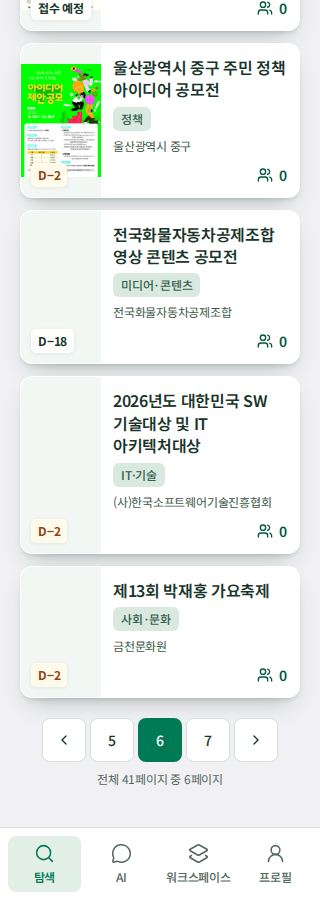 | 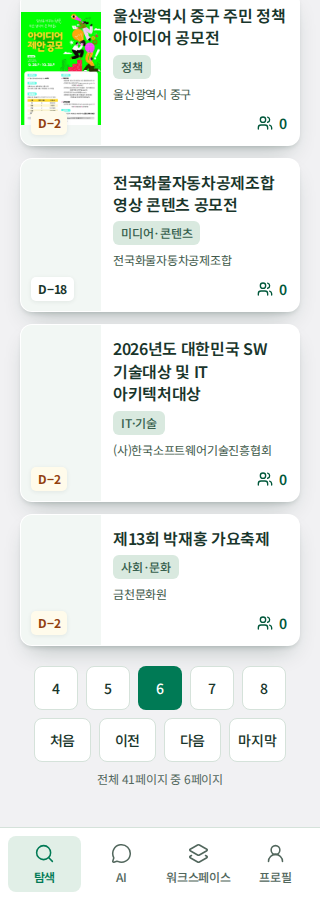 |

| 정보 확인 영역 변경 전 · 320px | 변경 후 · 320px |
| --- | --- |
| 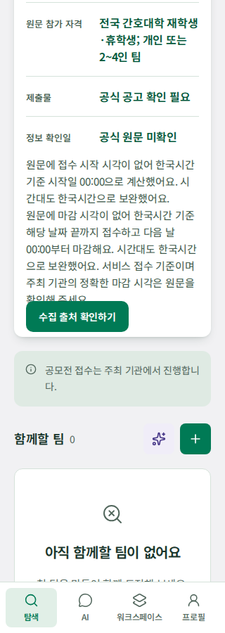 | 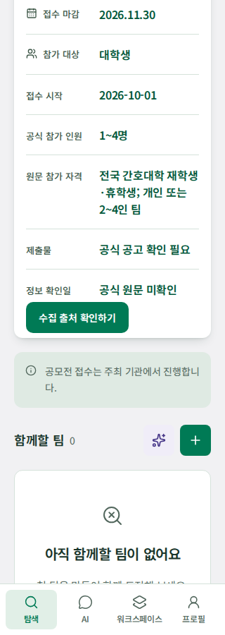 |

| 페이지 이동 · 480px | 공고 상세 · 480px |
| --- | --- |
| 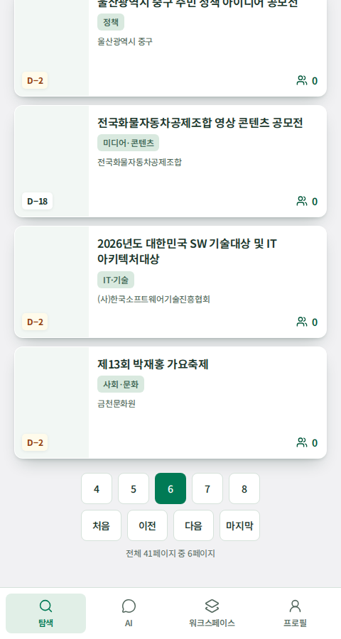 | 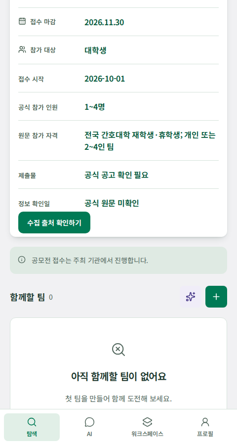 |

## 이번 변경의 확인 결과

이 절부터 「당시 검증의 범위와 현재 후속 작업」까지는 2026-10-19 레퍼런스 검증 기록입니다. 이후 보완 사항은 해당 항목과 날짜별 절에 기록합니다.

| 정책 | 디자인에서 확인한 근거 |
| --- | --- |
| TEAM AC-36 동시 지원·폐기 | 선발 성공 시 같은 공모전의 다른 대기 지원만 폐기. 다른 공모전·종결 이력·실패한 선발은 그대로 유지하는 상태 테스트 |
| TEAM AC-37 폐기 이력 | 본인/팀장 화면에 사유 표시, 대기 수·새 AI 후보·선발에서 제외, 선발 취소 후 자동 복원 없음. 기존 지원서 AI 검토·최신 프로필 재요청은 유지 |
| TEAM AC-38 명시적 재개 | 정원 충족 후 자리 반환만으로 자동 재개하지 않음. 팀장 확인 후 기한·공고·여석 검사. Drawer 취소 시 유지, 성공 후 모집 상태와 피드백 갱신 |
| TEAM AC-39 권한 | 현재 팀장만 모집 관리·지원자 관리에 접근. 팀장 변경·위임 기능을 추가하지 않음 |
| 참가 자격·운영 | 학적·학년·전공으로 자동 차단하지 않고 원문 확인 안내. 관리자 페이지·주최 측 조건 변경의 소급 처리는 TBD 유지 |

교차 검토에서 기존 지원서 검토와 새 선발 후보 추천의 조건이 섞여 있던 문제를 수정했습니다. 폐기·선발·미선발·취소여도 기존 지원 관계와 팀장 권한이 유지되면 AI 검토·재요청이 가능합니다. 권한이 없으면 저장된 결과와 요청 UI를 숨기며, 요청 완료 시에도 권한을 다시 확인합니다.

| 모집 재개 확인 · 320px | 폐기된 내 지원 · 390px |
| --- | --- |
|  |  |

## 정책 반영과 불일치 수정

| 영역 | 반영·검증한 동작 |
| --- | --- |
| 공모전 | 분야 최대 3개·대표 분야 없음, 참가 대상 4분류, 접수 예정/중/마감, 원문 시간대·시각 우선과 KST/날짜 끝 보완 계산. 상세의 시각·시간대 보완 설명은 생략하고 날짜·확인일·출처 링크 유지. 카드 숫자는 연결된 **모든 팀**이며 모집 필터는 상태·기한·남은 정원을 함께 확인 |
| 팀 생성 | 공식 고정 인원/범위/상한 없음에 맞는 정원, 범위 입력의 임의 기본값 제거, 1명인 팀은 역할·추가 모집 생략, 2명 이상은 역할 1~6개, 분야는 공모전 상속. 준비 모임 예외 제거 |
| 프로필 | 학적·학년 선택, 관심 1~3개·역할 1~2개·목록 내 역량, 기타 제거, 경험 3상태·본문 500자. 주당 시간은 모든 프로젝트 합산 4구간이며 미입력과 최저 구간 구분 |
| 입력 | 이름·소개·경험·포트폴리오 제목·팀명·팀 소개·지원 메시지 길이, 초과 붙여넣기 원문 보존과 필드 오류. 학사 종속값은 편집 초안에서 처리하고 취소 시 저장값 유지 |
| 공개·지원 | 비공개 신규 지원 차단, 공개 전환 설명·확인 후 별도 지원 제출. 비공개 전환 후 기존 지원·소속 유지, 일반 검색·AI 사람 추천 제외, 지원받은 팀장에게 현재 전체 프로필·AI 검토 허용 |
| 지원·검토 | 본인이 제출한 메시지 다시 보기, 최신 프로필 기반 검토 요청·실패·재시도, 마감·정원 충족 후에도 기존 지원 검토 가능. 선발/미선발/취소/폐기는 새 후보에서 제외, 선발 즉시 팀원·정원 반영 |
| 검토 결과 | 현재 세션의 화면 이동 후 결과 유지, 로그아웃 시 제거. 입력 정보가 바뀌면 이전 검토 결과임을 표시하고 재요청으로 갱신. 과거 결과를 자동으로 새 결과처럼 바꾸지 않음 |
| 인증 | 아이디 ASCII 영문 소문자·숫자 4~24자, 대문자/주변 공백 정규화, 밑줄·하이픈 금지. 비밀번호 NFC·15~128 코드 포인트·공백 보존·보기/숨기기. 공개 UI 테스트 계정은 인계 문서 참고 |
| AI 대화 | 로그인 전용, 메시지 1,000자 초과 보존·오류, 답변당 최대 3개·추가 요청. 본인/소속 팀·유효 중복 지원 팀 제외, 이전 추천 표시·복사에 현재 공개 범위·모집 조건 재검사 |
| 알림 | 지원 상태/신규 지원 두 종류의 실제 성공 전이별 기록. 이전 상태·읽음 보존, 재시도 중복 방지, 새 발생건은 새 미읽음. 브라우저 뒤로 알림함만 닫고 배경 경로 유지 |

## 실행 결과

| 검사 | 결과 |
| --- | --- |
| Vitest | 14개 파일·214개 테스트 통과 (`npm test -- --maxWorkers=2`). 기존 지원 AI 검토 권한 수정까지 반영한 최종 전체 실행 |
| 정적 검사 | 전체 ESLint·Prettier·TypeScript 통과 |
| 프로덕션 빌드 | 성공. 500kB 이상의 단일 JS 청크 경고는 유지되며 제품 구현에서 분할·실제 네트워크 성능 검증 필요 |
| 브라우저 | [검사 스크립트](https://github.com/wejo-team/sku-dreamon/blob/7f1ac30ddbba4c169582992730fbf51be3de30d7/design-reference/scripts/reference-check.cjs)로 Chromium 320×844·390×844·430×844 통과. 가로 넘침·런타임 오류 없음 |
| 화면 연결 | 로그인 공개 범위, 마감 공고, 필터 적용/취소, 카드·기본 이미지, 마스코트·프로필 저장, 공개 확인 후 지원·비공개 후 기존 지원 유지, 본인 메시지, 지원자 AI 검토·선발·팀원 반영, 대화 재시도, 알림 읽음 실패/재시도·뒤로 닫기 |
| 이번 상태 전이 검사 | 320·390·430px에서 `scenario=team-lifecycle`로 모집 재개 취소/확인, 모집 상태, 폐기된 내 지원·지원자 목록·상세, 기존 AI 검토 요청/재요청 표시·새 후보 제외 확인. 가로 넘침·런타임 오류 없음 |
| 이전 v13 추가 모바일 검사 | 320·390px에서 주당 4구간 각각 저장/취소, 정원 1명 팀·상한 없는 27명 팀 생성, 가입 초과값/비밀번호 보기, AI 1,001자 보존·오류 확인 |
| 독립 코드 검토 | 공모전/팀·프로필/인증·AI/알림 담당 분리 후 교차 검토. 이전 AI 결과와 현재 프로필이 섞여 보이는 문제를 발견해 변경 안내와 재검토 동작 보완 |

설치된 Chromium을 `CHROMIUM_PATH`, 로컬 브라우저 의존성을 `LD_LIBRARY_PATH`로 지정했습니다. 첫 실행의 브라우저 버전·라이브러리 경로 오류를 해결한 뒤 상호작용 검사를 수행했습니다. 일반 실행법은 [인계 문서](handoff.md#verification-commands)를 따릅니다.

## UI/UX 확인

`ui-ux-pro-max`의 입력 오류·명확한 상태·터치 영역·정보 계층 기준을 적용했습니다. 기존 회색 배경·흰 카드·녹색 선택 상태·서비스명과 마스코트를 유지했습니다. 초과 입력을 잘라 버리지 않고 오류와 원문을 함께 보여 주며, 공개 전환은 확인 전에 저장하지 않습니다. 제출 메시지는 화살표가 있는 펼침 조작으로 다시 볼 수 있습니다. AI 길이 오류와 입력창 포커스 외곽선이 겹친 문제는 위쪽 안쪽 여백으로 수정했고, 320·390px에서 글자가 외곽선 아래·하단 내비게이션 위에 표시됨을 다시 확인했습니다.

모바일 스크린샷에서 공개 전환 설명·하단 버튼, 좁은 화면의 폼 선택지·카운터, 지원서와 AI 검토 정보, 카드와 배경의 구분을 확인했습니다. 아래 이미지는 당시 코드의 실제 브라우저 기록이며, 현재 제품 인터랙션은 [제품 화면 소스](screens.md)에서 확인합니다.

| 탐색 · 390px | 내 지원 메시지 · 390px |
| --- | --- |
|  |  |

| 프로필 입력 · 320px | 팀 생성 · 320px |
| --- | --- |
|  |  |

| 공개 전환 확인 · 390px | 비공개 전환 확인 · 390px |
| --- | --- |
|  |  |

| 지원자 검토 · 390px | AI 대화 · 390px |
| --- | --- |
|  |  |

## 당시 검증의 범위와 현재 후속 작업

- 실제 계정 발급·유출 비밀번호 DB·세션, 서버 권한·영구 저장·기기 동기화·다중 사용자 동시 선발·LLM 실행은 별도 제품 구현입니다.
- 위 실행 수치·화면은 2026-10-19 기록입니다. 이후 확정된 공고 마감 전 선발 기준과 제품의 인증·AI·알림 구현을 당시 미정 상태로 해석하지 않습니다. 현재 미완료 범위는 [화면별 구현·후속 구분](screens.md#remaining-decisions)과 [제품 구현 현황](../development/implementation-status.md)을 따릅니다.
- 실제 모바일 기기·소프트 키보드·보조 기술 및 네트워크 성능 전체를 검증한 결과는 아닙니다. 제품 명세의 AC 완료 체크를 변경하지 않습니다.

## 2026-10-31 회원가입 개선

[인증 AC-17](../specs/authentication.md#acceptance-criteria)에 따라 제품과 레퍼런스의 가입 비밀번호를 8~128자·기호 포함으로 변경했습니다. 계정 정보와 기본 프로필을 구분하고 반복 설명을 삭제했습니다. `8자 이상`·기호 조건을 체크로 표시하고 한글·공백은 즉시 오류로 안내합니다. 상한 128자는 검증에서 유지합니다. Caps Lock 켜짐을 감지하면 입력 중에만 표시합니다. 기존 비밀번호의 로그인 호환성은 서버 PR에서 검증합니다.

| 검사 | 결과 |
| --- | --- |
| 제품 프론트 | 전체 31개 파일, 516개 테스트 통과. 계정 전환 회귀 테스트의 가입 데이터도 새 정책에 맞춤 |
| 디자인 레퍼런스 | 계정 화면·입력 정책 2개 파일, 59개 테스트 통과 |
| 정적 검사·빌드 | 두 앱의 ESLint·Prettier·TypeScript·프로덕션 빌드 통과. 기존 500kB 청크 경고 유지 |
| 브라우저 | 제품과 변경된 실제 로컬 서버·격리 DB를 연결해 320×900·390×900·1280×900 확인. 가로 넘침·런타임 오류 없음 |
| 입력 동작 | 한글/공백 즉시 오류·원문 보존·129자 최소조건 충족과 별도 상한 오류·Caps Lock on/off/blur·8자 실제 가입 201·세션 조회 200 확인. 단위 테스트로 NFC·고정 Unicode 15.1 기호·차단 예시·보기/숨기기 회귀 확인 |
| 기호 호환성 | 생성 표의 전체 코드 포인트를 서버 Unicode 15.1과 대조. 제품·레퍼런스 동기화와 최신 Unicode 기호 회귀 검증 포함, Python 도구 테스트 69개 통과 |
| 접근성 | 라벨과 도움말 연결, 조건별 아이콘·상태 텍스트·live 안내, 보기/숨기기 44px 터치 영역 확인 |

브라우저 확인은 변경된 실제 로컬 서버와 격리 DB에 연결했으며 운영 배포 검증을 대체하지 않습니다. Caps Lock은 합성 키보드 이벤트로 표시·해제를 검사했습니다. 실제 하드웨어 키 상태, 모바일 기기의 키보드와 스크린리더 음성 출력은 확인하지 않았습니다. 아래 이미지는 제품 앱에서 가상 입력값으로 촬영했습니다.

| 320px | 390px |
| --- | --- |
| 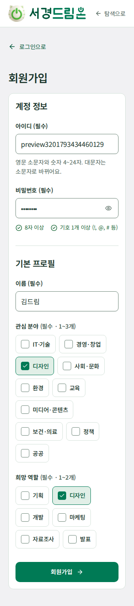 | 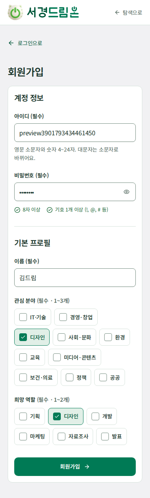 |

1280px 화면도 같은 모바일 중심 레이아웃을 유지합니다.

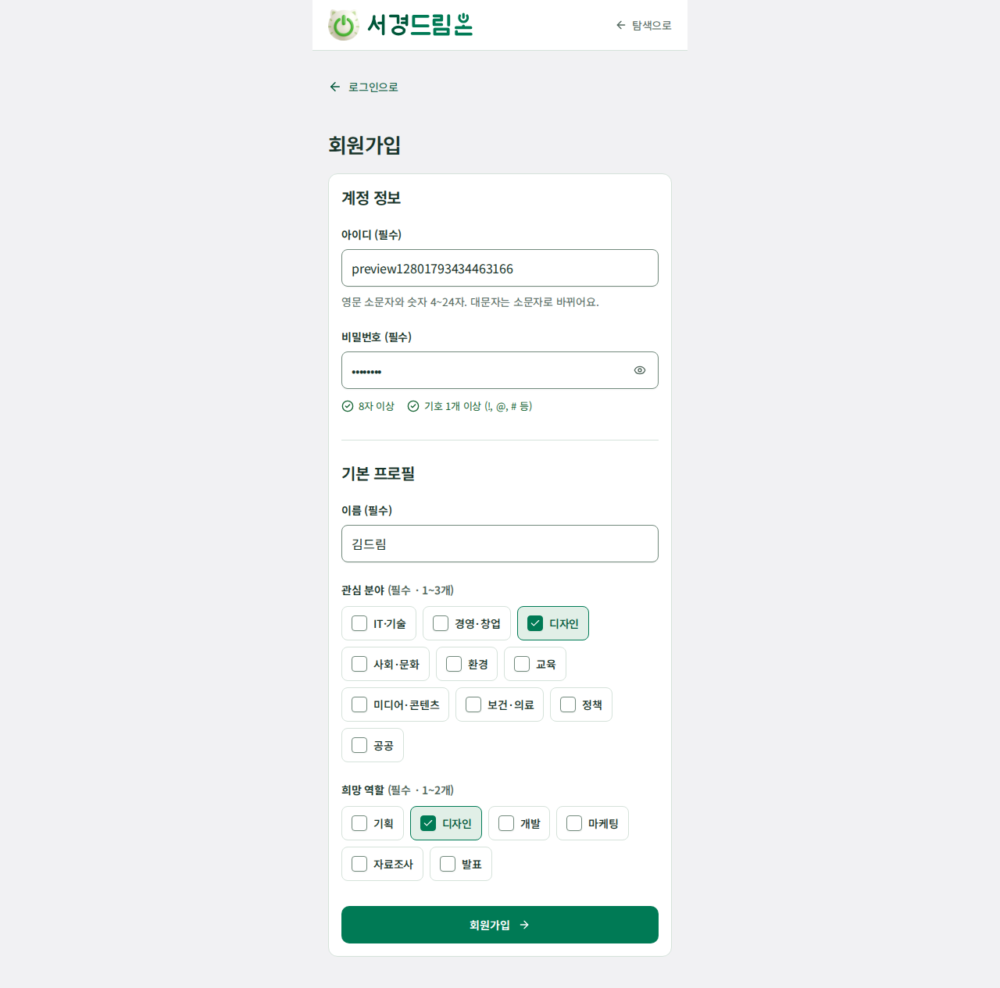
