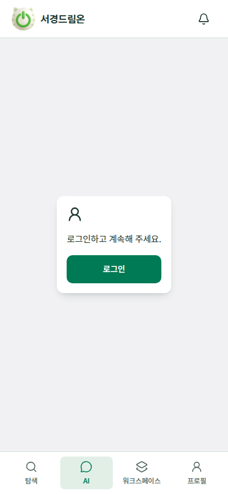
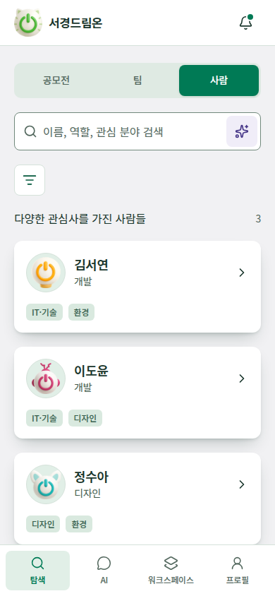
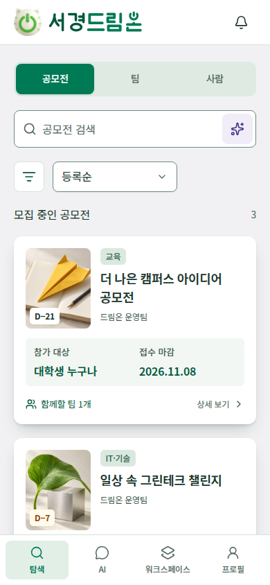
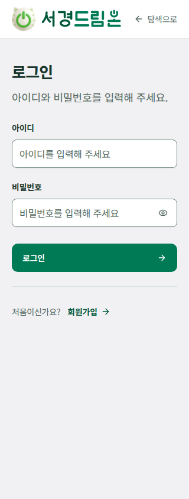
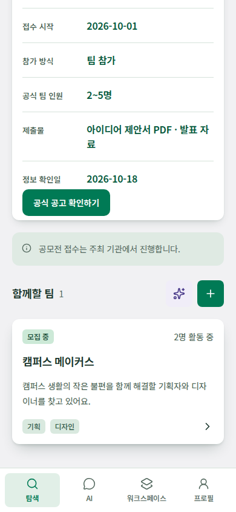
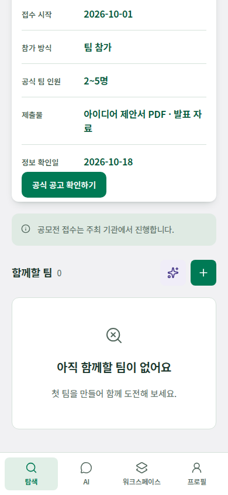
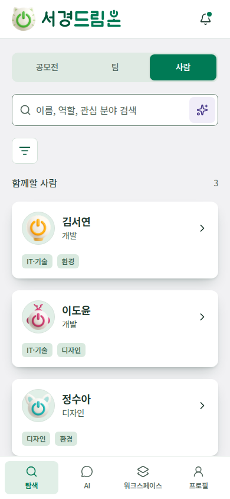
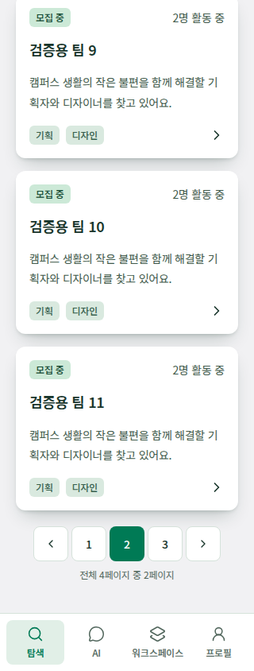

# 공식 디자인 검증 기록

2026-10-19에는 프로필의 항목별 공개 설정을 하나의 공개·비공개 상태로 통합하고, 전환 전에 설명·확인 팝업을 제공합니다. 공개이면 로그인한 사용자가 등록된 모든 항목을 확인하고, 비공개이면 일반 검색·AI 사람 탐색·일반 상세 주소에서 제외합니다. 지원받은 팀장은 공개 상태와 관계없이 전체 현재 프로필을 확인합니다. 정책 변경은 병합 전인 [문서 PR #75](https://github.com/wejo-team/sku-dreamon/pull/75)에 정리되어 있습니다.

AI는 로그인 후에만 이용하며 공모전·팀·사람 검색창 모두에 진입 아이콘을 둡니다. 워크스페이스의 모집 중 배지는 녹색, 모집 마감·정원 마감 배지는 회색으로 구분합니다. 프로필 이미지 선택창은 큰 장식 제목 대신 작은 설명을 사용하고, 접근성용 제목과 선택·적용·취소 동작을 유지합니다. 회색 화면 배경·흰 기본 카드·녹색 선택 상태와 기존 상단 공간 정리는 유지합니다.

재생성 가능한 검증 원본은 [탐색 테스트](../../design-reference/src/features/design-preview/ExplorePages.test.tsx)·[프로필 테스트](../../design-reference/src/features/design-preview/AccountPages.test.tsx)와 [브라우저 검사 스크립트](../../design-reference/scripts/reference-check.cjs)이며, 화면은 같은 변경 PR에 포함된 코드 기준입니다.

## 실행 결과

| 검사 | 결과 |
| --- | --- |
| 고정 의존성 `npm ci` | 이전 검증에서 성공. 이번에는 의존성 변경 없이 기존 설치를 사용했으며 재실행하지 않음 |
| `npm test` | 최종 수정 후 9개 파일·133개 테스트 통과 |
| ESLint·Prettier | 최종 수정 후 전체 검사 통과 |
| TypeScript·production build | 최종 수정 후 통과, 단일 JS 청크 675.75kB. 500kB 초과 경고는 남아 있으며 제품 구현 시 분할·실제 네트워크 성능 검증 필요 |
| `npm run check:ui` | 이번 변경에서 Chromium 320×844·390×844·430×844 통과. 기존 탐색·생성·프로필·지원·선발·AI·알림과 필터·워크스페이스 흐름 확인 |
| 공개 전환·전체 프로필 | 별도 브라우저 320·375·390·430px에서 전환 설명·확인·취소·Escape·포커스 복귀 확인. 공개 프로필의 등록 항목·시간·포트폴리오 표시, 비공개의 일반 검색·직접 상세 차단, 지원 팀장의 전체 현재 프로필 열람 확인 |
| AI 로그인·진입 | 같은 네 모바일 폭에서 비로그인 AI 접근 제한·로그인 후 복귀, 공모전·팀·사람 검색창의 AI 아이콘 확인. AI 대화는 로그인 후 제공하며 실제 LLM을 호출하지 않음 |
| 모집 상태·프로필 이미지 | 같은 네 모바일 폭에서 모집 상태별 배경색과 문구, 마스코트 선택창의 작은 설명·접근성용 제목·선택과 취소 확인 |
| 기존 연결·예외 흐름 | `check:ui`에서 비로그인 사람 차단, 마감 공고 읽기 전용, 프로필·팀 생성, 선발 즉시 팀원·정원 반영, AI 실패/재시도, 알림 실패/재시도 확인 |
| 마스코트·기본 커버 | 5종 원본 PNG와 기본 스콘, 선택·취소·저장·공개 프로필 반영, 공모전 이미지 없음·로드 실패 fallback을 기존 브라우저 검사와 최신 재검사에서 확인 |
| 키보드·작은 높이 | 320×568·667×375 가로 화면에서 공개 전환 팝업의 하단 버튼·취소 후 포커스 복귀, 마스코트 마지막 선택지·적용 버튼 접근 통과. 390×844에서 팝업 제목·설명을 CSS로 150% 확대해 배치 확인. 실제 기기 확대 검증은 아님 |
| 색상 대비 | 모집 중 #164c35/#cce9d7은 7.65:1, 마감 #52525b/#e4e4e7은 6.09:1. 인증 배지 흰 글자는 미인증 빨강 6.57:1·인증 파랑 6.70:1. 주요 버튼·선택 탭 흰 글자 5.36:1. 카드 보조 글자 #40594a는 기본·hover·누름 면에서 7.65:1·5.07:1·4.61:1, 녹색 값 #00573a는 각각 8.66:1·5.74:1·5.22:1. 흰 조작 면의 기본 보조 글자는 6.07:1 |
| 카드와 배경 | 배경 #f1f1f3 유지. 기본 카드 #ffffff, hover #bdd9c7·누름 #b2d0bd와 녹색 테두리·아래쪽 그림자 적용. 모집 상태 배지의 색을 달리해도 카드 전체의 기본 면은 유지 |
| 정보 계층 | 키는 13px/500 보조색, 값은 16px/600 녹색, 긴 설명은 16px/400 본문 색상. 빈 역량 안내의 불필요한 굵기를 제거하고 긴 설명의 줄바꿈을 정리 |
| 레퍼런스 화면 | 최신 브라우저 검사에서 모바일 가로 넘침·런타임 오류 없음. 기본 화면은 포인터를 카드 밖에 둔 상태로, hover는 별도 화면으로 기록 |
| 독립 코드 검토 | 공개/비공개 조회·지원 팀장 예외·AI 로그인 범위에서 중요 발견 사항 없음. 서버 권한 검증을 대신하지 않음 |
| 문서 | 최신 스크린샷을 포함한 원본 링크·앵커, VitePress 빌드·생성 링크·자산 검사 통과. 문서 도구는 변경하지 않음 |

브라우저 검사는 설치된 Playwright/Chromium을 환경 변수로 지정해 실행했습니다. 일반 설치·수동 실행 명령은 [인계 문서](handoff.md#verification-commands)를 따릅니다. 실제 기기의 키보드·보조 기술, 서버 권한, 다중 사용자 동시 선발, 영구 저장과 실제 LLM 품질은 검증 대상이 아닙니다. 이 결과는 기능 명세 AC의 제품 구현 완료를 의미하지 않습니다.

## UI/UX 점검

`ui-ux-pro-max` 기준으로 접근성·터치 조작·상태 구분·정보 계층·모바일 배치를 확인했습니다. 점검에서 발견한 문제와 반영한 변경은 다음과 같습니다.

| 발견 사항 | 반영 |
| --- | --- |
| 공개 스위치와 DrawerTrigger가 같은 `data-state`를 사용해 실제 공개 상태와 시각 상태가 충돌 | 스위치 상태와 팝업 상태를 분리하고, 확인·취소·Escape 이후 상태와 트리거 포커스 복귀를 다시 확인 |
| 비어 있는 역량 안내가 실제 입력 값처럼 굵게 표시 | 보조 안내의 일반 굵기로 조정해 실제 값과 구분 |
| 긴 공개 안내와 프로필 설명의 모바일 줄바꿈 | 좁은 폭에서도 문장·조작을 읽을 수 있도록 정리 |
| 모집 중과 마감 상태의 배경이 유사 | 녹색·회색 배경을 구분하면서 상태 문구를 유지해 색상만으로 의미를 전달하지 않음 |

위 결과는 검토한 화면·상태에 대한 점검이며 모든 화면의 자동 접근성 감사, 실제 모바일 보조 기술 검증이나 제품 서버의 권한 검증 완료를 뜻하지 않습니다.

## 모바일 화면

이미지는 빠른 리뷰를 위한 기록입니다. 공식 인터랙션은 저장소 앱을 실행해 확인합니다.

| 탐색 · 390px | AI · 390px |
| --- | --- |
|  |  |

| 탐색 필터 · 390px | 카드 hover · 390px |
| --- | --- |
|  |  |

워크스페이스는 내 팀·내 지원 제목 옆에 작업 아이콘을 배치합니다. 모집 중은 녹색, 모집 마감·정원 마감은 회색 배지로 구분합니다. 카드에서는 역할과 확정 인원을 강조하고, 전체 카드를 누르면 팀 공간으로 이동합니다.

| 즉시 선발 확인 · 390px | 확정 팀원 · 390px |
| --- | --- |
|  |  |

| 프로필 입력 · 320px | 팀 생성 · 320px |
| --- | --- |
|  |  |

| 마스코트 선택 · 390px | 공모전 기본 커버 · 390px |
| --- | --- |
|  |  |

공모전 검색 팝업은 320px에서도 썸네일·이름·주최자·마감과 선택 표시를 함께 확인합니다.

세 탐색 탭의 검색창 AI 아이콘과 프로필 카드의 수정·공개·미리보기 조작은 별도 페이지 제목 없이 사용할 수 있습니다. 공개·비공개 전환은 설명 팝업에서 확인한 뒤 반영되며 항목별 설정은 없습니다. AI의 새 대화는 로그인한 화면의 입력창 왼쪽 아래에 있습니다.

| 검색어 지우기·AI · 320px | 프로필 수정 진입 · 390px |
| --- | --- |
|  |  |

학교 인증 안내는 미인증 배지를 눌렀을 때만 표시합니다. 현재 계정의 인증 상태는 바꾸지 않습니다.

| 공개 전환 확인 · 390px | 비공개 전환 확인 · 390px |
| --- | --- |
|  |  |

| AI 로그인 안내 · 390px | 사람 탐색의 AI 진입 · 390px |
| --- | --- |
|  |  |

지원받은 팀장은 지원자 상세에서 공개 설정과 관계없이 등록된 전체 프로필을 확인합니다.

## 서비스명 워드마크

2026-10-19에 일반 서비스명 텍스트를 전용 SVG 레터링으로 바꿨습니다. 둥근 한글 획과 `온`의 전원 모양을 사용하며 기존 마스코트는 유지합니다. 헤더·시작 화면·로그인 소개에 같은 원본을 적용했습니다. 벡터는 폰트·외부 참조·래스터 없이 독립적으로 표시됩니다.

320·375·390·430px에서 이미지 로드·가로 넘침 없음·로고의 탐색 이동·알림 열기/닫기를 확인했습니다. 320px 로그인에서도 로고와 `탐색으로` 링크가 겹치지 않습니다. 링크의 접근성 이름과 44px 이상의 터치 영역을 유지합니다. 변경 파일 ESLint·Prettier·TypeScript·빌드와 문서 검사를 수행했으며, 자산·표현만 바꿔 동작 테스트를 추가하거나 전체 133개 테스트를 재실행하지 않았습니다. 이 변경의 JS 빌드는 676.03kB로 기존 번들 경고는 유지됩니다.

| 탐색 · 390px | 로그인 · 320px |
| --- | --- |
|  |  |

## 공모전 탐색 카드의 포스터 배치

2026-10-19에 공모전 카드를 왼쪽 세로 포스터와 오른쪽 요약으로 바꿨습니다. 이미지 아래 문구를 없애고 제목·분야·주최자 순서로 배치했습니다. 우하단에는 팀 아이콘과 현재 모집 중인 팀 수만 표시합니다. 별도 상세보기 문구·화살표와 접수 마감·참가 대상 요약을 제거했으며, D-day와 상세 화면의 정확한 마감일·참가 대상은 유지합니다.

320·375·390·430px에서 가로 넘침·런타임 오류 없음, 카드 전체 클릭·키보드 Enter 이동·복귀, 녹색 hover·포커스·누름 상태를 확인했습니다. 320px의 긴 제목·주최자와 150% 글꼴에서 내용이 겹치지 않고 카드가 늘어납니다. 기본 이미지와 이미지 로드 실패 대체를 확인했고, 브라우저에서만 제공한 2:3 포스터 fixture로 원본 비율·테두리가 잘리지 않는지 확인했습니다. 현재 정사각형 예시 커버는 포스터 영역 안에 여백을 두고 표시합니다.

탐색 테스트 29개, 변경 파일 ESLint·Prettier, TypeScript·프로덕션 빌드를 통과했습니다. 독립 화면 검토에서 차단 이슈가 없었고 `impeccable detect --scope layout`의 변경 전·후 기계 검사도 발견 사항이 없었습니다. 상세·팀 탐색·사람 탐색·공모전 선택창의 레이아웃은 변경하지 않았습니다.

## 탐색 페이지 번호와 공모전 상세의 팀 목록

2026-10-19에 사람 목록 제목을 `함께할 사람`으로 바꾸고 공모전·팀·사람 탐색에 페이지 번호 이동을 적용했습니다. 현재 레퍼런스는 한 페이지 6개이며 운영 페이지 크기·API·DB 집계 계약은 별도입니다. 조건 변경 시 1페이지로 돌아가고, 상세 왕복 시 조건·페이지를 유지합니다. 비로그인 사람 탐색에는 결과 수와 페이지 조작을 표시하지 않습니다.

공모전 상세에는 해당 공모전의 팀 카드가 바로 표시됩니다. 팀 찾기 버튼을 제거하고 AI·생성(+)을 44px 아이콘으로 배치했습니다. 팀이 없으면 첫 팀 생성을 권하며, 개인 전용 공고는 준비 모임으로 안내합니다. 마감 공고에서는 생성·AI·생성 권유를 숨기고 공개 정보는 유지합니다. 팀 카드는 탐색과 공통 컴포넌트를 사용하며 상세에서는 공모전명을 반복하지 않습니다.

- Vitest 10개 파일·155개 테스트: 다수 결과의 페이지 분리, 조건·복귀 경로 유지, 조건 변경 초기화, 잘못된 페이지 보정, 해당 공모전 팀만 표시, 아이콘 접근성 이름과 빈 상태를 포함합니다.
- ESLint·Prettier·TypeScript·프로덕션 빌드를 통과했습니다. 기존 단일 JS 청크 크기 경고(680.13kB)는 유지됩니다.
- 기존 `check:ui` 흐름은 Chromium 320·390·430px에서 통과했습니다. 추가 독립 브라우저 검토에서 상세의 팀 목록·열린/닫힌 공고·개인 전용·빈 결과·사람 제목과 페이지 조작을 확인했습니다. 가로 넘침·런타임 오류가 없고 각 조작 영역은 44×44px입니다.
- 브라우저 응답만 임시로 19개 팀으로 확장해 4페이지·페이지 이동·원래 공모전/탐색 복귀 정보를 확인했습니다. 2페이지 이동 후 팀 목록 제목으로 포커스가 이동하고 상단 88px 여백이 유지됩니다. 320px의 150% CSS 글꼴 확대에서도 가로 넘침이 없었습니다. 이 fixture는 앱 데이터나 배포에 포함하지 않습니다.
- 선택 페이지 글자색의 스타일 경합을 수정했습니다. 최종 흰 글자/녹색 배경 대비는 5.36:1이며 전체/현재 페이지 설명을 숫자 아래에 표시합니다. layout detector 전후 발견 사항은 없었습니다.

| 공모전 상세의 팀 · 390px | 열린 공고의 빈 팀 · 390px |
| --- | --- |
|  |  |

| 사람 탐색 · 390px | 여러 페이지 검증 · 320px |
| --- | --- |
|  |  |
