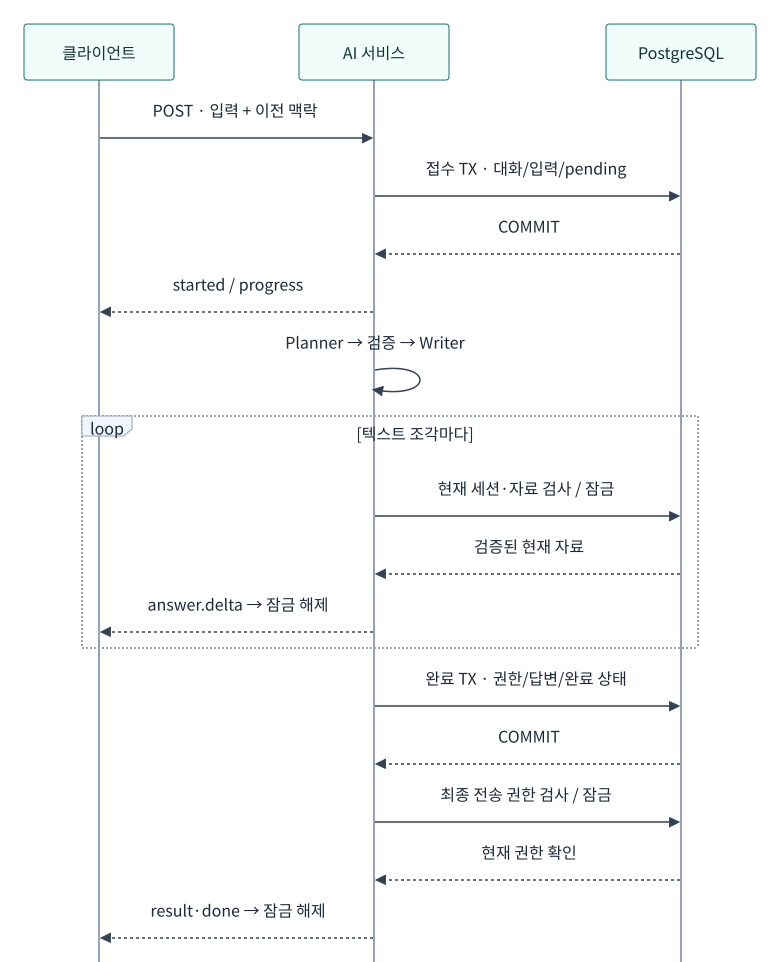

# AI 에이전트 아키텍처

현재 백엔드 구현을 읽고 수정하기 위한 문서입니다. 사용자 동작은 [추천 명세](../specs/matching.md), 설계 결정·후속 작업은 [SDD](../development-plans/ai-agent.md), 전송 계약은 [AI API](../api/ai.md), 테이블·제약은 [AI 저장](../database/ai.md)이 원본입니다. 프론트 연결·대화 기록 조회 API·운영 배포는 포함하지 않습니다.

## 구성과 실행 흐름

[그림 크게 보기](diagrams/ai-flow.svg) · [Mermaid 원본](diagrams/ai-flow.mmd)

보라색은 **Luna 호출**, 초록색은 **서버의 처리·검증**, 노란색은 **완료 저장**입니다. 입력 가드가 현재 사용자 요청을 허용한 뒤 단일 ReAct 에이전트가 자료 조회와 최종 답변을 이어갑니다. 서버의 필수 검증을 통과한 최종 호출의 텍스트만 즉시 전송하고, 생성 완료 후 저장과 최종 결과 전송으로 이어집니다. 대화 원문 저장은 일반 채팅에만 적용합니다.

별도 worker·작업 큐 없이 요청을 받은 FastAPI 프로세스가 실행합니다. [앱 수명](../../backend/app/main.py) 동안 모델 클라이언트를 공유하지만 대화·검증 상태는 실행별 객체에 둡니다. 요청마다 [create_agent](../../backend/app/agents/factory.py)의 그래프 하나와 목적별 도구를 구성하며 LangGraph 영속 checkpointer·store는 연결하지 않습니다. 서버 재시작 뒤 중단된 그래프를 재개하지 않습니다.

## 입력 가드와 단일 ReAct의 책임

| 단계 | 입력과 출력 | 책임 |
| --- | --- | --- |
| 입력 가드 middleware | 현재 사용자 발화·최근 사용자 발화 최대 6개(각 1,000자) → 허용/정책 사유 | 정규식은 의미 분류의 참고 신호이며 단어만으로 차단하지 않음. 도구 없는 Luna가 구조화된 판정만 반환 |
| 읽기 단계 | 허용된 요청·이전 사용자 발화·현재 권한으로 다시 읽은 이전 결과 → 읽기 도구 호출 | `tool_choice=required`, 한 번에 도구 하나. 텍스트·추론·도구 JSON을 제품 스트림에 보내지 않음 |
| 필수 서버 게이트 | `prepare_recommendations(RecommendationPlan)` → 확정 후보 | 관찰된 실제 ID·중복·목적·일반 채팅 카드 3개·현재 권한 검증. 서비스가 계획·선택 자료·참조를 복사해 고정 |
| 같은 에이전트의 최종 단계 | 확정된 후보·근거 → 텍스트 토큰 | 도구를 제거하고 최종 모델 호출을 내부 태그로 구분. 텍스트 블록만 즉시 전달 |

모든 호출은 설정된 `gpt-6-luna`를 사용합니다. 가드는 Planner가 아니며 별도 Writer도 없습니다. `RecommendationPlan`은 필수 제어 도구의 검증 schema입니다. 후보 없는 도움말·확인 질문도 빈 목록을 게이트에 제출합니다. 모델이 게이트 없이 끝내거나 여러 도구를 동시에 호출하거나 잘못된 인자를 제출하면 `invalid_output`으로 실패합니다. 최종 단계에서는 더 이상 도구를 호출할 수 없습니다.

[입력 가드](../../backend/app/agents/guards.py)는 매 사용자 메시지를 먼저 검사하고, 허용 후에만 이전 결과의 자료를 재조회합니다. `TargetStart`에는 사용자 자유 입력이 없어 고정된 서버 요청을 사용합니다. 프롬프트·비밀 유출, 지시·권한 덮어쓰기, 모욕·괴롭힘 생성과 무관한 범용 요청을 구분합니다. 정당한 인용·신고·불만과 AI·앱·보안 공모전 탐색은 허용 대상입니다. 정확한 범위는 [입력 정책](../specs/matching.md#input-guard)이 원본입니다.

정책 거절은 새 자료 조회·자유 생성 없이 빈 후보를 서버에서 검증하고 고정 안내를 반환합니다. 일반 채팅의 정상 `succeeded` 결과와 저장 규칙을 따릅니다. 분류기 장애·시간 초과·잘못된 응답은 `temporary_failure`이며 허용으로 간주하지 않습니다. 클라이언트의 역할·권한 주장과 이전 발화는 데이터이며 실제 권한은 서버가 결정합니다.

최종 텍스트의 추가 LLM 검토·문장/전체 답변 버퍼링은 없습니다. 모델 내용의 사실성·추천 품질 전체를 결정론적으로 보장하는 구조는 아닙니다. 첫 텍스트 전에 가드·자료 조회·검증 지연이 있으며 기존 `searching → validating → writing` 진행 이벤트를 유지합니다. `validating`·`writing`은 게이트 성공 후 첫 텍스트 직전에 전달됩니다.

[프롬프트](../../backend/app/agents/prompts.py)는 자유 텍스트의 지시를 자료로 취급하고 고정 점수·자동 선발을 금지합니다. 참가 자격은 원문 확인 안내에 사용하며 학사 조건으로 후보를 차단하지 않습니다. 주당 참여 가능 시간은 모든 프로젝트를 합산한 참고값입니다. 보안·권한 검사는 프롬프트 준수 여부에 의존하지 않습니다.

### 프롬프트 구성

[조회 프롬프트](../../backend/app/agents/prompts.py)는 역할·도구 선택·카탈로그 인자·검색 순서·검증·답변·데이터 보안·예외로 나눕니다. 도구 선택과 필수 검증 호출은 조회 단계에만 적용하고, 검증 뒤에는 최종 답변 지침으로 전환합니다. 공통 근거·권한 정책은 두 단계에 계속 적용합니다. [입력 가드](../../backend/app/agents/guards.py)는 역할·입력 데이터·분류 기준·정상 요청과 예외·출력으로 나눠 의미 분류만 수행합니다.

자료의 분야·역할·역량·주당 참여 가능 시간 설명은 [공통 카탈로그](../../backend/app/rules/catalogs.py)의 코드와 표시명에서 생성합니다. 경험 입력 상태는 프로필의 미입력·경험 없음·본문 입력을 구분합니다. 이 사전은 자료를 해석하는 용도이며 도구 schema에 없는 필터를 허용하지 않습니다. [최종 호출](../../backend/app/agents/factory.py)은 서버가 확정한 자료 JSON을 별도 데이터 절에 넣습니다. JSON 문자열의 명령·역할 주장·헤더는 지시가 아니며, 구분 표기가 서버의 권한·후보 검증을 대체하지 않습니다.

## 목적별 도구와 권한

[그림 크게 보기](diagrams/ai-tools.svg) · [Mermaid 원본](diagrams/ai-tools.mmd)

`SourceTools.build()`가 **요청 목적에 맞는 읽기 도구 묶음 하나**를 ReAct 에이전트에 전달합니다. 그림의 세 묶음을 한 요청에 모두 제공하지 않습니다. 도구 함수는 요청별 `SourceTools`를 클로저로 참조하고, 서버가 주입한 `SourceReader`에서 권한과 자료 범위를 확인합니다. 팩토리는 DB를 변경하지 않는 내부 제어 도구 `prepare_recommendations`를 추가하며, 최종 단계에는 모든 도구를 제거합니다.

| 목적 | 허용 도구·자료 | 경계 |
| --- | --- | --- |
| 일반 대화 | `find_contests`, `find_teams`, `find_people` 조건 탐색; `search_contests_by_title`, `search_teams_by_name`, `search_people_by_name` 제목·이름 검색; `get_resource_detail` 상세: 공개 공고·추천 가능한 팀·공개 사람 | 비공개 본인 프로필도 자동으로 읽지 않음. 일반 사람을 실제 지원자로 취급하지 않음 |
| 지원자 검토 | `read_applicant`: 경로로 고정된 지원 한 건 | 현재 해당 팀장만 허용. 지원 뒤 비공개 프로필도 기존 검토 관계로 읽음 |
| 팀 후보 추천 | `list_applicants`: 경로로 고정된 팀의 실제 지원 | 현재 팀장만 허용. 새 후보의 지원 상태·소속 검사 |

[SourceTools](../../backend/app/agents/tools.py)는 제어 도구를 포함한 실행별 도구/자료 수를 세고 동일 자료의 근거 변경을 감지합니다. 병렬 도구 요청의 자료 한도 예약은 잠금으로 직렬화합니다. [SourceReader](../../backend/app/services/ai_sources.py)는 도구 조회에 짧은 독립 DB 세션을 사용하고, 전송 직전 권한·근거 검증에는 잠금을 보유한 기존 세션을 재사용합니다. 기존 도메인 서비스의 권한 검사를 거쳐 모델 입력을 허용된 필드로 구성하며, 인증 정보·연락처 전용 필드·학사 항목·외부 포트폴리오 내용은 보내지 않습니다. 모델에는 SQL·범용 HTTP·쓰기 도구를 제공하지 않습니다.

프로필의 `courses`는 열람이 허용된 현재 수강 과목의 학수번호·대표 과목명만 포함합니다. 카탈로그 검색용 별칭·개설학과나 과목 설명은 모델 입력에 넣지 않습니다. 수강 중도 포함한 자기신고라는 의미와 성적·이수·숙련도 추정 금지는 [추천 정책](../specs/matching.md)에 정의합니다. 소속 `academicUnitId`와 수강 과목은 별개이며 과목 등록으로 사용자의 전공 소속을 추정하지 않습니다.

### 검색 도구의 구조화 조건

[도구 입력 schema](../../backend/app/agents/tool_inputs.py)는 역할·분야를 공통 카탈로그 enum으로, 접수 상태를 공고 enum으로 제한합니다. 각 인자의 설명에는 코드와 한국어 의미를 함께 제공합니다. 검색·상세·지원자 목록 도구는 선언하지 않은 인자를 거부합니다. 인자 없는 `read_applicant`는 기존처럼 서버에 고정된 지원 한 건만 읽습니다. HTTP API의 query 계약이나 모집·열람 정책을 바꾸는 설정은 모델에 제공하지 않습니다.

| 도구 | 선택 enum 조건 | 서버가 유지하는 범위 |
| --- | --- | --- |
| `find_teams`, `search_teams_by_name` | `role_code` | 모집 기간·정원·현재 요청자의 지원 가능 조건 |
| `find_people`, `search_people_by_name` | `role_code`, `field_code` | 공개 프로필만 조회 |
| `find_contests`, `search_contests_by_title` | `field_code`, `registration_status` | 마감순, 접수 상태 생략 시 전체. `deadline_within_days`로 미래 마감 범위 추가 |

`find_*`에는 자유 검색어가 없습니다. 예를 들어 IT 공모전은 `find_contests(field_code="it_technology")`, 개발자를 모집하는 팀은 `find_teams(role_code="development")`로 찾습니다. `search_*_by_*`는 앞뒤 공백을 제거한 필수 `title` 또는 `name`(1~100자)을 해당 항목에서만 리터럴 부분 일치로 검색합니다. `%`·`_`는 와일드카드가 아니며, 함께 지정한 enum·마감 필터와 **AND**로 적용합니다. 기존 HTTP의 `q` 범위는 보존합니다. 주최자·소개·역량 등 직접 지원하지 않는 조건을 제목·이름으로 대체하거나 지원하지 않는 인자를 만들지 않으며, 허용된 상세 사실로 확인하거나 사용자에게 질문합니다.

`deadline_within_days`는 1~365의 정수이며 공모전 목록과 집계가 공유하는 서버 시각으로 `now < closes_at <= now + N × 24시간`을 적용합니다. `closed`와 미래 마감 범위의 동시 요청은 입력 오류입니다. 접수 예정인 공모전도 미래 마감 범위와 함께 필터링할 수 있습니다. “마감 임박”에 일수가 없으면 접수 중인 공모전을 마감순으로 조회하고 실제 마감일을 설명하며, “이번 주” 같은 달력 범위를 상대 일수로 바꾸지 않습니다.

`page`는 1~10, 목록 크기는 서버에서 8개로 고정합니다. 결과의 `page`는 도메인 목록이 보정한 실제 페이지입니다. `hasMore`는 허용된 다음 페이지가 있을 때만 참이고, 10페이지 이후 자료가 남으면 `pageLimitReached`로 조건을 좁히도록 안내합니다. `appliedFilters`는 정규화한 제목·이름·코드·상태·일수를 담고 마감 조건에는 `checkedAt`, `deadlineAfter`, `deadlineOnOrBefore`로 실제 구간을 남깁니다. 조회 후 권한 검사에서 제외된 항목은 `items`에서 빠질 수 있으므로 추천 가능 총수는 제공하지 않습니다. 빈 페이지나 제한된 조회만으로 전체 자료 부재나 마감을 단정하지 않습니다.

모델은 도구 설명과 enum을 근거로 조건을 선택하지만 실제 자연어 해석의 정확도는 별도 품질 평가 대상입니다. 유효한 모집 기간을 갖는 시연 데이터셋 정비는 후속 작업이며, 이 도구 계약 변경에는 데이터 수정이나 운영 배포를 포함하지 않습니다.

## 대화 맥락과 저장 수명

| 위치 | 저장 정보 | 수명·사용 |
| --- | --- | --- |
| 브라우저 탭 메모리 | 표시한 대화·입력 초안·현재 결과·실행 참조 | 새로고침·새 대화·로그아웃 시 초기화하는 프론트 요구사항 |
| 요청 메모리 | 사용자 맥락·조회 자료·계획·생성 중 텍스트 | 실행 동안만 유지 |
| `ai_runs` | 실행 소유 세션·상태·시도·입력/결과 해시·근거 참조 | 기본 24시간 접근 만료, 새 요청·정리 CLI에서 삭제 |
| `ai_conversations`, `ai_messages` | 계정 소유 대화·접수된 사용자 입력·완성 답변·생성 시도/모델·근거 참조 | 실행 메타데이터와 독립 보존. 현재 자동 만료·삭제 정책 없음 |
| 앱 로그 | 실행 ID·시도·목적·종료 이벤트·소요 시간·예외 종류 | 본문·모델 오류 원문·키는 기록하지 않음. 운영 보존은 배포 설정 |
| LangSmith (키가 있으면 항상 활성화) | native 그래프·middleware·모델·도구 실행, 입력/출력·오류·시간·토큰 수 | 원문·조회 자료/ID를 포함. credential masking과 프로젝트 접근·보존 설정은 별도 |

DB 저장은 일반 채팅에만 적용합니다. 실패·중단·완료 전 권한 무효화의 부분 답변, 지원자 검토·후보 추천 원문, system/tool 메시지와 프로필 전문은 보존하지 않습니다. 사용자가 직접 입력하거나 생성 답변에 포함된 내용은 메시지 본문으로 저장됩니다. API 키나 제공자 응답 객체를 메시지로 저장하지 않습니다.

DB에 원문이 있어도 조회·목록·복원 API를 제공하거나 다음 모델 호출에 자동 주입하지 않습니다. 현재 요청은 기존처럼 `history`의 사용자 발화와 `previousResults`의 실행 참조를 받습니다. 이전 결과의 자료는 현재 권한으로 재조회하며 클라이언트의 assistant 본문은 근거로 신뢰하지 않습니다. 재시도는 원래 요청 전체의 해시를 비교하므로 원래 입력 전체를 다시 보내야 합니다.

OpenAI 호출은 `store=False`, 이전 응답 ID 연결은 끕니다. LangSmith는 키가 있으면 항상 [LangChain 기본 자동 추적](langsmith-tracing.md)으로 그래프·모델·도구의 실행과 원문을 기록합니다. 키가 없으면 외부 추적 없이 실행하며 운영 AI 초기화에는 경고를 남깁니다. SDK의 credential masking과 선택적 입력/출력 숨김을 지원하며 개인정보 전체를 자동 제거하는 것은 아닙니다. 이 설정은 우리 PostgreSQL의 대화 저장과 별개이며 제공자의 모든 로그·보존을 없앤다는 뜻은 아닙니다. 공급자·운영 로그·백업과 외부 추적 프로젝트의 접근·보존은 배포 단계에서 확인합니다.

## 트랜잭션과 중복 방지

[그림 크게 보기](diagrams/ai-lifecycle.svg) · [Mermaid 원본](diagrams/ai-lifecycle.mmd)

**접수 커밋과 완료 커밋은 별개의 트랜잭션**입니다. 그림은 일반 채팅의 정상 경로이며 모델·도구 호출 내부는 첫 번째 흐름 그림으로 묶었습니다. 모델을 기다릴 때는 DB 잠금을 유지하지 않고, 조각·최종 결과를 보내는 짧은 구간에서는 현재 권한을 잠금 아래 확인합니다. 완료 커밋은 클라이언트 수신 성공을 뜻하지 않습니다.

1. **접수:** 계정 잠금과 기존 실행·한도 확인 뒤 대화 소유권을 확인하고 현재 사용자 메시지와 `pending` 실행을 함께 커밋합니다. 같은 요청의 재시도는 사용자 메시지를 추가하지 않습니다. 입력 저장이 실패하면 실행과 새 대화 생성도 롤백됩니다.
2. **생성:** 모델을 기다리는 동안 DB 세션·잠금을 유지하지 않습니다. 각 텍스트 조각 전송 시 관련 자료와 현재 세션을 짧게 잠그고 근거·기한·시도를 재검사합니다.
3. **완료:** 현재 권한·자료를 다시 확인한 같은 트랜잭션에서 완성된 답변과 실행의 `succeeded`/`empty` 상태·결과 해시를 확정합니다. 답변 저장 오류는 성공으로 처리하지 않습니다.
4. **전송:** 커밋 후 `result`·`done` 전송에도 현재 권한을 확인합니다. 저장 성공은 클라이언트 수신 성공을 뜻하지 않습니다. 완료 커밋 뒤의 연결 단절·권한 변경으로 저장된 답변을 되돌리지는 않습니다.

일반 채팅의 `conversationId`는 계정에 귀속됩니다. 다른 계정은 같은 ID에 메시지를 추가할 수 없습니다. DB 고유 제약으로 요청별·대화 메시지별 user/assistant 각 한 건만 허용하고, `ai_runs`가 정리된 뒤에도 이미 저장한 입력을 재실행하지 않습니다. 재시도 가능한 실패는 현재 실행의 시도 번호를 확인하고 진행하며 오래된 정리는 새 시도를 취소하지 않습니다.

## 취소·실패·권한 변경

- 모델 호출 중에도 현재 실행과 세션을 확인합니다. 취소·로그아웃·기한 만료 시 하위 작업을 취소하고 마지막 상태를 확정합니다.
- SSE 소비·heartbeat·연결 종료를 관리하는 [응답 클래스](../../backend/app/routers/ai.py)는 최초 헤더 전송 실패와 진행 중 연결 종료 모두에서 생성기를 닫고 미완료 실행을 정리합니다.
- `invalidated`를 받으면 프론트는 해당 답변 전체를 제거해야 합니다. 이미 전송한 바이트는 서버에서 회수할 수 없습니다.
- 답변 생성 완료 전 실패·취소된 요청은 저장된 사용자 메시지만 남습니다. 실패 상세의 장기 이력은 저장하지 않으며 메타데이터 만료 뒤에는 메시지만으로 종료 원인을 복원할 수 없습니다.
- 프로세스가 종료되어 남은 `pending`은 기한 후 상태 조회·정리에서 실패로 바뀝니다. SSE 재생·완료 답변 복원은 제공하지 않습니다.

## 코드 책임과 검증

| 원본 | 책임 |
| --- | --- |
| [라우터](../../backend/app/routers/ai.py), [DTO](../../backend/app/schemas/ai.py) | HTTP·인증·입력·SSE·연결 수명 |
| [AI 서비스](../../backend/app/services/ai.py) | 게이트·후보 고정·전송 중 현재 권한·완료 저장 조합 |
| [실행 서비스](../../backend/app/services/ai_runs.py) | 시도·소유권·한도·잠금·완료 트랜잭션 |
| [대화 서비스](../../backend/app/services/ai_chat.py) | 상위 트랜잭션 안의 대화 소유권·메시지 저장 |
| [에이전트](../../backend/app/agents/factory.py), [가드](../../backend/app/agents/guards.py), [도구](../../backend/app/agents/tools.py) | 입력 분류·단일 ReAct·단계 강제·예산·최종 토큰 필터 |
| [자료 서비스](../../backend/app/services/ai_sources.py) | 도메인 조회·모델 입력 최소화 |
| [대화 레포지토리](../../backend/app/repositories/ai_chat.py), [실행 레포지토리](../../backend/app/repositories/ai_runs.py) | SQL·고유 제약·행 잠금·flush. 자체 commit 없음 |

의존 방향은 [공통 아키텍처](architecture.md#responsibility-boundaries)를 따릅니다. [통합 테스트](../../backend/tests/integration/test_ai.py)는 실제 PostgreSQL과 가짜 모델로 권한·중복·취소·원문 저장·트랜잭션 실패·연결 종료를 검사합니다. [도구 테스트](../../backend/tests/unit/test_ai_tools.py)는 도메인 분리·조회 한도·자료 변경을 검사합니다. [런타임 테스트](../../backend/tests/unit/test_ai_runtime.py)는 실제 `create_agent`와 가짜 모델로 필수 게이트·최종 토큰의 즉시 전달·취소를 검사하고, [가드 테스트](../../backend/tests/unit/test_ai_guards.py)와 [가드 통합 테스트](../../backend/tests/integration/test_ai_guard_stream.py)는 분류 계약·장애·거절 저장·재시도를 검사합니다. 가짜 판정 테스트는 실제 의미 분류 품질의 증거가 아닙니다. 실제 모델 수동 검사는 [로컬 실행](local-development.md#ai-backend)을 따르며 일반 테스트는 유료 API를 호출하지 않습니다.

시각자료의 수정·재생성 방법은 [도표 원본 안내](diagrams/README.md)를 따릅니다.
