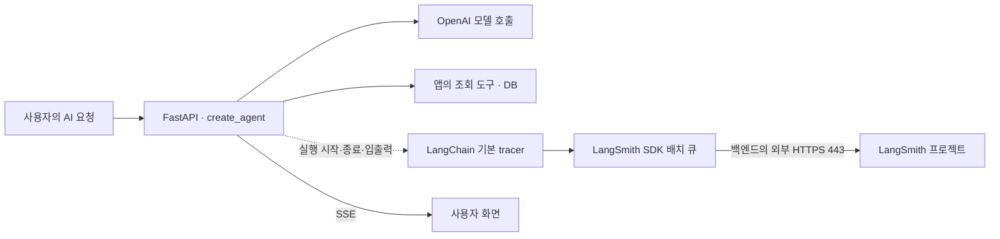

# LangSmith 자동 실행 추적

LangChain·LangGraph의 **기본 자동 tracer**로 실제 에이전트 실행 트리를 기록합니다. `create_agent` 그래프 아래의 middleware·입력 가드·모델·도구 호출, 입출력·오류·소요 시간·제공된 토큰 사용량을 LangSmith 프로젝트에서 확인합니다. 추적은 별도 스위치 없이 **LangSmith 키가 있으면 항상 활성화**됩니다. 키가 없으면 외부 추적 없이 실행하며, 운영 AI 초기화에서는 키 누락 경고를 남깁니다.

2026-10-30 사용자 요청에 따라 [PR #232](https://github.com/wejo-team/sku-dreamon/pull/232)의 원문 없는 수동 span·앱 전송 큐를 [PR #233](https://github.com/wejo-team/sku-dreamon/pull/233)에서 SDK 기본 추적으로 교체했습니다. 후속 요청으로 별도 활성화 스위치를 제거합니다. [품질·비용·보존 후속 #164](https://github.com/wejo-team/sku-dreamon/issues/164), [데이터 경계 #114](https://github.com/wejo-team/sku-dreamon/issues/114), [ReAct 구현 #206](https://github.com/wejo-team/sku-dreamon/pull/206)을 함께 검토했습니다. 실제 품질 평가와 운영 배포를 완료했다는 의미는 아닙니다.

## 데이터가 전달되는 흐름



OpenAI·DB가 수행한 실행 정보를 앱의 callback이 받아 LangSmith SDK에 전달합니다. LangSmith가 모델 호출이나 도구 실행을 대신하지 않으며 사용자 SSE가 추적 업로드 완료를 기다리지 않습니다. 앱은 설정한 한 endpoint·프로젝트를 사용하고 외부 컨텍스트의 부모 trace·복제 목적지를 상속하지 않습니다.

코드 원본은 [추적 설정과 Client 수명](../../backend/app/agents/tracing.py), [에이전트 실행](../../backend/app/agents/factory.py), [입력 가드](../../backend/app/agents/guards.py)입니다. 그래프에 native tracer 하나를 연결하며 가드도 같은 실행의 자식으로 기록합니다. 각 `anext`·생성기 정리마다 추적 컨텍스트를 적용하므로 서로 다른 task에서 스트림을 이어받아도 설정과 부모 관계가 유지됩니다.

## 기록 범위

기본 자동 추적은 **원문을 포함합니다**. 사용자 입력·대화 맥락·system prompt, 모델 응답, 도구 인자·반환 자료, 조회된 프로필·추천 근거·자료 ID, 오류가 기록될 수 있습니다. 시스템 프롬프트는 사용자 화면에 공개하지 않지만 권한 있는 LangSmith 프로젝트 사용자에게는 보일 수 있습니다. 이 전송은 OpenAI의 `store=False` 및 앱 PostgreSQL의 저장·만료 정책과 별개입니다.

LangChain의 비밀 설정 직렬화와 LangSmith SDK의 secret anonymizer를 사용합니다. 알려진 credential 형식과 설정된 OpenAI·LangSmith·CSRF 키를 입력·출력·metadata·오류의 지원되는 masking 경계에서 숨깁니다. 이것은 이름·연락처·프로필 등 개인정보 전체를 제거하거나 사용자가 쓴 임의의 비밀을 모두 탐지한다는 보장이 아닙니다. 프로젝트 접근 권한과 보존 기간은 운영에서 별도로 관리합니다.

`LANGSMITH_HIDE_INPUTS=true`·`LANGSMITH_HIDE_OUTPUTS=true`로 SDK의 입력·출력 필드를 숨길 수 있습니다. 그래프 구조와 실행 시간은 유지되지만, 이 옵션만으로 metadata·오류 등 다른 필드까지 전부 제거되지는 않습니다. 실제 전송 내용은 [자동 추적 회귀](../../backend/tests/unit/test_ai_tracing.py)에서 가짜 모델·전송 경계로 확인합니다.

trace의 성공·오류는 **에이전트 그래프 실행 결과**입니다. 입력 정책 거절로 그래프가 종료돼도 앱은 고정 안내를 정상 답변으로 보낼 수 있습니다. 그래프 완료 뒤 DB 저장·권한 재검사·SSE `done` 수신은 기존 [AI 실행 계약](../api/ai.md)으로 판단합니다. 로컬 `request_id`·시도·`trace_id` 로그로 실행을 연결하며 추적은 감사 기록이나 업무 상태의 원본이 아닙니다.

## 활성화

원본은 [Settings](../../backend/app/core/config.py)와 [환경변수 예시](../../backend/.env.example)입니다. 운영 SSM bundle에 다음 값을 지정합니다. 로컬에서 추적하려면 `backend/.env`에 별도 개발 프로젝트와 키를 지정합니다. 키는 OpenAI 키와 별개이며 프론트 `VITE_*`에 넣지 않습니다.

```dotenv
LANGSMITH_API_KEY=<별도 LangSmith 키>
LANGSMITH_PROJECT=sku-dreamon-production
```

| 설정 | 기본값·조건 |
| --- | --- |
| `LANGSMITH_API_KEY` | 기본 없음. 값이 있으면 항상 추적하며, 없으면 전송하지 않음. Git·로그에 실제 값을 넣지 않음 |
| `LANGSMITH_PROJECT` | `sku-dreamon`. 비어 있지 않은 단일 행, 최대 100자 |
| `LANGSMITH_ENDPOINT` | 기본 `https://api.smith.langchain.com`. US 사용 시 생략 가능. 다른 리전은 맞는 HTTPS URL 지정, 사용자정보·query·fragment 금지 |
| `LANGSMITH_WORKSPACE_ID` | 선택 UUID. 여러 workspace를 사용하는 조직 키라면 명시 |
| `LANGSMITH_HIDE_INPUTS` / `LANGSMITH_HIDE_OUTPUTS` | 각각 `false`. SDK 입력/출력 필드 숨김 |

이 앱은 `.env`를 읽는 `Settings`에서 SDK Client로 값을 명시적으로 전달합니다. 이전 `LANGSMITH_TRACING` 값은 무시하며 `false`여도 키가 있으면 추적합니다. 기존 SSM bundle과 rollback snapshot의 호환을 위해 배포 입력에서는 이 키를 계속 받아들이지만 새 설정에는 넣지 않습니다. 키가 없으면 외부 추적 컨텍스트가 있어도 SDK를 생성하지 않습니다.

`APP_ENV=production`에서 OpenAI 키로 AI가 활성화돼 있지만 LangSmith 키가 없으면, AI 초기화 때 고정 경고를 한 번 기록하고 외부 추적 없이 서비스를 시작합니다. 키 누락은 앱 시작·readiness를 막지 않습니다. 키가 없는 개발·테스트와 비AI DB migration·유지보수에는 이 경고를 남기지 않습니다. 실제 키의 유효성·할당량·클라우드 수신은 `/ready`에서 호출해 검사하지 않습니다.

기존 공개 EC2·앱 네트워크에서는 선택한 LangSmith endpoint로 **외부 HTTPS 443** 통신이 가능하면 됩니다. 새 inbound 포트나 Nginx 경로는 필요 없습니다. 외부 목적지를 제한하는 방화벽·프록시가 있다면 해당 endpoint를 허용해야 합니다.

운영 적용은 코드를 `develop → main`으로 릴리스한 뒤 SSM bundle에 키·운영 프로젝트를 등록하고 [SSM 설정 재배포](ssm-configuration.md)로 지정 버전을 적용합니다. 코드 배포는 기존 적용 설정을 사용하므로 SSM에 새 버전을 등록한 것만으로 키가 반영되지는 않습니다. 키가 적용되기 전에는 경고와 함께 외부 추적 없이 실행합니다. 키는 [백업 제외·버전별 재주입](production-backups.md)을 따릅니다.

## SDK 수명과 검증

별도의 앱 전송 큐를 만들지 않고 SDK의 기본 배치 전송을 사용합니다. 앱은 지원되는 SDK 환경설정으로 daemon thread를 사용하고 압축 전송의 별도 executor는 끕니다. SDK는 자체 재시도와 429 대기를 할 수 있습니다. 앱 종료는 기존 종료 예산 안에서 최대 2초 동안 Client 정리를 기다리며, 이 값은 모든 HTTP·재시도의 전체 소요 시간 보장이 아닙니다. 종료·전송 장애에는 추적이 누락될 수 있습니다.

회귀 검사는 실제 native tracer와 가짜 모델·HTTP 경계를 사용해 그래프·가드·모델·도구 부모 관계, 중복 없는 루트, 원문 기록·credential masking·선택적 숨김, 키 없는 실행·운영 경고·이전 flag 무시, 스트리밍·취소·종료를 검사합니다. 일반 테스트는 실제 OpenAI·LangSmith에 접속하지 않도록 추적 환경을 격리합니다.

```bash
cd backend
uv sync --locked
uv run pytest tests/unit/test_ai_tracing.py tests/unit/test_ai_runtime.py
```

이번 변경에서는 운영 키 등록·실제 LangSmith 수신·운영 배포를 수행하지 않았습니다. 코드 릴리스와 키 적용 후 승인된 환경의 가상 요청으로 프로젝트의 실행 트리를 확인해야 합니다. 키를 제거해도 이전에 저장된 trace는 자동 삭제되지 않습니다.

## 기술 근거

- [LangChain 자동 추적](https://docs.langchain.com/langsmith/trace-with-langchain)
- [환경변수 없이 Client·workspace 지정](https://docs.langchain.com/langsmith/trace-without-env-vars)
- [입출력 숨김과 masking](https://docs.langchain.com/langsmith/mask-inputs-outputs)
- [백그라운드 추적과 종료](https://docs.langchain.com/langsmith/troubleshooting)

현재 lockfile의 Python LangSmith 0.14.12를 기준으로 구현합니다. SDK 갱신 시 native callback·masking·종료 검사를 함께 재검증합니다.
