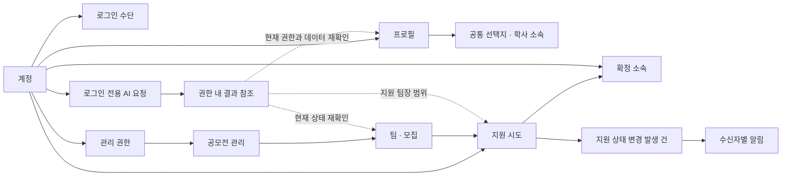

# 프로젝트 논리 모델 설계

**검토용 설계 초안**입니다. [기능 명세](../specs/README.md)와 2026-10-19 사용자가 정한 모집 재개·동시 지원·폐기·팀장 변경 제외·자격 비차단·관리자 관리 정책을 데이터 관계로 옮깁니다. 정책 원본은 명세이며, 아래 엔터티·속성·관계는 기술 설계 제안입니다. 문서 작성이 사람의 설계 승인이나 제품 구현 완료를 뜻하지 않습니다.

이번 결과물은 논리 ERD, 속성·식별자·관계·제약조건, 상태 전이·권한과 원자적으로 처리할 업무의 설계입니다. SQL, ORM, migration, API 구현 코드를 작성하지 않습니다. DB 물리 타입·인덱스·잠금 방식·API DTO와 LLM 내부 아키텍처도 여기서 확정하지 않습니다.

## 문서 선택

| 문서 | 책임 |
| --- | --- |
| [계정·프로필·분류](identity-profile.md) | 계정과 로그인 수단 분리, 프로필 전체 공개, 학사·공통 선택지·포트폴리오 |
| [공모전·탐색](contests-exploration.md) | 관리자 관리, 공고 조건·기간·인원, 탐색 조회와 집계 |
| [팀·지원·소속](teams-applications.md) | 모집 재개, 지원 시도와 상태, 선발·폐기·취소, 소속·정원 불변조건 |
| [AI·알림](ai-notifications.md) | 대화·추천의 논리 경계, 검토 근거, 업무 발생 건·수신자·읽음 |
| [권한·검증·미정 사항](review-checklist.md) | 도메인 사이 권한, 명세 추적, 검증 시나리오와 미결정 경계 |

## 범위와 표현

프로젝트 전체의 현재 제품 범위를 포함합니다. 가입·로그인·프로필·공모전·팀·지원·선발·워크스페이스·사람 탐색·AI·알림과 관리자 공고 관리 책임을 다룹니다. 일정 조율·사용자 간 채팅·학교 인증·소셜 로그인·팀장 변경·마감 알림은 현재 모델에 새 기능으로 넣지 않습니다. 후속 기능과 내부 아키텍처 TBD는 경계만 표시합니다.

- **확정 정책:** 명세·이번 사용자 결정에 근거한 사용자 동작과 불변조건.
- **설계 제안:** 확정 정책을 표현하기 위한 엔터티 분리·키·참조·파생값. 리뷰 중 변경 가능합니다.
- **TBD:** 아직 정하지 않은 제품 정책·기록 보존·외부 연동. 임의 기본값으로 채우지 않습니다.
- `PK`는 엔터티 식별자, `FK`는 참조, `UQ`는 유일성입니다. 문자열/정수/시각은 논리 값의 종류이며 DB 컬럼 타입 선언이 아닙니다.
- 카디널리티는 선택 관계 `0..1`, 단일 필수 `1`, 복수 `0..N`으로 설명합니다. 목록의 최소 선택 수는 별도 업무 제약으로 표시합니다.

## 영역 사이 관계

도표 원본 보기

워크스페이스·공모전별 팀 목록·사람 목록·페이지 번호·필터·카드 개수는 위 관계에서 조회하는 화면입니다. 별도 영속 엔터티를 화면마다 만들지 않습니다. 일반 AI 추천과 팀장의 지원자 검토는 같은 사람 데이터를 사용하더라도 접근 범위가 다릅니다.

## 설계 순서와 다음 단계

1. 영역별 엔터티·관계와 [검증 시나리오](review-checklist.md)를 함께 리뷰합니다.
2. 미정 정책이 있는 기능은 해당 부분만 보류하고 이미 확정한 관계와 제약을 검토합니다.
3. 논리 모델 리뷰 후 물리 모델·API 계약·구현 계획을 별도 작업으로 작성합니다. 현재 문서를 근거로 제품 코드를 자동 생성하거나 DB에 적용하지 않습니다.

이번 설계는 기존 스캐폴딩의 도메인 테이블 부재를 유지합니다. 공식 디자인의 메모리 배열·임시 ID·모의 AI 응답을 제품 저장 구조나 추천 로직으로 복사하지 않습니다.

도표는 각 문서의 Mermaid 원본과 SVG 내보내기를 함께 보관합니다. SVG는 문서 사이트에서도 별도 실행 라이브러리 없이 볼 수 있습니다. 관계를 수정하면 두 표현을 함께 갱신합니다. 이번 내보내기는 [Mermaid 공식 렌더링 API](https://mermaid.js.org/config/usage.html)를 이용한 12.2.0 결과이며, 프로젝트 앱 의존성이나 실행 코드를 추가하지 않았습니다.
