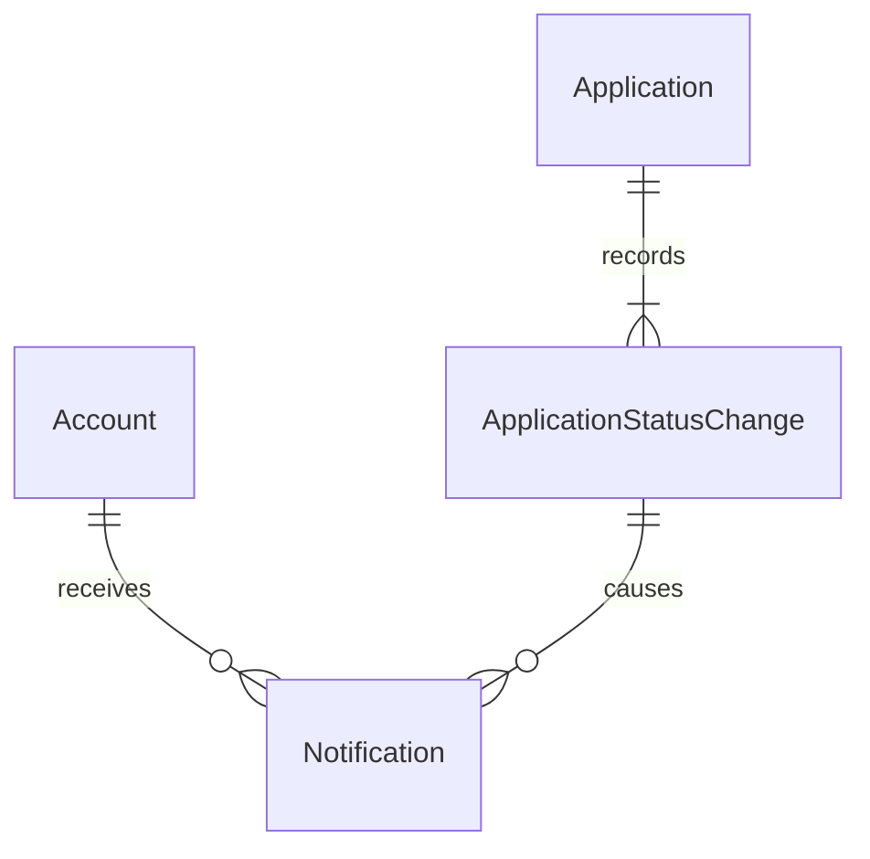

# AI·알림 논리 모델

상태: 검토용 설계 제안. 정책 원본은 [추천 매칭](../specs/matching.md), [서비스 알림](../specs/notifications.md), [프로필 권한](../specs/profile.md#visibility)입니다. LLM 제공자·검색·실행·프롬프트·캐시·평가 등 내부 아키텍처는 계속 TBD입니다. 여기서는 사용자 경험을 표현할 논리 정보와 도메인 접근 경계를 정의합니다.

## AI의 논리 정보와 영속화 경계

아래 이름은 **저장 테이블 확정이 아닌 정보 모델**입니다. 현재 대화의 탭 간 유지에는 화면 상태만으로도 충분할 수 있습니다. 새로고침 복원·서버 보존·삭제 정책이 정해지기 전 모든 대화와 원문 프로필을 영구 저장하는 설계로 해석하지 않습니다.

| 논리 단위 | 식별·관계 | 필요한 의미 |
| --- | --- | --- |
| Conversation | conversation_id; 소유 Account 1 | 현재 대화 구분. 새 대화 후 늦게 도착한 이전 응답을 구분할 식별 의미. 과거 목록·검색 기능 없음 |
| Message | message_id; Conversation 1 | 작성 주체(사용자/응답), 내용, 대화 내 순서. 사용자 메시지만 최대 1,000자 |
| RecommendationRequest | request_id; 요청 Account 1; 요청 Message 또는 지원자 검토 Team 중 하나 | 요청 범위, 준비/성공/결과 없음/실패/중단, 현재 시도 식별. 재시도해도 같은 사용자 메시지를 중복 생성하지 않음 |
| RecommendationResult | result_id; Request 1 | 답변·근거와 결과 생성 시점. 실패/중단을 빈 성공 결과로 바꾸지 않음 |
| RecommendationCard | `(result_id, position)` | 공모전/팀/공개 프로필 중 정확히 하나의 실제 대상 참조, 그 대상에 대한 근거. 답변당 종류 합계 0~3개 |
| ApplicantReviewResult | review_result_id; 검토 요청 1; 실제 Application 1 | 자기 팀 지원자에 대한 근거, 결과 생성 시점과 사용한 프로필 수정 버전. 지원 당시 프로필 사본에 고정하지 않음 |

대화 내 순서와 결과 카드 표시 순서는 사용자 경험에 필요한 관계입니다. 카드 position은 결과 안에서 유일하며, 존재하지 않는 대상이나 여러 종류를 동시에 참조하지 않습니다. 참가자 검토 결과의 개수를 일반 대화 카드 3개 제한과 혼동하지 않습니다. 지원자 검토에는 담당 명세에 별도 정의하지 않은 3명 제한을 추가하지 않습니다.

### 결과 참조의 무결성

논리 관계는 Contest, Team, Profile, Application의 실제 식별자로 연결합니다. 내부 구현에서 `target_type + 임의 문자열 ID`만으로 관계 검증을 생략하지 않습니다. 구체 저장을 채택한다면 종류별 참조 관계 또는 정확히 하나의 유효 참조를 강제하는 구조를 물리 설계에서 선택합니다.

프로필 최신성 확인을 위해 `Profile.updated_at` 또는 수정 버전과 결과가 사용한 버전을 비교하는 설계안을 둡니다. 이전 결과는 과거 근거임을 구분하고 재요청하면 최신 프로필을 사용합니다. 이것은 과거 프로필 전문을 저장하거나 모든 과거 AI 응답을 자동 재작성하는 정책이 아닙니다. 모델 입력 원문·필드별 보존은 MATCH-10·13에서 결정합니다.

## 추천 범위와 권한

| 요청 종류 | 허용 데이터 | 제외·재확인 |
| --- | --- | --- |
| 일반 공모전·팀 탐색 | 공개 공고·팀과 사용자가 입력한 조건 | 신규 지원 추천에는 현재 기한·모집·잔여 정원 등 서비스 제한 적용. 참가 자격은 설명하며 자동 지원 거부 근거로 쓰지 않음 |
| 일반 사람 탐색 | 현재 공개 Profile | 비공개 기본 프로필은 본인 것도 자동 주입하지 않음. 지원 팀장 예외를 일반 대화로 전파하지 않음 |
| 팀장 지원자 검토 | 본인이 팀장인 Team의 실제 Application 관계에 따라 최신 프로필 | 비공개 전환 후에도 해당 팀장의 기존 관계 범위에서 검토. 다른 팀·일반 팀원으로 확대하지 않음 |
| 새 선발 후보 추천 | 위 팀장 범위 중 지원 완료/검토 중 | 선발·미선발·취소·폐기 제외. 기존 결과를 볼 수 있다는 이유만으로 새 후보로 복원하지 않음 |

모든 AI 요청·결과는 로그인 전용입니다. 일반 추천에 비공개 프로필·인증 정보·권한 밖 지원 메시지가 들어가면 안 됩니다. 포트폴리오는 등록 URL·제목의 허용 범위를 따르고 외부 페이지 수집·분석을 하지 않습니다. 주당 참여 시간은 모든 프로젝트 합산 참고값이며 일정 교집합이나 팀별 잔여 시간을 도출하지 않습니다.

권한과 후보 상태는 요청 입력 조회, 결과 연결·표시·복사 시점에 다시 확인합니다. 생성 중 공개 상태·지원 상태가 바뀌면 이전 접근 범위로 만든 내용을 그대로 노출하지 않는 처리가 필요합니다. 구체 모델 출력의 재검증·취소·캐시 폐기 방법은 LLM 내부 설계에서 다룹니다. 기존 결과의 존재만으로 권한을 복구하지 않습니다.

AI 검토는 모집 마감·정원 충족 뒤에도 허용하지만 실제 선발을 수행하지 않습니다. 선발 트랜잭션에서 권한·현재 지원·소속·정원을 다시 확인합니다. LLM 응답 자체가 업무 상태 변경의 명령이 되지 않습니다.

## 알림의 엔터티

도표 원본 보기

`ApplicationStatusChange`는 [팀·지원 모델](teams-applications.md)의 동일 발생 건입니다. 별도 이벤트 버스나 범용 이벤트 소싱 아키텍처를 요구하지 않습니다. 상태 이력과 알림 발생을 연결하는 논리 식별 의미만 공통으로 사용합니다.

| 엔터티 | 키·참조 | 주요 속성·제약 |
| --- | --- | --- |
| Notification | notification_id PK; event_id FK; recipient_account_id FK | kind(본인 지원 상태/팀장 신규 지원), occurred_at, read_at(선택). `(event_id, recipient_account_id)` UQ |
| ApplicationStatusChange | 팀 모델의 event_id PK | 실제 지원·상태 변경·발생 시각·변경 주체/원인. 실패 요청·동일 상태 재저장은 생성하지 않음 |

읽음 여부는 read_at 유무로 표현하는 제안입니다. 별도 boolean과 시각이 서로 어긋나는 값을 갖지 않게 합니다. 발생 시각은 업무 변경 시각이며 알림 조회 시각을 대신 넣지 않습니다. 중복 occurred_at을 저장한다면 원천 사건과 일치해야 하며 원천 관계로 읽는 안을 우선합니다.

알림의 관련 지원·팀·공모전은 발생 건에서 조회합니다. 알림마다 모순될 수 있는 대상 FK를 다시 복제하지 않습니다. 표시 문구는 당시 사건의 사실과 현재 열람 범위로 구성하고, 비공개 프로필 내용을 제목에 영구 복제하는 구조를 기본으로 삼지 않습니다.

## 발생·읽음의 업무 경계

| 사건 | 수신자 | 변경의 원자적 범위 제안 |
| --- | --- | --- |
| 새 지원 접수 | 지원자, 해당 팀장 | 지원 생성·첫 상태 발생 건·수신자별 알림 |
| 선발 | 해당 지원자 | 해당 지원 선발·소속 생성·정원 제약 확인·같은 공모전 다른 대기 지원 폐기·각 상태 발생 건·본인 알림 |
| 다른 팀 선발에 따른 폐기 | 폐기된 지원의 본인 | 별도 폐기 발생 건·본인 상태 알림. 해당 팀장에게 새로운 종류의 폐기 알림은 추가하지 않음 |
| 본인 지원 취소 | 해당 지원자 | 지원 취소·선발됐던 경우 소속 종료/자리 반환·발생 건·알림 |
| 검토·미선발 | 해당 지원자 | 상태를 만드는 제품 행동 확정 후, 실제 변경에 한해 생성 |

선발과 여러 폐기의 발생 건은 각각 다른 지원의 상태 변경입니다. 같은 선발 원인 식별자로 연결할 수 있어도 동일 event_id를 재사용해 수신자 중복 제거 과정에서 폐기 알림을 잃지 않게 합니다. 재시도는 이미 성공한 동일 업무 변경의 발생 건을 재사용하여 중복 소속·폐기·알림을 만들지 않습니다. 실패 시 일부 지원만 폐기되는 중간 상태를 외부에 성공으로 보여주지 않습니다.

업무 상태 저장과 서비스 내부 알림 기록을 함께 완료하는 안을 제안합니다. 실제 전달 수단·재시도 인프라는 별도이며 푸시·이메일·마감 알림을 추가하지 않습니다. 알림 읽음 실패는 read_at을 바꾸지 않고 이동도 성공으로 처리하지 않습니다. 모두 읽음은 해당 수신자의 현재 제공된 알림만 대상으로 하며 지원 상태를 바꾸지 않습니다.

## 보존과 미정 범위

- 알림·지원 상태 발생 건·AI 결과의 보존 기간, 계정 탈퇴/팀 삭제 시 노출·삭제 정책은 미정입니다. 참조가 있다는 이유로 영구 보존하거나 즉시 연쇄 삭제한다고 결정하지 않습니다.
- 알림 읽음의 새로고침 복원·기기 동기화, AI 현재 대화의 서버 저장·복원은 관련 정책 확정 후 영속 모델을 결정합니다.
- AI 정보 모델은 논리 검토 대상이며 저장소·외부 제공자·비용 제한·백그라운드 작업 구현을 확정하지 않습니다. 추천 결과를 업무 엔터티와 분리함으로써 이 TBD가 계정·공모전·팀·지원의 관계 설계를 막지 않도록 합니다.
