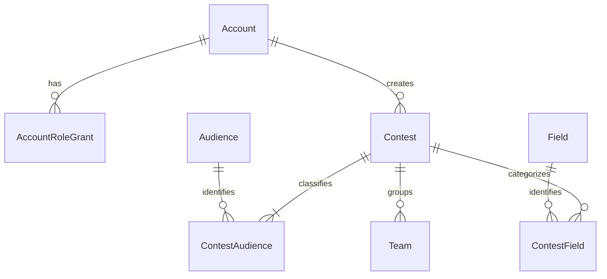

# 공모전·탐색 논리 모델

상태: 검토용 설계 제안. 정책 원본은 [공모전](../specs/contests.md), [공통 선택지](../specs/profile-options.md), [페이지 번호 탐색](../specs/sprint-1.md#exploration-pagination)입니다. 등록된 공고는 모두 공개하며 관리자가 관리합니다. 관리자 화면과 수집·적재 도구는 TBD입니다.

## 엔터티와 관계

도표 원본 보기

`Account`, `Field`는 [계정·분류 모델](identity-profile.md), `Team`은 [팀 모델](teams-applications.md)의 같은 엔터티입니다. 관리자 권한 보유자만 공고 관리 유스케이스를 실행합니다. 관리자 역할은 팀장 역할과 별개이며, 팀장은 해당 팀의 소속 관계로 판정합니다.

| 엔터티 | 키·참조 | 주요 속성과 선택성 |
| --- | --- | --- |
| AccountRoleGrant | `(account_id FK, role_code)` PK | 현재 관리 역할 `admin`. 공고 관리 권한의 표현 제안이며 부여·회수 절차/화면은 TBD |
| Contest | `contest_id` PK; `created_by_account_id` FK; `updated_by_account_id` FK | 제목·주최 기관명·원문 URL·원문 참가 조건 필수. 설명, 제출물, 시상, 문의처, 포스터 참조는 확인 가능한 경우. 확인 시각과 생성·수정 시각, 실제·시연 구분 is_demo |
| Audience | `audience_code` PK | 대학생/일반인/제한 없음/미확인의 고정 의미와 표시 이름 |
| ContestAudience | `(contest_id, audience_code)` PK, 각각 FK | 중복 없는 참가 대상 집합. 대표 대상 없음 |
| ContestField | `(contest_id, field_id)` PK, 각각 FK | 동등한 공통 분야 0~3개. 대표 분야·순위 없음 |

주최 기관은 현재 이름 외 독립 관리 기능이 없으므로 문자열로 제안합니다. 관리자가 누구인지와 주최 기관은 다릅니다. 주최 기관 디렉터리·복수 주최자 기능이 필요해지면 별도 엔터티 분리를 검토합니다. 공식 URL은 동일 페이지의 여러 모집 차수 등을 포함할 수 있어 고유 키라고 가정하지 않습니다. 포스터는 선택이며 기본 마스코트 이미지를 공고마다 복제 저장하지 않습니다.

### 참가 인원 속성

Contest에 `member_limit_kind`(범위/제한 없음/미확인), `min_members`, `max_members`를 둡니다.

| 의미 | 값 제약 |
| --- | --- |
| 숫자 범위 | 최소·최대 양의 정수, 최소 ≤ 최대. 고정 N명은 최소=최대=N |
| 제한 없음 | 최대는 비어 있음. 원문에 최소가 있으면 양의 정수 최소를 보존; 없으면 비어 있음 |
| 미확인 | 최소·최대가 비어 있음. 무제한이나 1명으로 바꾸지 않음 |

공고에서 확인한 최소와 서비스의 팀 최소 단위 1명을 구분합니다. 목표 정원은 공고 조건을 따르지만 모집 중 실제 확정 인원은 최소 인원 미만일 수 있습니다. 개인/팀 참가 구분, 준비 모임 예외는 저장하지 않습니다.

### 기간 속성

Contest의 접수 기간은 시작과 마감 각각에 다음 의미를 둡니다. 팀 모집 기한도 같은 시각 해석을 사용하되 해당 명세의 입력 형식을 따릅니다.

| 값 | 목적 |
| --- | --- |
| 원문 날짜, 시각(선택), 시간대(선택) | 원문에서 확인한 사실과 누락을 구분 |
| 서비스 해석 시간대 | 원문 우선, 누락 시 Asia/Seoul |
| 적용 시각 | 시작은 포함, 마감은 제외하는 경계. 저장·전송 UTC 원칙을 적용할 실제 시점 |
| 보완 여부 | 원문에 없던 시간대/시각을 보완했는지 안내. 위 원문 누락 정보에서 도출 가능 |

마감에 날짜만 있으면 해당 날짜의 끝, 즉 해석 시간대에서 다음 날 00:00을 제외 경계로 삼습니다. 시작 날짜만 있으면 해당 날짜 시작부터로 해석하는 안은 시작 시각 보완 정책 확인 후 확정합니다. 원문 시각·해석 경계를 서로 독립 편집하는 두 개의 진실로 두지 않고 저장 시 함께 검증합니다. 시간대·시각 보완 안내와 정확한 마감 경계는 [마감 정책](../specs/contests.md#deadline-policy)을 따릅니다.

## 관계·무결성 제약

- 참가 대상은 대학생·일반인 중 하나 또는 둘, 혹은 제한 없음 단독, 혹은 미확인 단독입니다. 빈 집합·미확인과 다른 값의 혼합은 허용하지 않습니다. 대학원생을 별도 세부 판정 코드로 만들지 않습니다.
- 공모전 분야는 동일한 Field를 중복 선택할 수 없고 최대 3개입니다. 팀의 분야는 공모전에서 읽으므로 TeamField에 복제하지 않습니다.
- 공고의 공개/비공개 상태나 공개 승인 상태를 만들지 않습니다. 미확인 수집 자료를 등록 공고와 혼동하지 않으며, 별도 수집 staging 저장소의 필요성·구조는 이번 모델에서 보류합니다.
- 생성/수정의 행위자는 실제 관리자 Account입니다. 관리 역할이 나중에 회수되어도 과거 작성자 참조가 사라지지 않습니다. 권한 부여 시점 이력의 상세 저장 범위는 운영 설계에서 검토합니다.
- 개인 참가 자격은 원문 안내 정보이며 지원·선발의 자동 거부 조건이 아닙니다. 프로필 공개·마감·정원·중복·확정 소속 제약은 별도로 유지합니다.
- 주최 측 조건 정정에 따른 기존 팀·지원·소속의 처리 정책은 의도적으로 TBD입니다. 자동 탈퇴·지원 폐기·정원 축소를 설계에 넣지 않습니다. 그 결정을 내리기 전 조건 버전/이력 엔터티를 확정하지 않습니다.

## 저장 값과 조회 값

| 조회 값 | 원천·판정 | 별도 저장하지 않는 이유 |
| --- | --- | --- |
| 접수 예정/접수 중/접수 마감 | 현재 시각과 접수 시작·마감 경계 | 시각이 흐를 때 저장 상태와 불일치하지 않게 함 |
| D-day | 표시 시간대의 날짜와 마감 | 원문 경계 대신 접수 가능 여부를 판단하는 값이 아님 |
| 공모전 연결 팀 수 | 해당 공모전 Team 전체 수 | 모집 중인 팀만 세지 않음; 미정인 팀 삭제 정책은 후속 반영 |
| 현재 모집 가능한 팀 | 명시적 모집 상태 + 기한 + 잔여 정원 | 수동 재개 정책을 유지하며 자리만 생겼다고 자동 재개하지 않음 |
| 참가 인원 표시 | member_limit_kind와 최소·최대 | 문자열 '2~4명'을 계산 원천으로 쓰지 않음 |
| 워크스페이스 | Account의 팀장/현재 소속 및 본인 지원 이력 | 별도 Workspace 소유 관계와 중복하지 않음 |

## 탐색 조회 계약의 논리 경계

공모전·팀·사람 목록은 페이지 번호 방식입니다. 검색어·필터·정렬·페이지는 조회 조건이며 독립 업무 엔터티가 아닙니다. 사람 검색·전체 건수에는 현재 공개 범위와 로그인 권한을 적용합니다.

- 페이지 결과와 전체 건수는 동일한 필터·권한 범위를 사용합니다. 공모전의 전체 연결 팀 수와 현재 팀 목록의 필터 결과 수는 다른 값입니다.
- 정렬의 동률은 안정적인 식별자로 구분하는 설계안을 사용합니다. 페이지 크기·구체 정렬 기준은 API 계약에서 정의합니다.
- 데이터 추가·삭제에 따른 페이지 번호 결과 이동은 발생할 수 있습니다. 번호 방식 자체로 과거 조회 스냅샷을 보장한다고 명세하지 않습니다.
- 공모전 상세의 팀 목록은 해당 contest_id 조건을 항상 적용합니다. 화면 복귀의 페이지/필터/스크롤은 프론트 상태 설계이며 DB에 검색 세션을 추가하지 않습니다.

## 남은 경계

관리자 화면·권한 부여/회수 절차·수집·갱신 도구, 공고 삭제·보존, 주최 측 변경 영향, 별도 요약의 MVP 포함 여부는 후속 결정입니다. 관리자 책임이 정해졌다는 이유로 새 승인 단계·공고 비공개·자동 크롤링을 도입하지 않습니다.
