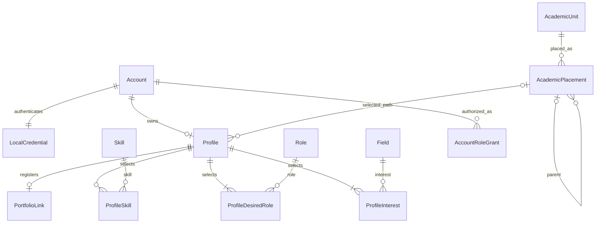

# 계정·프로필·공통 분류 논리 모델

이 문서는 **기술 설계 제안**입니다. 확정된 제품 정책을 관계·키·제약조건으로 옮긴 검토용 초안이며, DB·ORM·인증 세션·실제 API를 구현하거나 미정 정책을 확정하지 않습니다. 물리 자료형·인덱스·SQL DDL은 후속 설계 범위입니다.

근거는 [가입과 로그인](../specs/authentication.md), [프로필](../specs/profile.md), [공통 선택지](../specs/profile-options.md), [학사 구조](../specs/academic-structure.md)입니다. 최신 사용자 결정에 따라 팀장 변경 기능은 제공하지 않고, 학과·학년·참가 자격을 지원 차단 조건으로 사용하지 않습니다. 필수 프로필·공개·마감·정원·중복·소속 제한은 별개로 유지합니다.

## 표기와 설계 경계

- `ID`는 표시 이름·로그인 아이디와 분리된 불변 내부 식별자입니다. UUID 등의 구체 형식은 여기서 확정하지 않습니다.
- `?`는 미입력 가능한 값이며, 나머지 속성은 값이 있어야 합니다. `*_id`는 내부 ID, `*_code`·`code`는 제한된 코드 텍스트, 이름·본문·URL은 텍스트, `is_*`·`allows_*`·`major_unassigned`는 참/거짓, `*_at`은 시각, `sort_order`는 정수의 논리 자료형입니다. 해시는 비밀번호 검증값으로서 일반 텍스트 표시 대상과 구분합니다.
- 속성명과 영문 상태 코드는 설계 제안입니다. 화면 문구나 운영용 코드 사전을 확정한 것으로 취급하지 않습니다.
- 프로필은 현재 값 하나를 관리합니다. 지원마다 프로필 사본·포트폴리오 사본을 만들지 않습니다. AI 실행의 입력 버전·결과 기록은 AI 영역에서 별도로 다룹니다.

## 계정과 자체 로그인

| 엔터티 | 키와 속성 | 관계·제약 |
| --- | --- | --- |
| `Account` | `account_id` PK, `created_at`, `withdrawn_at?`, `is_demo` | 프로필·지원·소속·알림의 소유자. `withdrawn_at`은 soft delete를 표현하기 위한 제안이며 실제 탈퇴 효력 발생 시점·복구 규칙은 미정 |
| `AccountRoleGrant` | PK (`account_id`, `role_code`); FK → Account | 관리자 공고 관리 권한을 계정과 연결하는 기술 제안. 현재 필요한 역할은 `admin`이며 관리자 화면·권한 부여/회수 절차는 미정 |
| `LocalCredential` | `account_id` PK/FK → Account, `login_id_normalized`, `password_hash`, `credential_updated_at` | MVP에서 계정당 자체 로그인 정보 하나. 정규화된 로그인 아이디는 유일하며 같은 계정에 여러 자체 아이디를 만들지 않음 |

계정과 자체 로그인 정보의 생성은 함께 성공하거나 실패해야 합니다. 현재 MVP의 정상 가입 완료 계정에는 자체 로그인 정보가 하나 있습니다. 별도 관계로 나누는 이유는 향후 로그인 수단이 늘어도 도메인 소유자 ID를 유지하기 위해서이며, 소셜 연결 테이블·기능을 이번에 추가한다는 뜻은 아닙니다.

`login_id_normalized`는 앞뒤 공백 제거·ASCII 대문자 소문자화 후 `a-z`, `0-9` 4~24자입니다. 표시 이름은 중복을 허용하며 로그인 아이디나 이름으로 다른 계정을 합치지 않습니다. 비밀번호는 NFC 정규화와 확정 입력 규칙을 거친 후 검증 가능한 해시만 저장합니다. 원문·복호화 가능한 값·시연 비밀번호를 모델 문서나 운영 데이터 초기값으로 복제하지 않습니다.

로그인 아이디의 유일성은 soft delete된 계정과의 충돌도 확인할 수 있어야 합니다. **탈퇴 아이디의 재사용 허용 여부는 미정**이므로 이 초안으로 재사용 기능이나 자동 복구를 확정하지 않습니다. 세션 방식·저장소·기간, 로그인 시도 제한 수치, 계정 복구 수단은 별도 계약입니다.

학교 이메일·실명 인증 결과·연락처·소셜 식별자는 현재 수집 범위가 아니므로 필수 컬럼으로 만들지 않습니다. 모든 현재 계정의 교내 미인증 표시는 로그인 성공으로 변경되지 않으며, 후속 인증을 위한 범용 인증 이력 모델을 미리 구현하지 않습니다.

## 현재 프로필

| 엔터티 | 키와 속성 | 관계·제약 |
| --- | --- | --- |
| `Profile` | `account_id` PK/FK → Account; `real_name`; `is_public` 기본 false; `avatar_code?`; `academic_status_code?`; `grade_code?`; `weekly_availability_code?`; `academic_placement_id?`; `major_unassigned` 기본 false; `experience_state` 기본 UNSPECIFIED; `experience_body?`; `introduction?`; `updated_at` | Account 1 : Profile 0..1. 옵션 코드는 해당 분류의 공통 코드만 참조. 학사 경로는 아래 AcademicPlacement 참조 |
| `ProfileInterest` | PK (`account_id`, `field_id`); FK → Profile, Field | 프로필당 서로 다른 1~3개. 대표 분야나 순위 없음 |
| `ProfileDesiredRole` | PK (`account_id`, `role_id`); FK → Profile, Role | 프로필당 서로 다른 1~2개 |
| `ProfileSkill` | PK (`account_id`, `skill_id`); FK → Profile, Skill | 0개 이상, 목록 안에서 별도 개수 상한 없음 |
| `PortfolioLink` | `account_id` PK/FK → Profile; `url`; `title?` | Profile 1 : PortfolioLink 0..1. URL 삭제 시 제목을 함께 제거. 별도 공개 플래그 없음 |

가입 완료와 필수 프로필 저장을 분리할 수 있도록 **프로필 저장 전에는 Profile 관계가 없는 구조**를 제안합니다. 프로필 최초 저장은 이름·관심 분야·희망 역할을 함께 검증해 생성하며, 저장된 프로필의 필수값을 비우는 수정은 실패합니다. 편집 폼과 이미지 선택 팝업의 미저장 값은 현재 프로필에 반영하지 않습니다. 서버에 미완성 초안을 저장하는 기능은 이 모델로 추가하지 않습니다. 팀 생성·개인화 추천에서 프로필 완성을 언제 요구할지는 [PROFILE-03](../specs/profile.md#open-questions)에 남습니다.

단순한 FK·중복 제약만으로 연결 행의 최소·최대 개수를 보장할 수는 없습니다. 프로필 저장을 맡는 하나의 쓰기 유스케이스가 최종 관심 분야 1~3개·역할 1~2개를 확인하고 기본 프로필·연결 행·포트폴리오를 함께 변경합니다. 동시에 두 수정이 들어와도 최종 개수 제약을 우회하지 않도록 동일 프로필의 변경을 조정하는 계약이 필요합니다. 구체 잠금·버전 구현은 물리 설계에서 정합니다.

### 값의 의미와 불변 조건

| 값 | 논리 제약 |
| --- | --- |
| 이름·자기소개 | 이름은 공백 제거 후 1~50자, 자기소개는 최대 300자. 공통 텍스트 Unicode 계수 계약은 PROFILE-07에서 별도 확정 |
| 프로필 이미지 | 다섯 캐릭터 중 선택한 코드 또는 미입력. 미입력은 기본 스콘으로 표현하며 외부 이미지 URL·사용자 파일을 받지 않음 |
| 경험 `UNSPECIFIED` | 본문 없음. 공백만 있는 본문을 저장하면 이 상태 |
| 경험 `NONE` | 본문 없음. 이 상태로 저장하면 이전 본문 제거 |
| 경험 `PROVIDED` | 공백 제거 후 비어 있지 않은 최대 500자 본문 필요. 경험 분야 연결 관계 없음 |
| 학적·학년 | 미입력 가능. 학년의 명시적 `해당 없음` 코드와 NULL을 구분 |
| 주당 시간 | 네 구간 중 하나 또는 NULL. NULL을 5시간 미만으로 바꾸지 않음. 모든 프로젝트 합산의 자기신고 총량이며 팀별 약정·잔여 시간·요일별 일정 관계를 만들지 않음 |
| 포트폴리오 | 앞뒤 공백 제거 후 유효한 HTTP(S) URL 하나, 선택 제목 최대 50자. 본문·설명·파일·외부 수집 내용 없음. URL의 별도 길이 상한은 미정 |

## 공통 코드와 연결 관계

사용자 선택값은 문자열 배열이나 표시명으로 저장하지 않고 공통 분류와의 관계로 표현합니다. 목록의 책임은 공통으로 관리하되, 서로 다른 분류가 섞이지 않도록 의미가 다른 목록은 별도의 관계로 둡니다.

| 엔터티 | 키와 속성 | 관계·제약 |
| --- | --- | --- |
| `Field` | `field_id` PK; `code` 대체키; `display_name`; `is_selectable`; `sort_order`; `created_at`; `updated_at` | 공모전 분야·프로필 관심 분야에서 같은 ID를 참조. 대표 분야·우선순위 속성 없음 |
| `Role` | `role_id` PK; `code` 대체키; `display_name`; `is_selectable`; `sort_order`; `created_at`; `updated_at` | 프로필 희망 역할·팀 모집 역할이 같은 ID를 참조. 현재 6개 역할 |
| `Skill` | `skill_id` PK; `code` 대체키; `display_name`; `is_selectable`; `sort_order`; `created_at`; `updated_at` | 현재 목록 안에서 선택. 사용자 임의 기타 값 없음 |
| `AcademicStatus` | `code` PK; `display_name`; `is_selectable`; `sort_order` | 재학·휴학·졸업. NULL은 미입력으로 별도 표현 |
| `Grade` | `code` PK; `display_name`; `is_selectable`; `sort_order` | 1·2·3·4학년 이상·해당 없음. 명시적 해당 없음과 NULL 구분 |
| `WeeklyAvailabilityRange` | `code` PK; `display_name`; `sort_order` | 확정된 네 구간. 시간 예약·배정 관계가 아니며 NULL 가능 |
| `AvatarPreset` | `code` PK; `display_name`; `asset_reference`; `is_selectable`; `sort_order` | 다섯 캐릭터의 제공 자산 참조. 사용자 업로드 저장소 아님 |

분야·역할·역량의 `code`는 각 목록 안에서 유일하고 의미가 유지되는 한 바꾸지 않습니다. 다른 영역은 표시명 대신 ID로 연결하므로 같은 의미의 표기 수정으로 관계가 끊어지지 않습니다. 서로 다른 분류를 통합한 자유형 키/값 저장이나 EAV 모델은 제안하지 않습니다.

프로필의 단일 선택 코드도 해당 목록의 PK를 직접 참조합니다. 예를 들어 `academic_status_code`는 AcademicStatus만, `weekly_availability_code`는 WeeklyAvailabilityRange만 가리킵니다. ID나 코드가 존재한다는 검사만으로 역량을 역할로 저장할 수 있게 해서는 안 됩니다.

공통 목록의 추가·수정·비활성화 날짜·사유 기록에는 분류별 변경 관계를 제안합니다. `FieldChange`, `RoleChange`, `SkillChange`, `AcademicStatusChange`, `GradeChange`는 각각 `change_id` PK, 해당 목록 PK에 대한 FK, `change_type`, `changed_at`, `reason`, 변경 속성의 전후 값을 갖습니다. 스키마의 공통 형태를 재사용하되 실제 참조 대상이 없는 `target_type/target_id` 문자열만으로 이력을 연결하지 않습니다. 주당 시간·캐릭터 목록 변경을 지원하게 되면 같은 방식으로 확장할 수 있으며, 현재 관리자 편집 UI까지 제공한다는 뜻은 아닙니다.

목록 변경과 이력 추가는 함께 성공해야 합니다. 이 이력은 사용자 프로필 변경 이력·변경 배지·추천 점수 기록이 아니며, 학사 관계 변경은 아래 별도 이력에 둡니다. 공모전·팀이 별도 분야·역할 목록을 복제하지 않으므로 검색 필터와 추천 입력에서 같은 분류 의미를 사용합니다.

운영용 코드 문자열·초기 버전은 아직 확정하지 않았습니다. 코드 목록의 의미·허용 개수는 확정 정책이고 실제 식별자 사전 작성은 설계 작업입니다. 기존 기타·요일별 시간 슬롯 데이터가 실제로 존재한다면 자동 삭제·재분류·시간 합산을 하지 않고 별도 변환 계약을 적용합니다.

## 학사 항목과 소속 경로

학사 개편에서 단일 부모 FK를 덮어써 기존 사용자 소속이 다른 대학으로 바뀌는 일을 피하도록, **학사 항목 자체와 항목의 소속 경로를 분리**하는 안을 제안합니다. 현재 프로필에는 가장 깊게 선택한 경로 하나만 저장하고 상위 대학·학부는 경로에서 조회합니다.

| 엔터티 | 키와 속성 | 관계·제약 |
| --- | --- | --- |
| `AcademicUnit` | `academic_unit_id` PK; `code` 대체키; `kind` (`COLLEGE`, `DEPARTMENT`, `MAJOR`); `label` | 같은 표시명만으로 항목을 병합하지 않음. 실제로 같은 항목인지 공식 검증 후 식별 |
| `AcademicPlacement` | `academic_placement_id` PK; `academic_unit_id` FK → AcademicUnit; `parent_placement_id?` FK → AcademicPlacement; `is_selectable`; `effective_scope?`; `source_reference`; 학부 경로의 `major_selection_mode?`, `allows_unassigned?` | 대학 경로의 부모는 없음. 학부·학과는 대학 경로, 세부전공은 학부 경로를 부모로 가짐. 자기 참조 순환·잘못된 계층을 금지 |
| `AcademicCatalogChange` | `change_id` PK; `changed_at`; `reason`; `source_reference`; `academic_unit_id?` FK → AcademicUnit; `academic_placement_id?` FK → AcademicPlacement; 변경 속성의 전후 값 | 항목·경로 추가, 표기 변경, 비활성화의 근거와 이력. 변경 대상은 정확히 하나 |

`AcademicPlacement`의 후보키는 (`academic_unit_id`, `parent_placement_id`)입니다. 대학처럼 부모가 없는 경우에도 같은 항목의 루트 경로를 중복 생성하지 않습니다. 관계가 다시 현행이 되면 같은 경로를 재사용하고 변경 이력에 기록하는 안이며, 적용 학년도별 별도 관계가 필요한지는 공식 목록 검증 후 조정합니다. `effective_scope`는 학사 자료의 적용 연도·대상 설명이며 사용자의 가입·지원 자격을 제한하는 필드가 아닙니다.

이 구조에서는 동일 항목이 서로 다른 부모 아래에 나타나면 서로 다른 경로로 표현할 수 있습니다. 기존 경로를 새 부모로 덮어쓰거나 삭제하지 않으므로 비활성화 후에도 사용자 연결이 남습니다. 실제로 다른 학과·전공은 이름이 같아도 AcademicUnit ID 자체를 구분합니다. 자유전공학부와 다른 학부에 같은 전공명이 있다는 이유만으로 같은 ID라고 가정하지 않습니다.

프로필의 `academic_placement_id`가 대학이면 대학까지만, 학부·학과면 해당 단계까지, 전공이면 전공까지 입력된 상태입니다. 대학·학과·전공 FK를 각각 저장해서 서로 맞지 않는 조합이나 상위값의 중복을 만들지 않습니다.

`major_unassigned=true`는 전공 미배정을 명시한 상태이며 단순 미입력과 구분합니다. 해당 값은 전공 미배정을 허용하는 학부 경로를 선택했을 때만 허용합니다. 전공 경로를 이미 선택했거나 독립 학과·대학만 선택했을 때는 false여야 합니다. 학부 경로의 `major_selection_mode`는 세부전공 입력이 있는지 없는지를 구분합니다. 실제 어떤 학부에 미배정을 허용하고 어떤 전공을 선택할 수 있는지는 ACADEMIC-01~03의 공식 목록 검증 뒤 채워야 합니다.

### 새 선택·기존 선택 보존

1. 새 소속으로 바꾸면 선택 경로와 모든 상위 경로가 현재 선택 가능한지, 계층과 미배정 상태가 유효한지 확인합니다.
2. 다른 프로필 항목만 바꾸면서 기존 소속을 그대로 유지하면 비활성 경로라는 이유로 저장을 막거나 새 소속을 요구하지 않습니다.
3. 상위 소속을 바꿀 때는 같은 하위 항목 ID가 새 부모의 유효한 경로에 속할 수 있는지 확인합니다. 가능하면 새 경로로 대응해 선택 의미를 유지하고, 불가능하면 해당 하위 초안만 지웁니다. 같은 표시명으로 다른 항목을 자동 대응하지 않습니다.
4. 이 처리는 편집 초안에 적용하고 최종 저장에 성공한 뒤 프로필 참조를 바꿉니다. 취소·실패는 기존 경로를 유지합니다.
5. 참조되는 항목·경로의 물리 삭제·연쇄 삭제를 전제로 하지 않습니다. 학사 개편과 사용자 계정 탈퇴는 별도의 유스케이스입니다.

현재 명세의 31행 목록은 검증 완료 운영 데이터가 아닙니다. 이 설계 문서에서 현재 연도·학번별 소속이나 중복 항목의 정체를 임의 확정하지 않습니다.

## 열람 권한과 다른 영역의 연결

프로필의 공개 상태는 하나의 속성으로 표현하고 필드별 공개 설정이나 지원별 프로필 사본을 만들지 않습니다.

| 경로 | 필요한 관계·조건 |
| --- | --- |
| 본인 조회·수정 | 인증된 Account ID와 Profile 소유자 일치 |
| 일반 사람 목록·검색·상세·AI 사람 추천 | 로그인 + 현재 `Profile.is_public=true`. 목록 수·페이지 수도 같은 권한 범위로 계산 |
| 지원받은 팀장 직접 열람·해당 지원 AI 검토 | 그 팀의 고정 팀장과 대상 사용자의 지원 관계를 확인. 현재 프로필이 비공개여도 전체 현재 등록값 열람 가능 |
| 일반 팀원 | 같은 팀 소속만으로 비공개 프로필 상세 열람 권한이 생기지 않음. 팀 공간의 실명·역할 표시와 구분 |

지원 취소·미선발·선발 후 이탈만으로 기존 팀장의 직접 열람 관계가 종료되지 않는 정책을 유지합니다. 다른 팀 선발에 따른 `폐기` 상태에서도 [지원 영역의 열람 관계 유지 정책](../specs/team-recruitment.md#parallel-applications)을 적용합니다. 폐기는 대기 후보에서 제외하는 상태이며 기존 팀장 열람 관계를 삭제하지 않습니다. 팀장 변경 기능은 제공하지 않으므로 권한 승계용 팀장 이력 기능을 이번 모델에 만들지 않습니다.

일반 사람 검색과 AI 사람 추천의 후보 조회는 현재 공개 상태를 적용합니다. 과거 지원서·캐시·AI 결과가 일반 사용자에게 비공개 프로필을 다시 노출하는 우회로가 되어서는 안 됩니다. 반대로 일반 검색에서 제외됐다고 지원 팀장의 기존 열람까지 차단하지 않습니다. AI 입력의 구체 필드·외부 전송·보존·삭제는 별도 설계이며, 지원 팀장 열람 권한을 모든 데이터를 무조건 모델에 전송할 근거로 사용하지 않습니다.

프로필 공개 변경은 지원·소속 상태와 독립적인 쓰기입니다. 변경 저장과 지원 접수는 별개의 행동이고 공개 저장만으로 지원을 생성하지 않습니다. 실제 지원 접수 트랜잭션은 그 시점의 공개 상태·필수값을 다시 확인해야 합니다.

## 논리 관계도

도표 원본 보기

그림의 단일 선택 코드와 변경 이력 대상의 모든 FK는 가독성을 위해 그림에서 생략했으며 표의 제약이 원본입니다. ProfileInterest의 1~3개·ProfileDesiredRole의 1~2개는 Mermaid의 `1개 이상` 표기만으로 충분히 표현되지 않으므로 저장 불변 조건을 함께 읽습니다.

## 확정 전에 남길 사항

| 구분 | 남은 결정·검증 | 이 초안의 처리 |
| --- | --- | --- |
| 제품 정책 | 탈퇴 완료 시점, 로그인·세션·프로필 접근 효력, 소속·정원·지원 처리, 보존·복구·아이디 재사용 | soft delete 표현과 관계 보존만 제안. 연쇄 삭제·자동 탈퇴 취소·팀장 위임 없음 |
| 제품 정책 | 팀 생성·개인화 추천의 필수 프로필 완성 요구 | 신규 지원 직전 필수값 정책을 다른 행동에 자동 확대하지 않음 |
| 제품 정책·인증 설계 | 계정 복구 제공 범위·소유 확인, 세션 방식·수명·재시도 제한 | 이메일·전화번호·복구 테이블을 미리 추가하지 않음 |
| 데이터 검증 | 현행 학사 항목·소속 경로·미배정 허용 범위·출처와 적용 연도 | 구조를 제안하되 초기 카탈로그가 승인됐다고 표시하지 않음 |
| 기술 계약 | 운영용 코드 사전, Unicode 텍스트 계수, URL 길이, 동시 프로필 수정 | 확정된 길이·개수 의미를 유지한 채 후속 설계로 분리 |
| 기존 데이터 | 실제 존재하는 기타 값·요일별 시간 데이터 변환 | 데이터 존재부터 확인. 임의 삭제·시간 합산·추정 변환 없음 |

프로필·학사·로그인 정보는 직접 관련 없는 영역에 복제하지 않습니다. 계정·지원 이력·학사 경로에 대한 FK는 확정되지 않은 삭제 정책을 연쇄 삭제로 대신하지 않으며, 물리 삭제가 필요한 시점의 보존·비식별 계약은 별도로 검토합니다.
