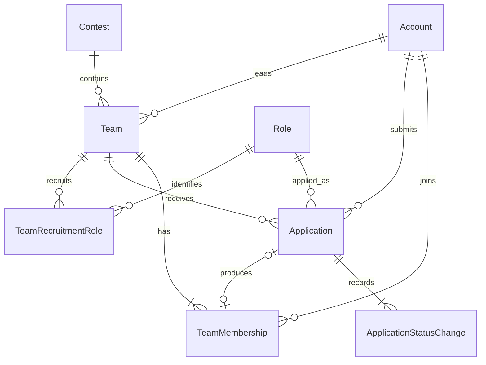

# 팀·지원·소속 논리 모델

이 문서는 [팀 모집·지원 명세](../specs/team-recruitment.md), [프로필 열람 정책](../specs/profile.md#visibility-priority), [알림 생성 정책](../specs/notifications.md#generation-policy)을 구현 가능한 관계와 불변조건으로 옮긴 **설계 초안**입니다. 2026-10-19의 수동 모집 재개·동시 지원·다른 대기 지원 폐기·팀장 변경 미제공 결정을 포함합니다. ORM·DDL·API 구현, 실제 데이터 저장·배포 완료를 뜻하지 않습니다. 식별자의 물리 타입과 인덱스·잠금 기법은 물리 설계에서 정합니다.

## 경계와 기본 원칙

- `Team`은 공모전 하나에 속한 팀과 현재 모집 정보를 소유합니다. MVP에서는 팀당 모집 공고를 별도 다건 엔터티로 나누지 않습니다. 모집 회차 기능은 확정되지 않았습니다.
- `Application`은 한 사람이 한 팀에 제출한 **지원 시도 한 건**입니다. 취소 후 재지원은 기존 행을 되살리는 것이 아니라 새로운 지원 식별자를 갖습니다.
- `TeamMembership`은 팀장 또는 선발된 팀원의 소속 기간입니다. 지원을 제출한 사실과 현재 확정 소속은 다릅니다. 종료된 소속도 새 소속과 구분합니다.
- 프로필을 지원서에 복제하지 않습니다. 권한이 있는 지원 검토는 최신 `Profile`을 읽고, 지원 당시 선택한 역할·메시지·발생 사실은 해당 지원에 남깁니다. 과거 프로필 사본 저장은 별도 미정입니다.
- `폐기`는 같은 공모전의 다른 팀에 선발되어 대기 지원이 종료됐다는 상태입니다. 물리 삭제·미선발·사용자 취소와 구분합니다.
- 공고의 분야는 팀으로 복제하지 않고 공모전 관계를 통해 읽습니다. 모집 역할과 지원 역할은 공통 `Role`을 참조하며 서로 다르다는 이유로 지원을 막지 않습니다.
- 참가 대상·학과·학년·경험·주당 시간은 시스템의 자격 차단 조건으로 사용하지 않습니다. 로그인·공개 프로필·필수 입력·마감·정원·중복·확정 소속 제약은 계속 적용합니다.

## 논리 관계도

도표 원본 보기

Application이 없는 소속은 팀장 생성 소속뿐이며, 선발된 지원 한 건은 소속 기간 최대 한 건에 대응합니다. 활성 소속의 유일성·정원은 아래 추가 제약으로 읽습니다.

## 엔터티와 속성

`N`은 값 필수, `Y`는 미입력 또는 아직 발생하지 않은 상태를 허용한다는 뜻입니다. 모든 FK는 실제 상대 엔터티의 식별자를 가리키며, 이 문서의 연결명은 API 필드명을 확정하지 않습니다.

### Team

| 속성 | 키·참조 | Null | 의미·제약 |
| --- | --- | --- | --- |
| team_id | PK | N | 팀 식별자 |
| contest_id | FK → Contest | N | 소속 공모전 하나. 생성 후 공모전 변경은 허용된 기능이 아님 |
| leader_account_id | FK → Account | N | 생성자이자 팀장. 팀장 변경 기능을 제공하지 않으므로 일반 편집으로 변경하지 않음 |
| name | — | N | 팀명 2~40자 |
| introduction | — | N | 소개·목표 10~1,000자 |
| target_capacity | — | N | 팀장 포함 목표 총 정원, 1 이상의 정수. 공고 공식 범위 검증 |
| recruitment_state | 상태 코드 | N | 모집 중·지원자 검토·모집 마감·팀원 확정의 상품 개념. 아래 상태표에서 정의된 전이만 사용 |
| closed_reason | 제한된 사유 코드 | Y | 종료 기록이 있을 때 팀장 종료·정원 충족을 구분. 시간 경과 여부는 현재 마감 시각으로 별도 판정 |
| recruitment_deadline_at | 시간 값 | N | 보완 규칙을 적용한 접수 종료 경계. 공고 종료 이후 신규 접수 불가 |
| deadline_source_timezone | 시간대 식별자 | N | 원문 시간대 또는 보완한 한국시간. 공고와 같은 시간대 계약 적용 |
| deadline_time_assumed | 불리언 | N | 시각을 날짜 끝으로 보완했는지 |
| deadline_timezone_assumed | 불리언 | N | 시간대를 한국시간으로 보완했는지 |
| is_demo | 불리언 | N | 실제·시연 팀 구분. 다른 데이터의 시연 여부를 권한 제한으로 사용하지 않음 |
| created_at / updated_at | 시간 값 | N | 실제 생성·최종 저장 시각 |
| version | 버전 값 | N | 갱신 충돌·낡은 화면 판정에 사용할 논리 버전. 물리 표현은 후속 설계 |

`(team_id, contest_id)`는 소속의 공모전 일치 검사를 위한 참조용 유일키입니다. 최소 후보키는 team_id이며 이 결합은 관계 일치를 검증하는 목적입니다. 현재 인원·남은 자리·현재 기한 경과·공모전명·공모전 분야를 독립된 원본 값으로 저장하지 않습니다. 팀 삭제·탈퇴에 따른 종료와 보존 기간은 아직 확정되지 않았으므로 임의 삭제 연쇄를 정의하지 않습니다.

정원 1명의 생성은 팀장 소속 1건으로 즉시 정원이 차며 추가 모집을 받지 않습니다. 기술 표현은 `recruitment_state=모집 마감`, `closed_reason=정원 충족`으로 통일하는 안입니다. 마지막 자리 선발도 같은 두 값을 함께 저장합니다. 자리 반환은 두 값을 바꾸지 않고, 팀장의 명시적 재개가 성공할 때만 `recruitment_state=모집 중`, `closed_reason=없음`으로 함께 변경합니다. 따라서 인원이 줄어도 접수 가능 공식의 모집 상태 조건을 통과하지 못합니다. 모집 중·지원자 검토 상태에는 미해제 닫힘 사유가 없도록 검증합니다.

### TeamRecruitmentRole

| 속성 | 키·참조 | Null | 의미·제약 |
| --- | --- | --- | --- |
| team_id | PK 구성, FK → Team | N | 모집하는 팀 |
| role_id | PK 구성, FK → Role | N | 공통 6개 역할 중 하나 |

팀당 중복 역할을 허용하지 않습니다. 목표 정원 1명이면 연결 0개, 2명 이상이면 1~6개입니다. 역할별 정원·충원 완료 여부를 추가하지 않습니다. 관심 분야 연결 테이블은 팀에 중복 생성하지 않습니다.

### Application

| 속성 | 키·참조 | Null | 의미·제약 |
| --- | --- | --- | --- |
| application_id | PK | N | 지원 시도 식별자 |
| team_id | FK → Team | N | 지원받은 팀 |
| applicant_account_id | FK → Account | N | 지원한 사용자 |
| applied_role_id | FK → Role | N | 이번 지원에서 선택한 역할 |
| message | — | Y | 팀에 전할 말, 최대 1,000자. 미입력 허용 |
| status | 상태 코드 | N | submitted / reviewing / selected / rejected / canceled / discarded의 표시 의미를 분리 |
| submitted_at | 시간 값 | N | 실제 접수 성공 시각 |
| status_changed_at | 시간 값 | N | 현재 상태로 바뀐 시각 |
| version | 버전 값 | N | 서로 다른 갱신 요청이 덮어쓰지 않도록 검증할 논리 버전 |

공모전은 `Application → Team → Contest`로 결정하며 별도 `contest_id`를 자유롭게 저장하지 않습니다. 지원 역할·메시지는 프로필을 바꾼다고 자동 변경하지 않습니다. 제출 후 메시지 수정 허용 여부는 미정입니다.

같은 사용자·팀 조합에 현재 유효한 지원(`submitted`, `reviewing`, `selected`)은 최대 한 건입니다. 취소 후 재지원은 새 ID로 생성하며 옛 ID에 도착한 취소·선발 요청은 새 지원에 영향을 주지 않습니다. `rejected`·`discarded` 뒤 재지원 허용 여부는 별도 정책이 필요합니다. 단순히 유효 지원 유일성 제약을 통과한다고 모든 신규 지원을 허용하는 것은 아닙니다.

### TeamMembership

| 속성 | 키·참조 | Null | 의미·제약 |
| --- | --- | --- | --- |
| membership_id | PK | N | 소속 기간 식별자 |
| team_id / contest_id | 결합 FK → Team(team_id, contest_id) | N | 두 값이 반드시 같은 팀·공모전 관계를 가리킴 |
| account_id | FK → Account | N | 확정 소속 사용자 |
| source_application_id | FK → Application | Y | 선발된 지원. 팀장 생성 소속에만 없음 |
| joined_at | 시간 값 | N | 팀 생성 또는 선발 성공 시각 |
| ended_at | 시간 값 | Y | 현재 소속이면 없음. 선발 후 지원 취소 성공 때 기록 |
| end_reason | 제한된 사유 코드 | Y | 현재 정의된 종료 사유는 본인 지원 취소. 탈퇴·팀 삭제 처리는 미정 |

`contest_id`는 편의상 따로 변경 가능한 값이 아니라 **공모전별 소속 유일성을 검증하기 위한 제한된 중복 키**입니다. `Team(team_id, contest_id)`와의 결합 참조를 만족해야 하며 공모전이 다른 팀에 잘못 연결할 수 없습니다.

- `ended_at`이 없는 소속은 `(account_id, contest_id)`당 최대 한 건입니다. 팀장도 이 제약에 포함합니다.
- `(account_id, team_id)`당 현재 소속도 최대 한 건입니다. 이전 소속 기간은 남아 있을 수 있습니다.
- 선발 소속의 지원은 같은 팀·같은 사용자의 지원이어야 합니다. `(source_application_id, team_id, account_id)`와 지원의 해당 관계를 함께 검증합니다.
- 지원 한 건으로 소속을 여러 번 생성하지 않습니다. 같은 선발 재시도는 기존 소속을 확인하고 반복 차감하지 않습니다.
- 팀장 소속은 `account_id = Team.leader_account_id`, `source_application_id = 없음`입니다. 일반 선발 소속은 해당 지원을 가집니다. 별도 변경 가능한 `is_leader`를 중복 저장하지 않습니다.
- 팀 생성 성공 시 팀장 현재 소속은 정확히 하나 있어야 합니다. 팀장 탈퇴·팀 삭제의 효과는 미정이므로 일반 지원 취소 경로로 팀장 소속을 종료하지 않습니다.
- 일반 팀원의 표시 역할은 해당 지원의 역할에서 읽습니다. 팀장 권한과 기획·개발 등의 작업 역할은 서로 다른 개념입니다. 선발 뒤 역할 재배정 기능은 추가하지 않습니다.

### ApplicationStatusChange

| 속성 | 키·참조 | Null | 의미·제약 |
| --- | --- | --- | --- |
| event_id | PK | N | 실제 상태 변경 한 번의 발생 건 식별자 |
| application_id | FK → Application | N | 상태가 바뀐 지원 |
| from_status | 상태 코드 | Y | 최초 접수 사건에만 없음 |
| to_status | 상태 코드 | N | 이번 변경 결과 |
| actor_account_id | FK → Account | Y | 본인·팀장 행동. 자동 폐기는 원인 사건으로 설명 가능 |
| reason_code | 제한된 사유 코드 | N | 접수·선발·본인 취소·다른 팀 선발에 따른 폐기 등의 실제 원인 |
| cause_event_id | FK → ApplicationStatusChange | Y | 폐기를 일으킨 다른 지원의 선발 발생 건. 다른 공모전 사건을 연결하지 않음 |
| occurred_at | 시간 값 | N | 성공한 업무 변경의 실제 발생 시각 |

이 기록은 현재 상태와 함께 원자적으로 추가합니다. 같은 상태 재저장·중복 재시도는 새 사건이 아닙니다. 상태 변경과 알림의 중복 방지에 필요한 최소 발생 사실이며, 모든 과거 프로필·메시지를 복제하거나 무기한 보존하는 결정이 아닙니다. 알림은 이 `event_id`와 수신자 조합을 참조할 수 있습니다.

팀 모집의 닫기·재개는 별도의 `TeamRecruitmentChange(event_id, team_id, from_state, to_state, reason_code, actor_account_id?, occurred_at)`로 같은 원칙의 최소 변경 사실을 남기는 안입니다. 이것을 새로운 알림 종류나 전체 이벤트 소싱 도입으로 해석하지 않습니다.

## 관계와 카디널리티

| 관계 | 수 | 비고 |
| --- | --- | --- |
| Contest → Team | 1 : 0..N | 팀은 반드시 공모전 하나에 속함 |
| Account → Team(팀장) | 1 : 0..N | 다른 공모전에는 여러 팀을 만들 수 있음. 같은 공모전 활성 소속 제약 적용 |
| Team ↔ Role | N : M | TeamRecruitmentRole을 통함 |
| Account → Application | 1 : 0..N | 같은 팀 재지원은 별도 시도 |
| Team → Application | 1 : 0..N | 물리 삭제로 지원 이력을 제거하지 않음 |
| Application → TeamMembership | 1 : 0..1 | 선발됐던 지원은 소속 기간 하나를 가짐. 생성자의 소속은 지원 없이 생성 |
| Account → TeamMembership | 1 : 0..N | 현재와 종료된 소속 기간을 구분 |
| Team → TeamMembership | 1 : 1..N | 생성 성공 시 팀장 소속 하나가 반드시 존재. 미정인 팀 삭제·탈퇴는 별도 |
| Application → ApplicationStatusChange | 1 : 1..N | 최초 접수 발생 건부터 연결 |

## 상태와 판정

### 모집 상태와 현재 접수 가능 여부

`신규 접수 가능 = 모집 중 또는 지원자 검토 상태 ∧ 공고 접수 중 ∧ 공고·팀 기한 전 ∧ 현재 확정 인원 < 목표 정원`입니다. 그 뒤 사용자별 공개 프로필·필수값·중복 지원·허용된 소속 정책을 확인합니다. 참가 자격 정보나 모집 역할 불일치는 자동 제한에 포함하지 않습니다.

| 사건 | 모집 상태·효과 | 확정 수준 |
| --- | --- | --- |
| 팀장 종료 | 모집 마감. 기존 지원과 현재 팀원 유지 | 확정 |
| 마지막 자리 선발 | 모집 마감 + 정원 충족 사유를 함께 저장. 자리 반환은 이 값을 변경하지 않음 | 정책을 만족하는 설계 제안 |
| 팀원 본인 취소로 자리 반환 | 현재 인원 감소. 이미 닫힌 모집은 그대로 유지 | 확정 |
| 팀장이 다시 모집으로 변경 | 현재 기한·정원 등 조건을 검증하고 모집 중으로 변경 | 확정 |
| 공고·팀 마감 시각 도달 | 현재 시각 기준 신규 접수 불가. 저장된 열린 상태로 기한을 우회할 수 없음 | 확정 |
| 기한이 지났거나 정원이 찬 상태에서 재개 | 재개로 접수 제한을 우회하지 못함 | 확정 정책에서 도출 |
| 지원자 검토 상태 진입·팀 전체 팀원 확정 | 진입 행동·시점과 종료 관계는 추가 정의 필요 | 미정 |
| 수동 모집 마감·기한 경과 후 기존 지원자 실제 선발 | AI 검토 허용과 별개. 아직 정의되지 않은 전이를 임의 허용하지 않음 | 미정 |

현재 정원 충족·마감 시각 도달은 계산값이고, 팀장의 종료·재개와 정원 충족으로 이미 닫혔던 사실은 보존할 상태입니다. 이 둘을 분리해야 자리가 생긴 순간 의도치 않게 자동 모집하는 문제가 없습니다. 현재 인원은 활성 소속 수로 계산하고 독립적으로 수정 가능한 카운터를 원본으로 두지 않습니다.

### 지원 상태 전이

| 시작 | 행동·사건 | 결과 | 함께 변경되는 관계 |
| --- | --- | --- | --- |
| 없음 | 현재 조건을 만족한 지원 접수 | 지원 완료 | 새 지원 ID·접수 발생 건·본인/팀장 알림 |
| 지원 완료·검토 중 | 팀장 선발 성공 | 선발 | 즉시 현재 소속 추가, 같은 공모전의 다른 대기 지원 폐기 |
| 지원 완료·검토 중 | 본인 취소 성공 | 지원 취소 | 소속 없음, 취소 발생 건 |
| 선발 | 본인 취소 성공 | 지원 취소 | 해당 소속 종료, 자리 반환, 다른 폐기 지원 복원 없음 |
| 지원 완료·검토 중 | 같은 공모전 다른 팀에서 선발됨 | 폐기 | 대기 종료·원인 선발 사건 연결, 새 후보에서 제외 |
| 지원 취소 | 현재 조건을 만족한 재지원 | 새 지원 건의 지원 완료 | 옛 지원·소속은 되살리지 않음 |
| 선발·미선발·지원 취소·폐기 | 다른 팀 선발 처리 | 기존 상태 유지 | 과거 결과를 일괄 덮어쓰지 않음 |
| 지원 완료 ↔ 검토 중, 대기 → 미선발 | 검토·미선발 행동 | 정의 필요 | 조회만으로 변경 여부 등을 임의 확정하지 않음 |
| 미선발·폐기 | 취소·재지원 | 정의 필요 | 허용된 본인 취소 후 재지원 정책과 구분 |

동시 지원은 허용하며, 선발 시 폐기 대상은 **같은 사용자·같은 공모전·선발된 지원 이외·지원 완료 또는 검토 중**의 교집합입니다. 다른 공모전의 지원과 이미 종료된 지원은 변경하지 않습니다. 탈퇴·팀 삭제·팀장 선발 취소로 종료하는 전이는 미정입니다.

## 원자적 변경과 동시성

하나의 업무 성공은 아래 관련 변경 전체의 성공을 뜻합니다. [백엔드 트랜잭션 책임](../development/backend.md)에 따라 최상위 유스케이스가 성공·실패를 결정하며 하위 변경을 따로 확정하지 않습니다. 구체적인 잠금·격리 수준·재시도 횟수는 물리 설계에서 결정합니다.

| 업무 | 원자적으로 함께 성공할 변경 | 실패 시 남기지 않을 것 |
| --- | --- | --- |
| 팀 생성 | Team·모집 역할·팀장 소속 생성 | 팀만 남거나 팀장 소속만 남는 상태 |
| 지원 접수 | 새 Application·최초 상태 사건·본인 접수/팀장 신규 지원 알림 | 실패 접수의 알림·중복 유효 지원 |
| 선발 | 현재 조건 재검증·지원 선발·활성 소속 생성·같은 공모전 다른 대기 지원 폐기·각 상태 사건과 알림·필요한 모집 종료 기록 | 다른 지원만 폐기되거나 정원만 차감된 부분 성공 |
| 선발 후 취소 | 지원 취소·해당 소속 종료·취소 사건과 알림 | 소속이 남거나 두 번 자리 반환되는 상태 |
| 모집 종료·재개 | 현재 팀장·기한·정원 재검증·상태 변경·변경 사실 | 실패했는데 UI 또는 상태만 열린 결과 |

- 마지막 한 자리에 서로 다른 지원자를 동시에 선발하면 한 명만 성공합니다. 확정 인원은 목표 정원을 초과하지 않습니다.
- 같은 사용자를 같은 공모전의 두 팀이 동시에 선발하면 하나만 성공합니다. 진 쪽은 소속·정원·다른 지원을 추가 변경하지 않습니다.
- 같은 공모전 팀 생성과 선발이 겹쳐도 팀장·팀원 소속 중 하나만 생깁니다.
- 선발과 해당 지원 취소가 겹치면 처리 순서에 맞춰 일관된 결과를 냅니다. 취소가 먼저 성공하면 선발 실패, 선발 후 취소가 성공하면 소속 종료입니다.
- 다른 지원의 취소와 자동 폐기가 겹치면 먼저 완료된 실제 상태를 재검증합니다. 이미 취소된 지원을 폐기로 덮어쓰지 않으며 이미 폐기된 지원을 미정의 취소 전이로 바꾸지 않습니다.
- 지원 접수와 다른 팀의 선발이 겹치면 **사용자·공모전 범위**에서 일관된 순서를 갖게 합니다. 선발 직전 접수된 대기 지원은 폐기에 포함됩니다. 선발이 먼저 끝난 뒤의 신규 지원은 ‘이미 소속된 사용자의 신규 지원’ 미정 정책을 따른다는 점을 분리합니다.
- 재개와 선발·취소가 겹치면 팀 상태와 현재 소속을 같은 기준으로 다시 확인합니다. 화면에서 본 오래된 빈자리만 믿지 않습니다.
- AI 요청은 선발 트랜잭션의 일부가 아닙니다. 외부 응답을 기다리며 소속·정원 변경을 붙잡지 않으며, AI가 추천한 시점과 실제 선발 시점의 상태가 다를 수 있으므로 선발 때 다시 검증합니다.

알림 저장은 같은 원자적 변경에 포함하는 단순한 설계를 우선 제안합니다. 후속 전달 작업이 필요할 때만 전송 대기 기록을 같은 변경에 넣는 방식을 검토합니다. 지원 폐기는 본인의 지원 상태 변경 알림 대상이며, 다른 팀장에게 새로운 종류의 알림을 추가하지 않습니다. 보존 기간·읽음 동기화의 최종 계약은 알림 영역 설계에서 다룹니다.

## 접근 권한과 조회

| 조회·행동 | 허용 관계 | 주의점 |
| --- | --- | --- |
| 공개 팀 모집 정보 | 공개 탐색 사용자 | 팀 공간·지원자 목록을 노출하지 않음 |
| 본인 지원·메시지 | 해당 지원자 | 다른 지원자의 메시지 조회 불가 |
| 팀 지원자 목록·전체 현재 프로필·해당 지원 AI 검토 | 지원받은 팀의 팀장 | 공개·비공개와 무관하되 실제 과거 지원 관계 확인. 취소·미선발·폐기 이력을 없애지 않음 |
| 새 선발 후보 추천 | 그 팀의 현재 지원 완료·검토 중 지원 | 폐기·선발·미선발·취소 제외. 검토 결과가 실제 선발 허가가 아님 |
| 팀 공간 | 현재 팀장 또는 활성 소속 사용자 | 종료된 소속·대기 지원만으로 접근하지 않음 |
| 일반 팀원의 타인 프로필 조회 | 일반 공개 프로필 권한 | 같은 팀 소속만으로 비공개 프로필 예외를 얻지 않음 |
| 모집 종료·재개·선발 | 해당 팀장 | 팀장 위임·변경 기능 없음. 상태·정원 재검증 |

공개 여부 변경은 기존 Application·TeamMembership을 수정하지 않습니다. 과거 지원 관계를 이용한 팀장의 열람 예외는 일반 사람 검색·AI 사람 추천으로 전파하지 않습니다. 열람·AI 요청 때 현재 관계와 공개 상태를 확인하며 알림 링크나 이전 AI 결과를 권한 우회로 쓰지 않습니다. 회원 탈퇴 이후 세션·열람·소속 처리와 지원 이력 보존 종료는 별도 미정입니다.

목록에서 필요한 값은 다음 원본에서 산출합니다.

- 내 팀: 본인의 활성 TeamMembership과 Team을 조회합니다. 대기 지원을 포함하지 않습니다.
- 내 지원: Application의 시도·현재 상태를 조회합니다. 폐기와 취소·미선발을 구별합니다. 과거 시도의 상세 노출 범위는 후속 정책을 따릅니다.
- 검토 대기 수: 해당 팀의 지원 완료·검토 중 지원 수입니다. 폐기·종료 기록을 포함하지 않습니다.
- 팀 현재 인원·잔여 정원: 활성 TeamMembership 수와 Team.target_capacity로 계산합니다.
- 공모전 팀 수: 해당 Contest의 연결 팀 수입니다. 모집 가능한 팀 수와 구분합니다. 팀 삭제가 도입되면 삭제 후 집계 정책을 따로 정합니다.
- 팀 검색·필터: Team의 제목·소개, 연결 Contest, TeamRecruitmentRole을 조회합니다. 페이지 번호·정렬 조건을 사용하며 중복 역할 연결로 팀 결과 수가 늘지 않게 팀 단위로 집계합니다.

## 논리 모델에서 남겨 둔 결정

| 미정 | 이번 설계의 처리 |
| --- | --- |
| 이미 같은 공모전에 소속된 사용자의 신규 지원 | 확정 소속 1개 불변조건과 분리. 화면상의 임시 제한을 제품 정책으로 확정하지 않음 |
| 팀을 새로 만들어 팀장이 될 때 기존 대기 지원 처리 | ‘선발 시 다른 지원 폐기’를 자동 확장하지 않음 |
| 미선발·폐기 후 새 지원, 미선발 후 취소 | 같은 팀 유효 지원 중복 제약과 신규 허용 정책을 별도로 검토 |
| 검토 중·미선발 진입 행동, 팀 전체 팀원 확정과 마감 관계 | 가능한 상태명은 표현하되 미승인 전이를 구현하지 않음 |
| 마감 후 기존 지원자 선발, 팀장에 의한 선발 취소 | AI 검토 허용으로 추론하지 않음 |
| 팀장 탈퇴·팀 삭제·회원 탈퇴 이후 관계·보존 | 팀장 변경은 미제공으로 확정. 나머지를 임의 승계·연쇄 삭제하지 않음 |
| 모집 정보 편집·지원 메시지 수정 | 현재 값·시도 식별자는 모델링하되 새 편집 권한을 부여하지 않음 |
| 주최 측 조건 정정이 기존 팀·지원에 미치는 영향 | 사용자 요청대로 현재 정의하지 않음. 자동 탈락·퇴출·과거 조건 고정도 추가하지 않음 |
| 팀 공간의 일정·외부 메신저·추가 협업 데이터 | 후속 기능. 주당 참여 가능 시간을 팀 일정 엔터티로 복제하지 않음 |

## 설계 검증 사례

1. 두 대기 지원이 같은 공모전에 있고 하나에서 선발되면 소속 1건·선발 1건·폐기 1건이며, 다른 공모전 지원은 그대로입니다.
2. 이미 취소·미선발·폐기된 과거 지원은 다른 팀 선발 후에도 상태·이력·읽은 알림이 바뀌지 않습니다.
3. 선발 뒤 본인 취소는 소속을 종료하고 빈자리를 만들지만, 폐기 지원을 대기로 되돌리거나 닫힌 모집을 자동 재개하지 않습니다.
4. 취소 후 새 지원은 새 ID를 갖고, 이전 지원에 늦게 도착한 선발 요청은 새 지원·새 소속을 건드리지 않습니다.
5. 정원 1명인 팀 생성은 팀장 소속만 만들고 모집 역할·추가 지원을 허용하지 않습니다.
6. 마지막 자리 경합과 같은 공모전 이중 선발 경합에서 성공 소속은 각각 한 건이며 실패 알림·부분 폐기가 생기지 않습니다.
7. 프로필 비공개 전환 후 일반 검색에서는 빠지지만 기존 지원 팀장의 최신 프로필 검토 관계는 유지됩니다. 폐기 지원은 새 선발 후보로 추천되지 않습니다.
8. 팀장 재개는 빈자리·현재 기한을 재검증하며, 기한이 지났거나 이미 정원이 찼으면 접수를 가능하게 만들지 못합니다.
9. 학과·학년·참가 대상 불일치는 자동 차단하지 않지만 비공개 신규 지원·중복 유효 지원·정원 초과 선발은 여전히 실패합니다.
